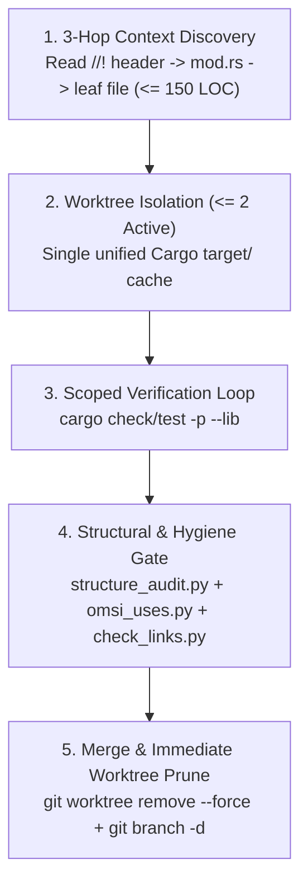

# OPTS Project Critical Audit & Multi-Agent Engineering Strategy

**Repository:** [opts](../../Cargo.toml) (`Open Public Transport Simulator`)  
**Audit Snapshot 1 (Baseline):** `2026-11-15 08:05` (`master` @ `c7ccefdb`)  
**Audit Snapshot 2 (Post-Split Wave):** `2026-11-16 07:30` (`master` @ `3245b1ea`)  
**Audit Snapshot 3 (Post-Remediation):** `2026-11-16 09:34` (`master` @ `f0db5232`)  
**Audit Snapshot 4 (Module-Doc & Wave-B Closeout):** `2026-11-16 11:00` (`master` @ `76337c69`)  
**Audit Snapshot 5 (Pre-Commit Hook & `M-0124` Closeout):** `2026-11-16 11:20` (`master` @ `85660ed2`)  
**Audit Snapshot 6 (Headless Test Hardening & Wave-C):** `2026-11-16 11:42` (`master` @ `a0c31549`)  
**Audit Snapshot 7 (Current — `M-0151` Closed & Build-Cache Audit):** `2026-11-17 05:54` (`master` @ `7a05a6ae`)  
**Stack:** Rust `1.97.1` (2024 edition), Bevy `0.19.0`, `bevy_egui 0.40`, `avian3d 0.6.1`, 17 Workspace Crates + Root Binary Wrapper (`18` Cargo packages)

---

## 1. Executive Summary & Longitudinal Scorecard

Between Snapshot 6 (`a0c31549`) and Snapshot 7 (`7a05a6ae`), **24 commits** landed on `master`, delivering the official closure of **`M-0151` and all of Phase 15** (`8e5faa67`), fixing the broken post-split source-inspection test paths in `help/controls/table.rs` and `shared_sampler.rs` (`90fed38c`), and landing major Phase 11 & Phase 12 feature slices across `M-0115`, `M-0117`, `M-0120`, `M-0121`, `M-0122`, and `M-0123`.

All **9 automated static, lint, doc, and source-inspection gates** now pass on `master` (`7a05a6ae`). Furthermore, during this audit's test execution, we uncovered **the exact root cause of why AI agent test runs take 1–3+ minutes to recompile and why `target/` regrew from 30 GB to 107 GB**: **Cargo feature-unification thrashing across 4 workspace dependency edges**.

| Audit Dimension | S1 (`c7ccefdb`) | S2 (`3245b1ea`) | S3 (`f0db5232`) | S5 (`85660ed2`) | S6 (`a0c31549`) | S7 (`7a05a6ae`) | Status |
| :--- | :--- | :--- | :--- | :--- | :--- | :--- | :--- |
| **150-LOC File Gate (`structure_audit.py`)** | 1,291 files > 150 LOC | **0 files > 150 LOC** | **0 files > 150 LOC** | **0 files > 150 LOC** | **0 files > 150 LOC** | **0 files > 150 LOC** (max 148) | 🟢 **PASS** (`M-0151` Closed) |
| **80-LOC Function Gate (`structure_audit.py`)** | 0 fns > 80 LOC | 0 fns > 80 LOC | 0 fns > 80 LOC | 0 fns > 80 LOC | 0 fns > 80 LOC | **0 fns > 80 LOC** | 🟢 **PASS** |
| **Missing `//!` Module Docs (`crates/*/src`)** | — | — | 89 files missing `//!` | **0 missing `//!`** | **0 missing `//!`** | **0 missing `//!`** (enforced) | 🟢 **PASS** |
| **`cargo fmt --all -- --check`** | 🔴 FAIL | 🔴 FAIL | **PASS** | **PASS** | **PASS** | **PASS** | 🟢 **PASS** |
| **`cargo clippy --workspace --all-targets --all-features`** | **PASS** | 🔴 FAIL (`opts-game`) | **PASS** | **PASS** | **PASS** | **PASS** (`16.49s`) | 🟢 **PASS** |
| **`RUSTDOCFLAGS="-D warnings" cargo doc`** | 🔴 FAIL (4 crates) | 🔴 FAIL (47 errs) | **PASS** | **PASS** | **PASS** | **PASS** (`48.43s`) | 🟢 **PASS** |
| **`python3 scripts/check_links.py`** | **PASS** | 🔴 FAIL (4 links) | **PASS** | **PASS** | **PASS** | **PASS** (`543 files`) | 🟢 **PASS** |
| **`python3 scripts/omsi_uses.py --check`** | 🔴 FAIL (`opts-sim`) | 🔴 FAIL (3 crates) | **PASS** | **PASS** | **PASS** | **PASS** (`130/31/14/0/5`) | 🟢 **PASS** |
| **`shared_sampler` & `help::controls` Source Paths** | PASS | 🔴 Broken by split | 🔴 Broken by split | 🔴 Broken by split | 🔴 6 stale paths | **Fixed (`90fed38c`)** | 🟢 **PASS** |
| **`no_blocking_ui` Split Directory Coverage** | PASS | 🟠 5 split dirs missed | 🟠 5 split dirs missed | 🟠 5 split dirs missed | 🟠 5 split dirs missed | **5 split dirs missed (1 live `.save()` hit)** | 🟠 **Needs Fix (`F-02`)** |
| **Cargo Feature Unification & `target/` Cache** | — | 313 GB `target/` | 30 GB `target/` | 41 GB `target/` | 48 GB `target/` | **107 GB (`4` feature splits trigger 3m14s rebuilds)** | 🔴 **High-Impact Fix (`F-01`)** |

---

## 2. What Improved Between Snapshot 6 (`a0c31549`) and Snapshot 7 (`7a05a6ae`)

### 2.1 Official Closure of `M-0151` and Phase 15 (`8e5faa67`)
- [M-0151.md](../src/roadmap/phase-15/M-0151.md), [phase-15/README.md](../src/roadmap/phase-15/README.md), and [ROADMAP.md](../../ROADMAP.md) now mark **`M-0151` and Phase 15 as 🟢 Complete (2026-11-16)**.
- [scripts/roadmap_audit.py](../../scripts/roadmap_audit.py) (`--check`) reports `146 milestones ({'done': 84, 'open': 59, 'special': 3}); 5 findings, 5 explained`.

### 2.2 Resolution of Stale Source-Inspection Paths (`90fed38c`)
- [crates/opts-game/src/help/controls/table.rs](../../crates/opts-game/src/help/controls/table.rs#L14-L53) was updated from single-file `include_str!` calls to helper macros (`in_game!`, `dev_console!`, `minimap!`) that concatenate the split sibling files (`sim.rs` + `sim/actions.rs` + `sim/T`, `rail_track.rs` + `rail_track/gizmos.rs`, `pause_menu.rs` + `pause_menu/input.rs`, `dev_console/mod.rs` + `toggle.rs`, `minimap/mod.rs` + `build.rs`).
- [crates/opts-bevy/tests/shared_sampler.rs](../../crates/opts-bevy/tests/shared_sampler.rs) was updated to inspect the split loader modules and now passes (`2 passed; 0 failed`).

### 2.3 Feature Waves Landed Across Phase 11 & Phase 12 (Commits `d8342afd`..`7a05a6ae`)
- **`M-0115` (Tunnel Darkening & Zone Lighting):**
  - Per-tile `ZoneRegistry::reconcile` wired to tile streaming via `sync_tile_zones` (`a2df047b`), with headless `resource_exists::<ZoneRegistry>` guard added (`adddfd78`).
  - Control protocol `1.36.0` adds `zones.query` handler (`3bc11c68`).
  - Partial corpus census of 200 tunnel-named `.sco` objects across 5 map roots recorded (`7a05a6ae`).
- **`M-0117` (Exhaust Particles):**
  - Diesel exhaust puffs and `graphics.exhaust` setting/cap (`5021dc13`).
- **`M-0120` (Rain on Windows & Dirt):**
  - `graphics.window_overlays` (`Off / Simple / Full`) setting wired (`93a9b1f5`).
  - Corpus audit table and documentation for `[rain_window]` and `[dirt]` (`55e3803c`, `5a21d983`).
  - Control protocol `1.34.0` adds `vehicle.surface` command to set/read `wetness` and `dirt` (`7bab9ede`).
- **`M-0121` (Road Surface Wetness & Seasons):**
  - `winterhalbjahr` and `sommerhalbjahr` host values and `WinterSnow` seasonal texture routing (`1f375192`).
  - Separate vehicle paint and tyre wetness shader parameters (`d0a119f6`).
  - Control protocol `1.35.0` extends `sim.set_time` with wetness hold/release (`ed369f83`).
- **`M-0122` (Lighting & Post-Processing):**
  - `graphics.bloom` upgraded from `bool` to `Off / Low / Natural / High` enum (`d8342afd`) with ladder placement documented (`0047e92c`).
- **`M-0123` (Engine & Fuel Consumption):**
  - HUD fuel readout, `fuel-bar` gauge, `tank_percent` VM input, and `F12` refuel action (`93635e26`, `ade87c0b`).

---

## 3. Codebase Scale & Structural Telemetry (`7a05a6ae`)

Across the 17 workspace crates and the root wrapper binary (`18` Cargo packages), OPTS now comprises **3,354 Rust files** and **296,564 lines of Rust** (**210,693 production lines** + **75,397 test lines** as measured by `structure_audit.py`), with **0 files over 150 production lines**.

| Crate | Layer / Responsibility | `src/` Files | `src/` Total LOC | `tests/` Files | `tests/` LOC | `omsi` Uses (Cap) |
| :--- | :--- | ---: | ---: | ---: | ---: | :--- |
| [opts-game](../../crates/opts-game/Cargo.toml) | Binary shell, UI screens, settings, control server, in-game HUD | 1,214 | 109,178 | 121 | 10,530 | Uncapped (`M-0046` next) |
| [opts-bevy](../../crates/opts-bevy/Cargo.toml) | Bevy 3D world, terrain/mesh loaders, WGSL shaders, audio, lighting | 667 | 56,260 | 112 | 8,465 | 130 (cap 131) |
| [opts-omsi](../../crates/opts-omsi/Cargo.toml) | Legacy OMSI 2 format parsers (`.bus`, `.ovh`, `.sco`, `.sli`, `.map`, `.osc`) | 245 | 23,650 | 40 | 3,783 | Native parser crate |
| [opts-gui](../../crates/opts-gui/Cargo.toml) | Shared `egui` widgets, theme tokens, 2D canvas primitives, dialogs | 253 | 23,535 | 4 | 559 | 0 (cap 0) |
| [opts-sim](../../crates/opts-sim/Cargo.toml) | Vehicle physics, RPN VM host, articulation, doors, systems, controller | 160 | 14,226 | 23 | 1,801 | 31 (cap 31) |
| [opts-traffic](../../crates/opts-traffic/Cargo.toml) | AI road/rail/pedestrian traffic, timetables, passengers, stops | 79 | 7,886 | 2 | 208 | 14 (cap 14) |
| [opts-benchmark](../../crates/opts-benchmark/Cargo.toml) | Benchmark harness, hardware scoring & regression comparator | 93 | 7,029 | 8 | 802 | 0 |
| [opts-cli](../../crates/opts-cli/Cargo.toml) | Control socket protocol (`1.36.0`), schema, CLI & test client | 47 | 3,984 | 2 | 265 | 0 |
| [opts-hardware](../../crates/opts-hardware/Cargo.toml) | Host CPU/RAM/GPU probe & graphics preset recommender | 42 | 3,317 | 6 | 426 | 0 |
| [opts-l10n](../../crates/opts-l10n/Cargo.toml) | Localisation loader, translation tables & fallback catalog | 41 | 3,232 | 0 | 0 | 0 |
| [opts-catalogue](../../crates/opts-catalogue/Cargo.toml) | Content discovery, thumbnail cache, map/vehicle scanning | 33 | 2,677 | 0 | 0 | 5 (cap 5) |
| [opts-logging](../../crates/opts-logging/Cargo.toml) | Structured tracing, log ring buffer & crash diagnostics | 20 | 1,736 | 3 | 242 | 0 |
| [opts-tools](../../crates/opts-tools/Cargo.toml) | Offline CLI inspection, validation & conversion utilities | 15 | 1,429 | 0 | 0 | Allowed boundary |
| [opts-types](../../crates/opts-types/Cargo.toml) | Foundational IDs, coordinates, units, time & shared types | 6 | 599 | 0 | 0 | 0 |
| [opts-model](../../crates/opts-model/Cargo.toml) | Engine-neutral domain model (vehicles, maps, schedules) | 3 | 168 | 0 | 0 | 0 |
| [opts-importer](../../crates/opts-importer/Cargo.toml) | Archive & content package import pipeline | 1 | 83 | 0 | 0 | 0 |
| [opts-core](../../crates/opts-core/Cargo.toml) | Core facade crate re-exporting foundational types | 1 | 20 | 0 | 0 | 0 |
| [opts (root)](../../src/main.rs) | 12-line binary entrypoint delegating to `opts_game::run()` | 1 | 12 | 0 | 0 | 0 |

---

## 4. Remaining Critical Findings & Technical Risks (`7a05a6ae`)

### 🔴 Finding F-01: Cargo Feature-Unification Thrashing Across Workspace Crates (Root Cause of 3m14s Rebuilds & 107 GB `target/`)

During this audit, running `cargo test -p opts-game --test shell_sources --test no_blocking_ui` immediately after `cargo test -p opts-bevy --test shared_sampler` forced Cargo to **recompile `opts-core`, `opts-gui`, `opts-cli`, `opts-traffic`, `opts-sim`, `opts-catalogue`, `opts-bevy`, and `opts-game` from scratch (`3m 14s` wall time)** even though zero source files had changed.

Inspecting the workspace `Cargo.toml` manifests revealed **4 feature-unification mismatches** that invalidate Cargo's incremental fingerprint cache whenever an agent or hook alternates between `-p opts-bevy`, `-p opts-game`, and `--workspace --all-features`:

1. **`opts-gui` (`serde` feature split):**
   - [Cargo.toml](../../Cargo.toml#L48) declares `opts-gui = { path = "crates/opts-gui" }` (where `default = []` in [crates/opts-gui/Cargo.toml](../../crates/opts-gui/Cargo.toml#L11-L13)).
   - [crates/opts-bevy/Cargo.toml](../../crates/opts-bevy/Cargo.toml#L20) depends on `opts-gui = { workspace = true }` (**without `serde`**).
   - [crates/opts-game/Cargo.toml](../../crates/opts-game/Cargo.toml#L20) depends on `opts-gui = { workspace = true, features = ["serde"] }` (**with `serde`**).
   - **Consequence:** Every time an agent runs `cargo check/test -p opts-bevy` and then `cargo check/test -p opts-game` (or `--workspace`), `opts-gui` changes feature hashes, which invalidates `opts-bevy` (39,930 LOC) and forces a full rebuild of `opts-bevy` and `opts-game`.

2. **`opts-cli` (`client` feature split):**
   - [Cargo.toml](../../Cargo.toml#L44) declares `opts-cli = { path = "crates/opts-cli", default-features = false }`.
   - [crates/opts-bevy/Cargo.toml](../../crates/opts-bevy/Cargo.toml#L49) `[dev-dependencies]` enables `opts-cli = { workspace = true, features = ["client"] }`.
   - [crates/opts-game/Cargo.toml](../../crates/opts-game/Cargo.toml#L16) depends on `opts-cli = { workspace = true }` (**without `client`**).
   - **Consequence:** Running `cargo test -p opts-bevy` compiles `opts-cli` WITH `client`, while `cargo test -p opts-game` compiles `opts-cli` WITHOUT `client`, invalidating downstream dependents.

3. **`sysinfo` (`system` feature split):**
   - [crates/opts-bevy/Cargo.toml](../../crates/opts-bevy/Cargo.toml#L40) depends on `sysinfo = { version = "0.38", default-features = false, features = ["disk"] }`.
   - [crates/opts-hardware/Cargo.toml](../../crates/opts-hardware/Cargo.toml#L15) (depended on by `opts-game`) depends on `sysinfo = { version = "0.38", default-features = false, features = ["system", "disk"] }`.
   - **Consequence:** Building `-p opts-bevy` alone compiles `sysinfo` with `["disk"]`; building `-p opts-game` or `--workspace` recompiles `sysinfo` with `["system", "disk"]` and invalidates `opts-bevy`.

4. **`--all-features` activates `opts-game/profile = ["bevy/trace", "bevy/debug"]`:**
   - [crates/opts-game/Cargo.toml](../../crates/opts-game/Cargo.toml#L11-L12) defines `profile = ["bevy/trace", "bevy/debug"]`.
   - Because [scripts/pre-commit](../../scripts/pre-commit#L21) and [scripts/local-ci.sh](../../scripts/local-ci.sh#L23) invoke `cargo clippy --workspace --all-targets --all-features`, `--all-features` turns on `bevy/trace` and `bevy/debug`, forcing Cargo to compile and store a **second complete copy of all ~300 Bevy crates and all 17 OPTS crates** in `target/debug/deps/` (explaining why `target/` balloons to 107+ GB and why `cargo test` without `--all-features` cannot share artifacts with `cargo clippy --all-features`).

> [!IMPORTANT]
> **4-Line Manifest Fix (`F-01`):**
> 1. In [crates/opts-gui/Cargo.toml](../../crates/opts-gui/Cargo.toml#L12), set `default = ["serde"]`.
> 2. In [Cargo.toml](../../Cargo.toml#L44), remove `default-features = false` from `opts-cli` (so `client` is always unified across workspace builds).
> 3. In [Cargo.toml](../../Cargo.toml), hoist `sysinfo = { version = "0.38", default-features = false, features = ["system", "disk"] }` into `[workspace.dependencies]` and reference `sysinfo.workspace = true` in both `opts-bevy` and `opts-hardware`.
> 4. In [scripts/pre-commit](../../scripts/pre-commit#L21) and [scripts/local-ci.sh](../../scripts/local-ci.sh#L23), either drop `--all-features` from the default `clippy` invocation or pass `--all-features` consistently to `cargo test` so `clippy` and `test` share a single `bevy` + `opts-*` artifact graph.

---

### 🟠 Finding F-02: `no_blocking_ui` Integration Test Still Misses 5 Split UI Subdirectories (With 1 Live `.save()` Violation)

In [crates/opts-game/tests/no_blocking_ui/lists.rs](../../crates/opts-game/tests/no_blocking_ui/lists.rs#L6-L31), `UI_PATHS` lists directories and `.rs` files to scan for main-thread blocking calls (`fs::`, `Command::`, `.join()`, `.save()`, etc.). However, when 5 single-file UI modules were split during `M-0151` into a root `<name>.rs` file plus a Rust-2018 `<name>/` sibling directory, only the root `.rs` files remained in `UI_PATHS`:

| Entry Currently in `UI_PATHS` (`lists.rs`) | Missing Split Sibling Directory | Files Currently Un-Scanned | Live Violations Found in Un-Scanned Files |
| :--- | :--- | ---: | :--- |
| `"in_game/loading_ui.rs"` | `"in_game/loading_ui"` | 2 files | 0 |
| `"in_game/loading_pipeline.rs"` | `"in_game/loading_pipeline"` | 8 files | 0 |
| `"in_game/vehicle_menu.rs"` | `"in_game/vehicle_menu"` | 21 files | **1 hit:** `.save()` in [in_game/vehicle_menu/configs_page/actions.rs](../../crates/opts-game/src/in_game/vehicle_menu/configs_page/actions.rs) |
| `"settings_theme.rs"` | `"settings_theme"` | 1 file | 0 |
| `"control_ui.rs"` | `"control_ui"` | 11 files | 0 |

- **Remediation:** Add `"in_game/loading_ui"`, `"in_game/loading_pipeline"`, `"in_game/vehicle_menu"`, `"settings_theme"`, and `"control_ui"` to `UI_PATHS` in [crates/opts-game/tests/no_blocking_ui/lists.rs](../../crates/opts-game/tests/no_blocking_ui/lists.rs#L6-L31), and either offload or allowlist (if bounded/cached) the `.save()` call in [crates/opts-game/src/in_game/vehicle_menu/configs_page/actions.rs](../../crates/opts-game/src/in_game/vehicle_menu/configs_page/actions.rs).

---

### 🟡 Finding F-03: Minor Planning Doc Drift (`priority-list.md` & `BOARD.md`), 3 Prunable Worktrees, and 23 `#[path]` Attributes

1. **Stale Status Entries in [priority-list.md](../../priority-list.md) and [docs/dev/BOARD.md](../dev/BOARD.md):**
   - [priority-list.md](../../priority-list.md#L7-L16) still has header prose from before `8e5faa67` stating `M-0151` is `🟡 In progress` (`12 files over 150 lines remain`) and row 8 of Tier P1 (`L44`) still lists `M-0124` as `🔄` (`In progress`), even though both `M-0151` and `M-0124` are closed (`🟢`).
   - [docs/dev/BOARD.md](../dev/BOARD.md#L99-L100) still has `- [x] 🟢 Passenger load: closed 2026-11-16 (M-0124)` and `- [x] 🟠 Batch 4: Source files to the 150-line rule (M-0151)` sitting under the `🚧 In Progress` section instead of moving them down to `Recently Done`.
2. **3 Prunable Agent Worktrees & Local Branches:**
   - `git worktree list` shows 3 prunable worktrees (`/tmp/opts-wt-bellow`, `/tmp/opts-wt-doors`, `/tmp/opts-wt-overlay`) and 3 corresponding merged branches (`agent/bellow`, `agent/doors`, `agent/overlay`), all at `7a05a6ae` (`ahead=0, behind=0`). Run `git worktree prune && git branch -d agent/bellow agent/doors agent/overlay`.
3. **23 Non-Standard `#[path = "..."]` Attributes in `crates/*/src/`:**
   - `crates/*/src/` contains **23** `#[path = "..."]` attributes (up by 1 since S6 after `M-0115c` added one in `opts-bevy`), and `crates/*/tests/` contains **123**. Normalize `src/` modules to standard Rust 2018 submodule paths and teach [scripts/structure_audit.py](../../scripts/structure_audit.py) to flag new `#[path]` attributes in `crates/*/src/`.

---

### 🟡 Finding F-04: Architectural Coupling (`M-0046` & Phase 13 Boundary Ratchets)

1. **`opts-game/src/in_game/omsi_world/` (`M-0046`):**
   - `opts-game/src/in_game/omsi_world/` (**61 files, 4,946 LOC**) and `opts-game/src/in_game/omsi_bus/` (**48 files, 3,795 LOC**) still reside inside the binary crate `opts-game` rather than `opts-bevy` or `opts-sim`, leaving `opts-game` uncapped in [scripts/omsi_uses.py](../../scripts/omsi_uses.py#L22-L28).
2. **Remaining `opts_omsi` Caps in Runtime Crates (Phase 13):**
   - `opts-catalogue` has only **5** remaining `opts_omsi` uses (`M-0134`) and `opts-traffic` has only **14** (`M-0133`). Eliminating those 19 uses will drop two entire runtime crates to `0` legacy format dependencies.

---

## 5. Strategy for AI Systems Building in OPTS

Now that `M-0151` (Phase 15) is complete and every `.rs` file in the repository is $\le 150$ lines with a mandatory `//!` header, AI systems operating in OPTS should follow five concrete protocols to maximize build speed and code quality:

### Protocol 1: Unify Workspace Cargo Features First (`60–80%` Faster Agent Iteration)
- **Why:** As proved in **Finding F-01**, any feature difference between `opts-bevy`, `opts-game`, and `--all-features` (`opts-gui/serde`, `opts-cli/client`, `sysinfo/system`, `opts-game/profile`) forces Cargo to recompile `opts-bevy` and `opts-game` from scratch (`1m16s`–`3m14s` per switch) and duplicates `target/debug/deps/`.
- **Rule for Agents:**
  1. Never add crate-local feature flags on workspace dependencies in leaf `Cargo.toml` files; always enable shared features in the root `[workspace.dependencies]` table of [Cargo.toml](../../Cargo.toml).
  2. During inner-loop iteration, run `cargo check -p <crate> --tests` or `cargo test -p <crate> --lib <module_filter>` rather than toggling `--all-features` on and off.

### Protocol 2: The "3-Hop" Context Protocol (Zero-Bloat File Navigation)
With 3,354 files all under 150 lines and every file starting with a `//!` header:
1. **Hop 1 (Header Scan, ~500 tokens):** Run `head -n 5 crates/<crate>/src/<subsystem>/**/*.rs` to read the `//!` responsibility summary of every file in a subsystem without reading function bodies.
2. **Hop 2 (Entrypoint & Types, ~300 tokens):** Read only `<subsystem>/mod.rs` (or `<subsystem>.rs`) and its `types.rs` / `model.rs` file.
3. **Hop 3 (Target Leaf Only, $\le 150$ lines):** Read and edit only the 1–2 leaf `.rs` files under investigation. **Never** bulk-read an entire crate or directory tree into context.

### Protocol 3: Safe Module Splitting & Source-Test Sync Rules
Whenever a file approaches 135–145 lines and must be split:
1. **Standard Rust 2018 Layout Only:** Split `foo.rs` into `foo/mod.rs` + `foo/bar.rs` (or `foo.rs` + `foo/bar.rs` without `#[path = "..."]`). Do not introduce `#[path]` attributes in `src/`.
2. **Resource-Guard Every New Bevy System:** If a new `Update` or `PostUpdate` system takes `Res<T>` or `ResMut<T>` for a resource inserted conditionally or asynchronously, always attach `.run_if(resource_exists::<T>)` (preventing headless test panics like those fixed in `a0c31549` and `adddfd78`).
3. **Update Source-Inspection Whitelists When Splitting UI/Loader Files:** If splitting a file referenced by [crates/opts-game/tests/no_blocking_ui/lists.rs](../../crates/opts-game/tests/no_blocking_ui/lists.rs), [crates/opts-game/tests/shell_sources.rs](../../crates/opts-game/tests/shell_sources.rs), [crates/opts-game/src/help/controls/table.rs](../../crates/opts-game/src/help/controls/table.rs), or [crates/opts-bevy/tests/shared_sampler.rs](../../crates/opts-bevy/tests/shared_sampler.rs), add the new subdirectory to the test list in the same commit.

### Protocol 4: Coordinator–Worker Parallel Wave Pattern
When running multi-agent waves (`agent/<topic>` worktrees):
1. **Disjoint Write Scopes:** Assign each worker an explicit, non-overlapping file glob (e.g., Worker A owns `crates/opts-bevy/src/zone_lighting/**`, Worker B owns `crates/opts-game/src/in_game/hud/**`).
2. **Cap Concurrent Worktrees at $\le 2$:** Never run more than 2 concurrent `cargo` processes against the shared `target/` directory to avoid `flock` contention and `lld` OOM stalls.
3. **Coordinator Owns Shared Registries & Roadmap Docs:** Workers must not edit `ROADMAP.md`, `BOARD.md`, `priority-list.md`, or `scripts/omsi_uses.py` caps if another worker is active; the Coordinator updates shared manifests and ratchets `omsi_uses.py` caps downward in the merge commit, then immediately runs `git worktree remove --force /tmp/opts-wt-<topic> && git branch -d agent/<topic>`.

---

## 6. Prioritized Action Plan (Next 4 Steps)

| Priority | Action Item | Exact Target Files / Commands | Expected Impact |
| :--- | :--- | :--- | :--- |
| **P0 (Immediate — 5 mins)** | **Unify Workspace Cargo Features (`F-01`)** | 1. [crates/opts-gui/Cargo.toml](../../crates/opts-gui/Cargo.toml): set `default = ["serde"]` 2. [Cargo.toml](../../Cargo.toml): remove `default-features = false` on `opts-cli` and add workspace `sysinfo` with `["system", "disk"]` 3. [scripts/pre-commit](../../scripts/pre-commit) & [scripts/local-ci.sh](../../scripts/local-ci.sh): align `--all-features` usage | Eliminates **1m16s–3m14s redundant rebuilds** when switching between `-p opts-bevy` and `-p opts-game` and halves `target/` disk bloat. |
| **P0 (Immediate — 5 mins)** | **Add 5 Split UI Directories to `no_blocking_ui` (`F-02`)** | Update `UI_PATHS` in [crates/opts-game/tests/no_blocking_ui/lists.rs](../../crates/opts-game/tests/no_blocking_ui/lists.rs#L6-L31) and resolve the `.save()` hit in [crates/opts-game/src/in_game/vehicle_menu/configs_page/actions.rs](../../crates/opts-game/src/in_game/vehicle_menu/configs_page/actions.rs) | Restores 100% main-thread non-blocking UI enforcement across all 43 split UI files. |
| **P1 (Short-Term — 5 mins)** | **Sync `BOARD.md` & `priority-list.md` + Prune 3 Worktrees (`F-03`)** | Move `[x] M-0124` and `[x] M-0151` from `In Progress` to `Recently Done` in [docs/dev/BOARD.md](../dev/BOARD.md#L99-L100), update [priority-list.md](../../priority-list.md#L7-L44), and run `git worktree prune && git branch -d agent/bellow agent/doors agent/overlay` | Keeps agent entry-point planning docs 100% consistent with `ROADMAP.md` (`84 done`). |
| **P2 (Medium-Term — Architectural)** | **Execute `M-0134` (`opts-catalogue` 5 $\to$ 0) & `M-0133` (`opts-traffic` 14 $\to$ 0)** | Migrate the 5 `opts_omsi` uses in `opts-catalogue` and 14 in `opts-traffic` to `opts-model`, then ratchet [scripts/omsi_uses.py](../../scripts/omsi_uses.py) caps to `0` | Fully decouples two runtime crates from legacy OMSI parser types ahead of `M-0046`. |
