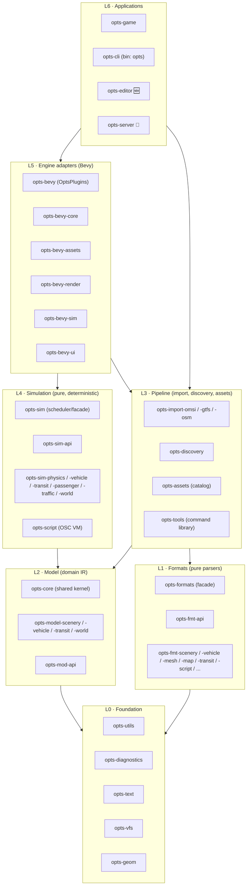
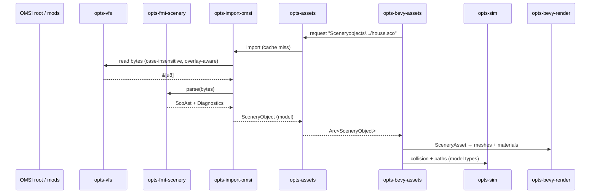

# 🏗️ Proposed Architecture

| Metadata | Value |
| :--- | :--- |
| **Status** | 🟡 Proposed — pending [ADR-0003](adr/0003-layered-crate-architecture.md) |
| **Supersedes (once accepted)** | The dependency tree in [Coding Standards §2.11](https://github.com/your-username/opts/blob/main/docs/src/contributing/standards.md) |
| **Last Updated** | 2026-10-04 |

---

## 🎯 Goals

OPTS is meant to be a *platform* ([Vision, principle 3](../src/vision.md)): every subsystem replaceable or extendable. The crate graph is where that promise is either kept or broken. The architecture below optimises for:

| # | Goal | What it means in practice |
| :--- | :--- | :--- |
| G1 | **Replaceability** | Any subsystem (a parser, the physics model, the renderer) can be swapped without touching its neighbours. |
| G2 | **Bevy independence** | Everything except the engine adapter layer compiles and tests without Bevy. Tools and a headless server never pull in a renderer. |
| G3 | **Source independence** | The simulation never knows whether a bus came from OMSI 2, GTFS, OSM or a native OPTS package. |
| G4 | **Small blast radius** | Editing the `.sli` parser recompiles the `.sli` parser and its dependents — not the world. |
| G5 | **Determinism** | Simulation crates are pure and deterministic, enabling replays, lockstep multiplayer and reproducible bug reports. |
| G6 | **Extensibility** | Mods and third-party crates add formats, importers, simulation systems and plugins through registries and stable APIs, not forks. |
| G7 | **Legibility** | A newcomer can answer "where does this code go?" from the crate name alone. |

Non-goal: maximal crate count. A crate exists because it is a *seam* — a place where something can be replaced, tested in isolation, or compiled independently. See [§ When to Create a Crate](#-when-to-create-a-crate).

---

## 🧱 The Seven Layers



> [!IMPORTANT]
> **Formats (L1) and Model (L2) do not know each other.** Parsers produce *format ASTs* that mirror the file faithfully; the model describes *what OPTS simulates*. Only the Pipeline layer (L3) knows both and translates between them. This one rule is what makes G3 possible: a GTFS importer and an OMSI importer target the same model, and the simulation never sees either file format.

### L0 · Foundation

Domain-agnostic building blocks. No OMSI, no transit, no Bevy.

| Crate | Responsibility |
| :--- | :--- |
| `opts-utils` | Tiny, genuinely shared helpers. Not a junk drawer — anything with a better home goes there. |
| `opts-diagnostics` | `Span`, `Severity`, `Diagnostic`, `Diagnostics` collector. Lets parsers report *all* problems in a file with line/column, not just the first. |
| `opts-text` | Encoding detection and decoding (CP1252 vs UTF-8 — see [`.sco` § Encoding](../src/formats/text/sco.md)), line/keyword lexer for the shared `[keyword]` grammar used by `.sco`, `.sli`, `.bus`, `.cfg`, … |
| `opts-vfs` | Virtual file system: `FileSource` trait, case-insensitive OMSI-root resolution, overlay stacking (base game → add-ons → user mods), in-memory sources for tests. |
| `opts-geom` | Units (`Meters`, `Radians`, …), coordinate frames and the OMSI ↔ OPTS axis conversion, tile coordinates. Built on `glam`. |

### L1 · Formats

Pure, I/O-free parsers: `&[u8]` in, `(Ast, Diagnostics)` out. One crate per **format family**, each format behind a feature flag.

| Crate | Formats |
| :--- | :--- |
| `opts-fmt-api` | The `Format` trait, `ParseOptions`, `AssetRef` (outgoing file references), the `FormatRegistry`. |
| `opts-fmt-common` | Blocks shared across families: `[mesh]`, `[matl]`, `[script]`, `[varnamelist]`, `[new_attachment]`, … |
| `opts-fmt-scenery` | `.sco`, `.sli`, scenery scripts |
| `opts-fmt-vehicle` | `.bus`, `.ovh`, `model.cfg`, `paths.cfg`, `passengercabin.cfg`, `sound.cfg`, repaints (`.cti`) |
| `opts-fmt-mesh` | `.o3d` (`binrw`), `.x` |
| `opts-fmt-texture` | `*.bmp.cfg`, DDS/BMP/TGA decoding glue |
| `opts-fmt-script` | `.osc`, variable lists, constant files |
| `opts-fmt-map` | `global.cfg`, map tiles, lists & calendars, chrono overlays, `.dsc`, `laststn.osn` |
| `opts-fmt-transit` | `.hof`, timetable files, `.org` |
| `opts-fmt-config` | Environment/weather, engine config, `.opl`, ticket packs, money, fonts, `.kennz`, misc. |
| `opts-fmt-native` | OPTS's own versioned formats (RON / bincode schemas) |
| `opts-formats` | **Facade**: re-exports the families above behind features; builds a default `FormatRegistry`. |

Each family maps 1:1 onto a section of the [format specifications](../src/formats/overview.md), so a spec and its parser are always easy to find.

Inside each family crate, the existing [three-layer parser pattern](https://github.com/your-username/opts/blob/main/docs/src/contributing/standards.md) (lexer → parser → validate) still applies. The *validated* output is still a **format-level** type (e.g. `O3d`); lowering it into the domain model is a fourth, separate step owned by `opts-import-omsi`.

### L2 · Model

The OPTS domain intermediate representation (IR) — format-agnostic, Bevy-free, `serde`-serialisable.

| Crate | Responsibility |
| :--- | :--- |
| `opts-core` | **Shared kernel**: typed IDs, asset handles (`AssetId`, `AssetPath`), common error types, re-exported `opts-geom` units. Small and stable. |
| `opts-model-scenery` | `SceneryObject`, `Mesh`, `Material`, `Spline`, collision, light definitions |
| `opts-model-vehicle` | `VehicleDefinition`, axles, doors, cabin, attachments, sound sets |
| `opts-model-transit` | Stops, lines, routes, trips, timetables, calendars (shaped so GTFS fits too) |
| `opts-model-world` | Map, tiles, terrain, environment, weather presets |
| `opts-mod-api` | 💭 The **stable, semver-guarded** surface offered to mods and scripts. Depends only on the model. |

### L3 · Pipeline

Everything that turns files on disk into model values, and back.

| Crate | Responsibility |
| :--- | :--- |
| `opts-import-omsi` | Lowers OMSI ASTs into the model; resolves references through `opts-vfs`. |
| `opts-import-gtfs` / `-osm` | Real-world timetables and street networks into the same model. |
| `opts-discovery` | Scans a `FileSource`, uses `Format::references` to build the asset dependency graph (`petgraph`), reports missing/broken assets. |
| `opts-assets` | Bevy-free **asset catalog**: identity, dedup, load state, content-hash cache keys. Engine adapters wrap it; tools use it directly. |
| `opts-cache` | 🆕 On-disk cache of imported model data (content-addressed) so a city loads in seconds the second time. |
| `opts-export-gltf` | 💭 Export model meshes to glTF for inspection in external tools. |
| `opts-tools` | The **tool-command library** (`inspect`, `convert`, `validate`, `graph`) — reusable by the CLI *and* the editor. |

### L4 · Simulation

Pure Rust, deterministic, no wall clock, no Bevy (see [Open Question Q1](#-open-questions)).

| Crate | Responsibility |
| :--- | :--- |
| `opts-sim-api` | `SimSystem` trait, `SimWorld` view, fixed-timestep `Tick`, stage ordering, sim events. The only thing sibling sim crates share. |
| `opts-sim` | **Scheduler + facade**: owns the tick loop, registers systems, re-exports members behind features. |
| `opts-sim-clock` | Simulation time, calendars, time acceleration |
| `opts-sim-physics` | Vehicle dynamics: engine, transmission, brakes, suspension, steering |
| `opts-sim-vehicle` | Vehicle systems: doors, lights, indicators, ticketing, IBIS |
| `opts-sim-transit` | Network, dispatch, timetables, delay propagation |
| `opts-sim-passenger` | Passenger agents, boarding/alighting, transfers, crowding |
| `opts-sim-traffic` | AI traffic and pedestrians on the spline/path network |
| `opts-sim-routing` | Pathfinding over road/rail/transit graphs |
| `opts-sim-world` | Day/night, weather, seasons |
| `opts-script` | 🆕 The `.osc` virtual machine: executes vehicle and scenery scripts against `opts-sim-api` |
| `opts-save` / `opts-replay` | Versioned save games; input recording and deterministic playback |

### L5 · Engine Adapters (Bevy)

The **only** layer allowed to depend on Bevy. Each crate exposes exactly one `Plugin`.

| Crate | Plugin responsibility |
| :--- | :--- |
| `opts-bevy-core` | Shared `SystemSet`s (`OptsSet::{Input, Sim, Sync, Render}`), app `States`, shared resources. Every other `opts-bevy-*` crate depends on this, never on each other. |
| `opts-bevy-assets` | `AssetLoader`s wrapping `opts-assets` + `opts-import-*`; newtype `Asset` wrappers around model types. |
| `opts-bevy-render` | OMSI material emulation (alpha modes, env maps, night maps), lighting, LOD. *(today: `opts-graphics`)* |
| `opts-bevy-sim` | Runs `opts-sim` inside `FixedUpdate` and mirrors sim state into ECS components. |
| `opts-bevy-streaming` | Tile streaming around the camera |
| `opts-bevy-input` / `-camera` / `-audio` | Input mapping, cameras (cab, chase, free), positional audio |
| `opts-bevy-ui` | Menus, HUD, dialogs *(today: `opts-gui`)* |
| `opts-bevy-devtools` | Inspectors, debug overlays, path/collision visualisation — never in release builds by default |
| `opts-bevy` | **Facade**: `OptsPlugins` `PluginGroup` with feature-gated members. |

### L6 · Applications

Thin composition roots: parse arguments, configure logging, pick plugins/features, run. **No domain logic.**

| Crate | Binary | Role |
| :--- | :--- | :--- |
| `opts-game` | `opts-game` | The simulator |
| `opts-cli` | `opts` | Command-line front end over `opts-tools` |
| `opts-editor` | `opts-editor` | 🆕 Map / scenario editor (Bevy) |
| `opts-server` | `opts-server` | 💭 Headless dedicated server — L0–L4 only, no Bevy |
| `opts-launcher` | `opts-launcher` | 💭 Content manager / mod installer |

### Cross-cutting · Development

May be used as `[dev-dependencies]` from any layer; never as normal dependencies. All `publish = false`.

| Crate | Role |
| :--- | :--- |
| `opts-testkit` | 🆕 Assertion helpers, in-memory `FileSource`, snapshot helpers |
| `opts-fixtures` | 🆕 Clean-room, self-authored test fixtures and generators ([ADR-0002](../src/adr/0002-clean-room-policy.md)) |
| `opts-benchmark` | Corpus-level benchmarks |
| `xtask` | 🆕 Workspace automation: `cargo xtask check-layers`, `new-crate`, `docs` |

---

## 📏 Dependency Rules

### The allowed-dependency matrix

Rows may depend on columns marked ✅.

| from ↓ / to → | L0 Found. | L1 Formats | L2 Model | L3 Pipeline | L4 Sim | L5 Engine | L6 App |
| :--- | :---: | :---: | :---: | :---: | :---: | :---: | :---: |
| **L0 Foundation** | ✅¹ | ❌ | ❌ | ❌ | ❌ | ❌ | ❌ |
| **L1 Formats** | ✅ | ✅¹ | ❌ | ❌ | ❌ | ❌ | ❌ |
| **L2 Model** | ✅ | ❌ | ✅¹ | ❌ | ❌ | ❌ | ❌ |
| **L3 Pipeline** | ✅ | ✅ | ✅ | ✅¹ | ❌ | ❌ | ❌ |
| **L4 Simulation** | ✅ | ❌ | ✅ | ❌ | ✅¹ | ❌ | ❌ |
| **L5 Engine** | ✅ | ❌² | ✅ | ✅ | ✅ | ✅¹ | ❌ |
| **L6 Application** | ✅ | ❌² | ✅ | ✅ | ✅ | ✅ | ❌ |

¹ Within a layer only towards that layer's `*-api` / `*-core` / `*-common` crate — siblings never depend on each other directly.<br>
² Go through the Pipeline. Nothing above L3 should ever see an OMSI AST.

### The rules in words

| # | Rule |
| :--- | :--- |
| R1 | **Dependencies point down the matrix.** No cycles, no upward edges, no edges "around" the Pipeline into Formats. |
| R2 | **Bevy only in L5 and L6.** Not even behind an optional feature in lower layers — features unify across the workspace and would leak Bevy everywhere. |
| R3 | **Siblings talk through an API crate.** `opts-sim-passenger` never imports `opts-sim-traffic`; both use events/traits from `opts-sim-api`. Same for `opts-bevy-*` via `opts-bevy-core` and `opts-fmt-*` via `opts-fmt-api`/`-common`. |
| R4 | **Facades contain no logic.** `opts-formats`, `opts-sim`'s re-exports and `opts-bevy` only re-export and wire features. (The `opts-sim` scheduler is a documented exception and lives in its own module.) |
| R5 | **I/O lives at the edges.** Formats parse byte slices; Model and Simulation never touch the file system. Only `opts-vfs`, the Pipeline and Applications perform I/O. |
| R6 | **Simulation is deterministic.** No wall-clock time, no unseeded RNG, no iteration-order-dependent `HashMap` traversal, `rayon` only with order-independent reductions. |
| R7 | **Applications are composition only.** If two binaries need the same code, it belongs in a library. |
| R8 | **Errors**: libraries use `thiserror` and never expose `anyhow`; binaries may use `anyhow` ([Coding Standards §2.1](https://github.com/your-username/opts/blob/main/docs/src/contributing/standards.md)). |
| R9 | **Features are additive** and never change public types in a breaking way. |

### Enforcement

Rules that are not checked by a machine erode. Two complementary checks run in CI:

1. **Layer metadata + `cargo xtask check-layers`.** Every crate declares its layer:

   ```toml
   [package.metadata.opts]
   layer = "formats"   # foundation | formats | model | pipeline | sim | engine | app | dev
   role  = "member"    # member | api | facade
   ```

   `xtask` reads `cargo metadata`, builds the graph, and fails on any edge that violates the matrix or rule R3.

2. **`cargo-deny` bans** as a second line of defence for R2:

   ```toml
   # deny.toml
   [bans]
   deny = [
     { crate = "bevy", wrappers = ["opts-bevy", "opts-bevy-core", "opts-bevy-assets", "opts-bevy-render", "opts-bevy-sim", "opts-bevy-ui", "opts-game", "opts-editor"] },
   ]
   ```

---

## 🔌 Extension Seams

Modularity happens at a handful of traits. Each is owned by an `*-api` crate so implementations can live anywhere — including outside this repository.

```rust
// opts-vfs — where bytes come from
pub trait FileSource: Send + Sync {
    fn read(&self, path: &VPath) -> Result<Bytes, VfsError>;
    fn exists(&self, path: &VPath) -> bool;
    fn list(&self, dir: &VPath) -> Result<Vec<VPathBuf>, VfsError>;
}

// opts-fmt-api — how bytes become an AST
pub trait Format {
    type Ast;
    const NAME: &'static str;
    const EXTENSIONS: &'static [&'static str];
    fn parse(bytes: &[u8], opts: &ParseOptions) -> Parsed<Self::Ast>; // Ast + Diagnostics
    fn references(ast: &Self::Ast) -> Vec<AssetRef>;                 // feeds opts-discovery
}

// opts-import-* — how an AST becomes model data
pub trait Importer {
    type Output;
    fn import(&self, path: &VPath, cx: &mut ImportContext<'_>) -> Result<Self::Output, ImportError>;
}

// opts-sim-api — how the world advances
pub trait SimSystem: Send {
    fn stage(&self) -> Stage;
    fn step(&mut self, world: &mut SimWorld, tick: Tick);
}
```

| Seam | Registry | Typical third-party extension |
| :--- | :--- | :--- |
| `FileSource` | overlay stack in `opts-vfs` | ZIP/7z mod archives, network content |
| `Format` | `FormatRegistry` (by extension) | Support for a new file type |
| `Importer` | `ImporterRegistry` | LOTUS-style or other-simulator content, custom data feeds |
| `SimSystem` | `opts-sim` scheduler | New vehicle systems, alternative passenger models |
| Bevy `Plugin` | `OptsPlugins` | Alternative renderer, VR camera, telemetry overlay |
| `opts-mod-api` | 💭 script / WASM host | Sandboxed mods that run without recompiling OPTS |

**Bevy and the orphan rule.** Model types cannot derive Bevy's `Asset`/`Component` without depending on Bevy (forbidden by R2). Engine adapters therefore wrap them: `#[derive(Asset, TypePath)] struct SceneryAsset(pub Arc<opts_model_scenery::SceneryObject>);`. The wrapper is the adapter's whole job.

---

## 🔄 Data Flow: From File to Frame



---

## 🧩 Feature Flags & Composition

Facades let each application compile exactly what it needs:

```toml
# opts-cli: inspection tool, no Bevy, all formats
opts-tools = { workspace = true, features = ["all-formats"] }

# opts-server: headless — simulation without engine
opts-sim = { workspace = true, features = ["physics", "transit", "passenger", "traffic"] }

# opts-game: full experience
opts-bevy = { workspace = true, features = ["render", "audio", "ui", "streaming"] }
```

Convention: every facade has `default = ["full"]` for convenience, and minimal builds use `default-features = false`.

---

## 📁 Directory Layout

Grouping crate folders by layer makes the architecture visible in the file tree:

```text
crates/
├── foundation/   opts-utils, opts-diagnostics, opts-text, opts-vfs, opts-geom
├── formats/      opts-fmt-api, opts-fmt-common, opts-fmt-*, opts-formats
├── model/        opts-core, opts-model-*, opts-mod-api
├── pipeline/     opts-import-*, opts-discovery, opts-assets, opts-cache, opts-tools
├── sim/          opts-sim-api, opts-sim, opts-sim-*, opts-script, opts-save, opts-replay
├── engine/       opts-bevy-core, opts-bevy-*, opts-bevy
├── apps/         opts-game, opts-cli, opts-editor, opts-server
└── dev/          opts-testkit, opts-fixtures, opts-benchmark
xtask/
```

The root manifest then shrinks to `members = ["crates/*/*", "xtask"]`. Documentation stays flat (`docs/crates/<crate>/`) so links survive moves between layers.

---

## 🌱 When to Create a Crate

The [catalog](catalog.md) is a **map, not a to-do list**. A planned crate is created only when its first real code is written, and only if at least one of these is true:

- ✅ It is an **extension seam** someone may want to replace (an `*-api` crate or an implementation of one).
- ✅ It **isolates a heavy dependency** (Bevy, `binrw`, `rayon`, an HTTP client) from crates that don't need it.
- ✅ It has a **different consumer set** than its neighbours (e.g. tools need parsers, the server does not).
- ✅ It **compiles slowly** and changes independently.

Otherwise it starts as a module in the nearest existing crate and is promoted later. Promotion is cheap when the module already respects the layer rules — which is exactly what the rules are for.

---

## ⚖️ Trade-offs

| Benefit | Cost | Mitigation |
| :--- | :--- | :--- |
| Small rebuilds, parallel compilation | More manifests to maintain | `[workspace.package]` + `[workspace.dependencies]` inheritance; `cargo xtask new-crate` scaffolding |
| Bevy-free testing of 80 % of the code | Newtype wrappers in adapters | Wrappers are mechanical; one module per adapter |
| Swappable subsystems | API crates must be designed with care | Keep `*-api` crates tiny; changes to them need review from two contributors |
| Clear ownership | Discoverability across ~40 crates | Facades, this book, and layer folders |
| Formats ≠ Model separation | One extra translation step | Translation is where reference resolution and validation belong anyway |

---

## ❓ Open Questions

| # | Question | Options | Leaning |
| :--- | :--- | :--- | :--- |
| Q1 | How is simulation state stored? | (a) plain structs + `SimSystem` trait; (b) standalone `bevy_ecs` in L4; (c) another ECS (`hecs`) | (a) for now — (b) would need R2 relaxed to "`bevy_ecs` allowed, `bevy` not" |
| Q2 | Is `opts-tools` the library and `opts-cli` the binary, or vice versa? | See [opts-cli](opts-cli/) | `opts-tools` = library, `opts-cli` = `opts` binary |
| Q3 | Script execution model for `.osc` | Interpreter vs. compile-to-bytecode vs. transpile to WASM | Interpreter first, behind `opts-script` API |
| Q4 | Mod sandboxing | Native plugins (`dylib`), WASM (`wasmtime`), scripting only | WASM via `opts-mod-api`, Phase 5 |
| Q5 | Do we publish crates to crates.io? | Never / format crates only / all | Format crates only, once specs are ✅ Specified — they are useful to the wider OMSI community |
| Q6 | Layer folders now or later? | Move during Phase 2 / leave flat | Move at the start of Phase 2, while crates are still empty |

---

## 🔗 Related Reading

- [Crate Catalog](catalog.md) · [Crate Conventions](conventions.md) · [Workspace Audit & Migration Plan](audit.md)
- [ADR-0001: Why Bevy and Rust?](../src/adr/0001-why-bevy-and-rust.md) — "the Cargo workspace allows strict separation of concerns"
- [ADR-0003: Layered, Highly Modular Crate Architecture](adr/0003-layered-crate-architecture.md)
