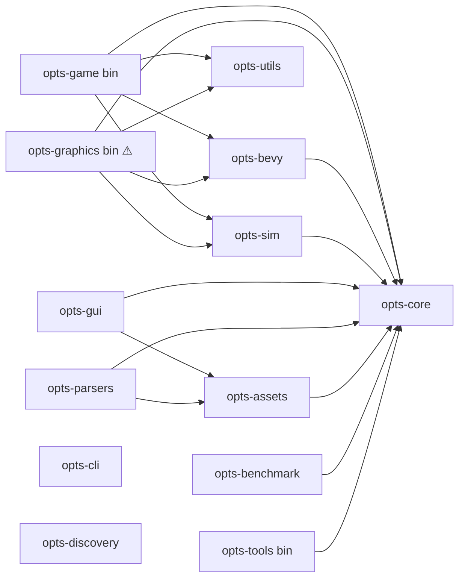

# 🔍 Workspace Audit & Migration Plan

| Metadata | Value |
| :--- | :--- |
| **Audited state** | Workspace as of 2026-10-04 (no commits yet on `master`) |
| **Status** | 🟡 Findings verified locally; migration proposed |
| **Last Updated** | 2026-10-04 |

---

## 📸 Current State

13 crates, all skeletons (empty `lib.rs` or `Hello, world!` `main.rs`).

| Crate | Kind | Internal deps | External deps | Bevy? |
| :--- | :--- | :--- | :--- | :---: |
| `opts-assets` | lib | core | image, ddsfile, **tiny_d3d11tex**, tracing | — |
| `opts-benchmark` | lib | core | image, ddsfile, **tiny_d3d11tex**, tracing | — |
| `opts-bevy` | lib | core | bevy, image, ddsfile, tracing | ✅ |
| `opts-cli` | lib | — | nom, binrw, serde, glam, petgraph, thiserror, tracing, **argh** | — |
| `opts-core` | lib | — | nom, binrw, serde, glam, petgraph, thiserror, tracing | — |
| `opts-discovery` | lib | — | nom, binrw, serde, glam, petgraph, anyhow, thiserror, tracing | — |
| `opts-game` | bin `opts-game` | core, bevy, sim, utils | bevy, anyhow, tracing(-subscriber) | ✅ |
| `opts-graphics` | bin **`opts-game`** | core, bevy, sim, utils | bevy, anyhow, tracing(-subscriber) | ✅ |
| `opts-gui` | lib | core, assets | bevy, tracing | ✅ |
| `opts-parsers` | lib | core, assets | bevy, tracing | ✅ |
| `opts-sim` | lib | core | glam, petgraph, serde, bincode, rayon, thiserror, tracing | — |
| `opts-tools` | bin `opts` | core | anyhow, tracing(-subscriber), image, ddsfile | — |
| `opts-utils` | lib | — | — | — |

---

## 🚨 Findings

### Blocking — the workspace does not build

| # | Finding | Evidence | Fix |
| :--- | :--- | :--- | :--- |
| F1 | `tiny_d3d11tex` is used with `workspace = true` by `opts-assets` and `opts-benchmark` but is **not declared** in `[workspace.dependencies]`. | `cargo metadata` → *failed to parse manifest at crates/opts-assets/Cargo.toml* | Add it to the root manifest, or drop it (DDS decoding can start with `ddsfile` + `image`). |
| F2 | `argh` is used with `workspace = true` by `opts-cli` but is **not declared**. Root manifest comments plan `clap` instead. | Same failure class as F1 | Choose one CLI parser (see [opts-cli](opts-cli/)) and declare it. |
| F3 | `opts-graphics` declares `[[bin]] name = "opts-game"` — the same binary name as `opts-game`. | `crates/opts-graphics/Cargo.toml` | Make `opts-graphics` a library (`src/lib.rs`), remove the `[[bin]]` section. |

### Architectural — rule violations and overlaps

| # | Finding | Rule violated | Fix |
| :--- | :--- | :--- | :--- |
| F4 | `opts-gui`, `opts-parsers`, `opts-graphics` depend on Bevy. | Standards §2.11: "`opts-bevy` is the **only** crate that depends on Bevy" | Gui/graphics: accept as engine-layer crates under the new rule R2 (rename `opts-bevy-*`). Parsers: **remove** the Bevy dependency. |
| F5 | Two homes for parsers: `opts-core` ("Core data structures **and parsers**") and `opts-parsers`. Format specs name `opts_core::formats::sco` as parser module. | One owner per concern | Parsers → `opts-fmt-*` behind the `opts-formats` facade (today: `opts-parsers`). `opts-core` keeps only the model kernel. |
| F6 | Two CLI crates: `opts-cli` (lib, no internal deps, but parser deps) and `opts-tools` (bin `opts`). | Rule R7 (apps are composition only) | `opts-tools` → command library; `opts-cli` → `opts` binary. |
| F7 | `opts-discovery` (a library) depends on `anyhow`. | Standards §2.1 / R8 | Replace with a `thiserror` enum. |
| F8 | `opts-discovery` and `opts-cli` pull `nom`/`binrw`/`glam` directly. | R1 / R3 — they should consume parsers, not write their own | Depend on `opts-formats` (+ `opts-vfs`) instead. |
| F9 | `opts-benchmark` is a regular library crate with runtime deps. | Dev tooling should not be a normal dependency | `publish = false`, benches in `benches/` with `criterion`, `[package.metadata.opts] layer = "dev"`. |

### Hygiene

| # | Finding | Fix |
| :--- | :--- | :--- |
| F10 | Root `src/main.rs` exists but the root manifest is a virtual workspace (no `[package]`) — the file is dead. | Delete it. |
| F11 | No crate has a `//!` header, as required by Standards §3.8 / §3.11. | Add a one-paragraph header linking to the crate's page here. |
| F12 | `rust-version` is set in `[workspace.package]` but not inherited by any crate. | Add `rust-version.workspace = true`; verify the MSRV against the chosen Bevy version. |
| F13 | Doc drift: Standards §3.11 and PROMPTS.md say `docs/crates/<crate>.md`; the repository uses `docs/crates/<crate>/README.md` folders. Standards §2.11 lists only 5 of 13 crates. | Update both to the folder layout and to [ADR-0003](adr/0003-layered-crate-architecture.md) once accepted. |
| F14 | No shared `[workspace.lints]`. | Add workspace lints (`clippy::unwrap_used`, `missing_docs`, …) and `[lints] workspace = true` everywhere. |

---

## 🧭 Migration Plan

The plan is ordered so that **every step leaves the workspace building**, and it front-loads moves while the crates are empty.

### Step 0 — Make it build *(before any Phase 2 code)*

- [ ] F1, F2: declare or remove `tiny_d3d11tex` and `argh`.
- [ ] F3: `opts-graphics` → library.
- [ ] F10: delete root `src/main.rs`.
- [ ] `cargo check --workspace` green in CI.

### Step 1 — Fix responsibilities *(no new crates)*

- [ ] Remove Bevy from `opts-parsers`; remove `anyhow` from `opts-discovery` (F4, F7).
- [ ] Decide Q2 and swap the `opts-cli` / `opts-tools` roles (F6).
- [ ] Reword `opts-core`'s description to "OPTS domain model kernel" (F5).
- [ ] Add `[package.metadata.opts]` layer tags and `rust-version.workspace` (F12) to all manifests.

### Step 2 — Guard rails

- [ ] Add `xtask` with `check-layers`; add `deny.toml` Bevy wrappers list.
- [ ] Add `[workspace.lints]` (F14) and `//!` headers (F11).
- [ ] Accept [ADR-0003](adr/0003-layered-crate-architecture.md); update Standards §2.11 and §3.11, PROMPTS.md (F13), and the `Parser Module` row in each format spec.

### Step 3 — Renames & layer folders *(start of Phase 2)*

| From | To |
| :--- | :--- |
| `opts-parsers` | `opts-formats` |
| `opts-graphics` | `opts-bevy-render` |
| `opts-gui` | `opts-bevy-ui` |
| flat `crates/*` | `crates/<layer>/*` |

### Step 4 — Grow on demand *(Phase 2 onwards)*

Create catalog crates as the first code for them is written — typically in this order:

1. `opts-diagnostics`, `opts-text`, `opts-vfs` — needed by the first parser.
2. `opts-fmt-api`, `opts-fmt-common`, `opts-fmt-scenery`, `opts-fmt-mesh`, `opts-fmt-transit` — the four Phase 2 specs (`.sco`, `.sli`, `.o3d`, `.hof`).
3. `opts-testkit`, `opts-fixtures` — alongside the first parser tests.
4. `opts-geom`, `opts-model-scenery`, `opts-import-omsi` — when the first object must reach Bevy (Phase 3).
5. `opts-bevy-core`, `opts-bevy-assets` — Phase 3.
