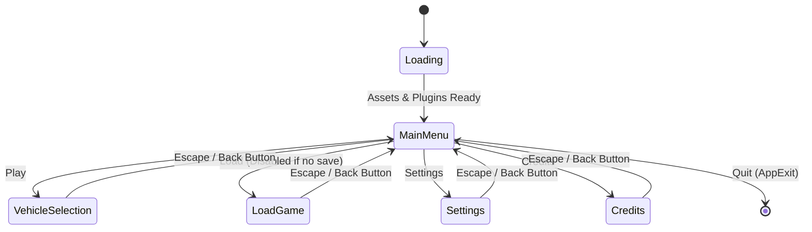

# `opts-game`

| Metadata | Value |
| :--- | :--- |
| **Layer** | L6 · Application |
| **Role** | Application Composition Root & Consumer UI Screens |
| **Kind** | Binary (`opts-game`) + Library (`opts_game`) |
| **Status** | 🟢 Implemented (Main Menu & Lifecycle State Machine) |
| **Last Updated** | 2026-10-08 |

---

## 🎯 Purpose

`opts-game` is the primary executable and presentation orchestrator for the Open Public Transport Simulator. It provides:
1. Top-level application initialization, logging setup, and window configuration.
2. The global lifecycle state machine (`AppState`).
3. The interactive **Main Menu** featuring Material Design 3 styling, glassmorphic translucent surfaces, and dynamic map-backed background loading.
4. Destination screen routing with return navigation.
5. User settings persistence (`GameSettings`) via platform standard paths (`settings.toml`).

---

## 🏗️ Architecture & State Machine

Navigation and simulation execution are governed deterministically by the Bevy `AppState` machine:

```rust
#[derive(States, Debug, Clone, Copy, PartialEq, Eq, Hash, Default)]
pub enum AppState {
    #[default]
    Loading,
    MainMenu,
    VehicleSelection,
    LoadGame,
    Settings,
    Credits,
    InGame,
}
```

### State Flow


---

## 📂 Menu Module Hierarchy

The main menu subsystem is isolated under `crates/opts-game/src/menu/`:

| Module | File | Role & Implementation |
| :--- | :--- | :--- |
| **Module Root** | `menu/mod.rs` | Exposes public API and `MainMenuPlugin`. |
| **Plugin** | `menu/plugin.rs` | Registers lifecycle hooks (`OnEnter`, `OnExit`) and update systems conditioned to `in_state(AppState::MainMenu)`. |
| **Layout** | `menu/layout.rs` | Builds viewport hierarchy: background (`z=0`), content (`z=1`), floating controls (`z=2`). |
| **Entries** | `menu/entries.rs` | Spawns canonical entries (Play, Load, Settings, Credits, Quit), sets tab indices, and handles quit actions. |
| **Background** | `menu/background.rs` | Loads `<recent_map_path>/picture.jpg` into Bevy `Image` texture, overlays 45% contrast scrim, and falls back to solid `ColorRole::Surface`. |
| **Glass Surfaces** | `menu/glass.rs` | Manages `GlassSurface` component; `sync_glass_surfaces` system dynamically applies translucent alpha (0.25–0.80) from theme tokens. |
| **Interactions** | `menu/interactions.rs` | Focus ring visualizer (2px solid outline), hover/pressed state luminance adjustments, and [Enter]/[Space] keyboard button activation. |
| **Theme Toggle** | `menu/theme_toggle.rs` | Floating circular button (top-right) and [F2] hotkey dispatching `ThemeChanged` for live theme swapping. |
| **Systems** | `menu/systems.rs` | Setup/teardown triggers and initial keyboard focus management. |

---

## 🛠️ How to Add a Future Screen

Adding a new application screen (e.g. Vehicle Selection, Settings, Map Chooser) follows a standardized three-step workflow:

### Step 1: Declare or Target the `AppState` Variant
Ensure the target state is represented in `crates/opts-game/src/app_state.rs`:
```rust
pub enum AppState {
    ...
    VehicleSelection,
}
```

### Step 2: Implement the Screen Module & Plugin
Create a dedicated submodule under `crates/opts-game/src/<screen>/` (e.g. `vehicle_select/`):
```rust
use bevy::prelude::*;
use crate::app_state::AppState;

pub struct VehicleSelectPlugin;

impl Plugin for VehicleSelectPlugin {
    fn build(&self, app: &mut App) {
        app.add_systems(OnEnter(AppState::VehicleSelection), spawn_vehicle_select_ui)
           .add_systems(OnExit(AppState::VehicleSelection), cleanup_vehicle_select_ui)
           .add_systems(Update, vehicle_select_update.run_if(in_state(AppState::VehicleSelection)));
    }
}
```

### Step 3: Retire the Destination Stub & Register Plugin
1. In `crates/opts-game/src/stub_screens/mod.rs`, remove the stub registration for that state.
2. In `crates/opts-game/src/lib.rs`, add your new plugin to `OptsGamePlugin`:
```rust
app.add_plugins(VehicleSelectPlugin);
```

---

## 📦 Dependencies

| Dependency | Purpose |
| :--- | :--- |
| `opts-gui` | Material Design 3 widgets, design tokens, and focus subsystem. |
| `opts-bevy`, `opts-sim`, `opts-core` | Core simulation bridge and domain data models. |
| `bevy` | Engine, ECS, asset pipeline, UI layout, and window management. |
| `directories` | Standard OS user config path resolution (`~/.config/opts/`, `%APPDATA%\opts\`). |
| `toml` | Configuration serialization for `settings.toml`. |
| `image` | Dynamic runtime texture decoding for map `picture.jpg`. |
| `serde` | Struct serialization for settings. |

---

## 🏃 Running Examples

```bash
# Run with solid surface fallback:
cargo run -p opts-game --example main_menu

# Run with custom map background photo:
cargo run -p opts-game --example main_menu -- --map-path /path/to/omsi/maps/Berlin-Spandau
```
