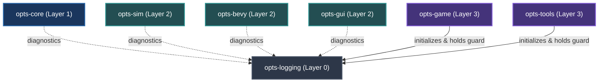

# 🪵 `opts-logging`

Centralized diagnostic foundation, non-blocking asynchronous writers, per-subsystem file routing, rotation, and crash panic hooks for the Open Public Transport Simulator.

---

## 🏛️ Architecture & Boundaries

`opts-logging` is positioned at **Layer 0** of the OPTS workspace. It has **zero dependencies on any internal OPTS crate**, ensuring that every crate in the hierarchy (`opts-core`, `opts-sim`, `opts-bevy`, `opts-gui`, `opts-game`, `opts-tools`) can safely emit `tracing` telemetry without introducing circular dependencies.



---

## 📁 Subsystem File Routing

Logs are written to the platform data directory (`~/.local/share/opts/logs/` on Linux):

| File Target | Filter | Description |
| :--- | :--- | :--- |
| `opts.log` | `*` | Unified aggregate session log |
| `opts-core.log` | `opts_core::*` | Format parsing, chunk decoding, and road geometry |
| `opts-sim.log` | `opts_sim::*` | Kinematics, drivetrain torque, Ackermann steering |
| `opts-bevy.log` | `opts_bevy::*`, `wgpu`, `naga`, `bevy_render` | 3D mesh loaders, materials, coordinates, rendering |
| `opts-gui.log` | `opts_gui::*` | UI widget lifecycle, tokens, focus events, theme changes |
| `opts-game.log` | `opts_game::*` | App state transitions, main menu, settings I/O |
| `opts-tools.log` | `opts_tools::*`, `opts::*` | CLI commands, asset conversion, inspection |
| `panics.log` | Panic Hook Output | Dedicated crash dump with thread name and backtrace |

---

## 🚀 Integration Guide

### 1. Application Initialization (`opts-game / src/main.rs`)

```rust
use opts_logging::prelude::*;

fn main() -> Result<(), anyhow::Error> {
    // 1. Initialize logging before any engine or subsystem setup
    let _guard = opts_logging::init_default()?;

    tracing::info!("OPTS application booting");

    // 2. Build and run Bevy App (Bevy inherits the global subscriber)
    App::new()
        .add_plugins(DefaultPlugins)
        .run();

    Ok(())
}
```

### 2. Configuration via TOML

```toml
level = "info"

[per_target]
"wgpu" = "warn"
"naga" = "warn"
"opts_sim" = "debug"

[console]
enabled = true
ansi = "auto"
verbosity = "standard"

[files]
enabled = true
directory = "~/.local/share/opts/logs"
rotation = "daily"
retention = "days(7)"
per_subsystem = true
json = false
```

### 3. Dynamic Reconfiguration

Log levels can be mutated dynamically at runtime without restarting the application:

```rust
use opts_logging::set_level;
use tracing::Level;

// Dynamically silence verbose rendering logs during gameplay
set_level("opts_bevy", Level::WARN)?;
```

---

## 🧪 Verification & Guarantees

- **Non-blocking Writes:** Disk and stdout operations execute on background worker threads via lock-free ring buffers (`tracing-appender`). Frame times in simulation and rendering are unaffected.
- **Flushing on Exit:** Dropping `LogGuard` flushes all worker queues before process termination.
- **Panic Hook:** Captures fatal crashes directly into `panics.log` with thread name and backtrace.
