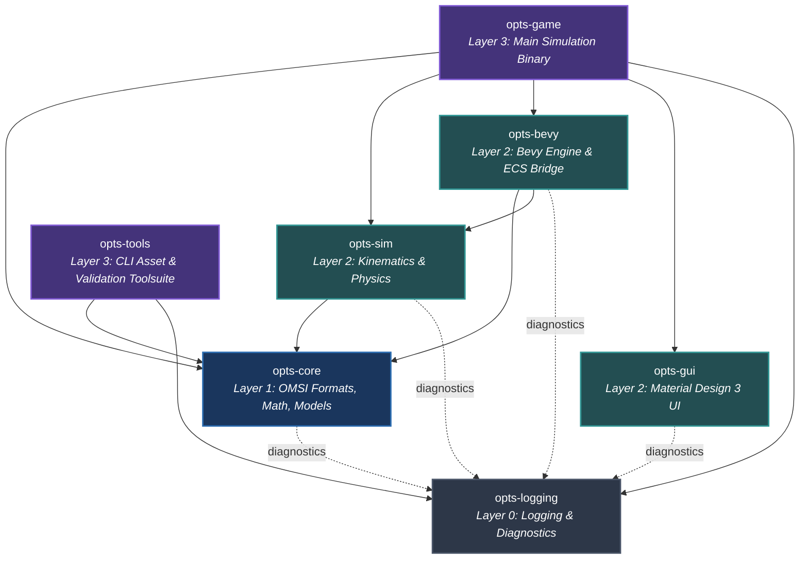

# ADR-0005: Workspace Crate Architecture & Boundary Enforcement

| Metadata | Value |
| :--- | :--- |
| **ADR ID** | 0005 |
| **Status** | ✅ Accepted |
| **Date** | 2026-10-08 |
| **Deciders** | OPTS Architecture Team & Core Contributors |
| **Supersedes** | None |
| **Superseded by** | None |

---

## 📌 Context

The Open Public Transport Simulator (OPTS) workspace initially declared 14 member crates in `Cargo.toml`. While the core engine and simulation milestones (M-0001 through M-0023) have established solid, production-grade implementations in 5 active crates (`opts-core`, `opts-gui`, `opts-bevy`, `opts-sim`, and `opts-game`), the remaining 9 crates are empty skeletons (0 to 3 LOC) that accumulated speculative dependencies, duplicated responsibilities, and violated established architectural boundaries.

Specific issues identified in the 2026-10-08 Critical Review (**F-002**) include:
1. **Boundary Inversions & Leaks:** `crates/opts-parsers` declared a dependency on `bevy`, in direct violation of the foundational rule that parsers must remain engine-agnostic and clean-room isolated.
2. **Namespace & Target Collisions:** `crates/opts-graphics` declared `[[bin]] name = "opts-game"`, colliding directly with `crates/opts-game`.
3. **Redundant & Overlapping Crates:** All OMSI parsers are fully implemented in `opts-core`, rendering `opts-parsers` obsolete. Similarly, `opts-cli` and `opts-discovery` duplicate the purpose of `opts-tools`.
4. **Premature Workspace Bloat:** Crates such as `opts-benchmark`, `opts-editor`, and `opts-assets` exist as empty shells with unmaintained dependency manifests, cluttering CI build graphs and workspace documentation.
5. **Missing Unified Diagnostics:** Logging was ad-hoc, with crates importing varying logging crates or lacking centralized subsystem routing and panic hooks.

A decisive architectural restructuring is needed to eliminate premature stubs, enforce strict unidirectional layering, and integrate `opts-logging` as the foundational diagnostic substrate.

---

## 🎯 Decision

**We will consolidate the OPTS workspace into a streamlined, strictly layered 7-crate architecture and retire redundant skeleton crates.**

Specifically:
1. **Establish `opts-logging` as Layer 0:** A zero-dependency foundational crate providing non-blocking logging, per-subsystem file routing (`opts.log`, `opts-core.log`, etc.), rotation, retention, and crash panic hooks.
2. **Retain `opts-core` as Layer 1 (Domain Core & Parsers):** The pure Rust home for all OMSI file formats (.sco, .sli, .o3d, .x, .bus, maps, paths), mathematical helpers, and asset data structures. Zero Bevy dependency; zero file I/O.
3. **Structure Layer 2 (Domain Simulation & Presentation Bridges):**
   - **`opts-sim`:** Pure authoritative physics, vehicle kinematics, drivetrain, suspension, steering, and future script VM execution. Zero Bevy dependency; zero file I/O.
   - **`opts-gui`:** Material Design 3 UI widget library, tokens, layout, and theme styling for Bevy.
   - **`opts-bevy`:** Engine bridge containing Bevy 3D asset loaders, materials, coordinates translation, and the `VehicleController` ECS simulation bridge.
4. **Consolidate Layer 3 (Applications & Tooling):**
   - **`opts-game`:** The primary interactive simulation executable, orchestrating Bevy application state, UI menus, and presentation bridges.
   - **`opts-tools`:** The unified command-line toolsuite for asset inspection, format validation, model conversion, and discovery (absorbing the responsibilities of `opts-cli` and `opts-discovery`).
5. **Retire Redundant Skeleton Crates:**
   - Retire `opts-parsers` (parsers reside in `opts-core`).
   - Retire `opts-graphics` (presentation resides in `opts-bevy` and `opts-game`).
   - Retire `opts-cli` and `opts-discovery` (merged into `opts-tools`).
   - Retire premature stubs `opts-assets`, `opts-editor`, `opts-benchmark`, and `opts-utils` from workspace `members` until their designated roadmap milestones are reached.

---

## 🧠 Rationale

| Reason | Explanation |
| :--- | :--- |
| **Strict Boundary Enforcement** | Enforcing `opts-core` and `opts-sim` to remain Bevy-free guarantees determinism, simplifies headless integration testing, and allows headless simulation or CLI asset conversion without linking the Bevy engine. |
| **Clear Separation of Concerns** | Eliminating overlapping crates (`opts-parsers`, `opts-graphics`, `opts-cli`) prevents ambiguity regarding where new format loaders or CLI tools should be implemented. |
| **Faster CI & Local Compilation** | Removing 9 empty crate compilation targets simplifies `Cargo.lock` dependency resolution, reduces compiler overhead, and keeps workspace analysis clean. |
| **Unified Diagnostics Foundation** | Placing `opts-logging` at Layer 0 without internal dependencies ensures that every crate in the workspace can emit structured `tracing` events without creating circular dependencies. |
| **Idiomatic Rust Tooling** | Benchmarks belong in crate `benches/` directories via Criterion, rather than a top-level workspace crate. Tooling commands belong under a single CLI binary (`opts <subcommand>`). |

---

## 🏛️ Target Dependency Graph

---

## ⚖️ Alternatives Considered

| Alternative | Reason for Rejection |
| :--- | :--- |
| **Keep all 14 crates as placeholders** | Promotes confusing workspace clutter, creates dead dependencies, and leads to boundary violations (such as `opts-parsers` depending on `bevy`). |
| **Single Monolithic Crate** | Compiles slowly, couples pure format parsers to the heavy Bevy game engine, prevents headless simulation, and destroys clean-room isolation. |
| **Crate-per-format (e.g. `opts-o3d`, `opts-bus`)** | Excessive fragmentation; overhead of maintaining dozens of `Cargo.toml` files outweighs benefits for tightly-coupled OMSI asset specifications. |
| **Merge `opts-sim` into `opts-bevy`** | Violates determinism and engine independence; vehicle physics must remain runnable in headless servers and unit tests without GPU or Bevy runtime dependencies. |

---

## 🌊 Consequences

### ✅ Positive
- **Guaranteed Engine Independence:** `opts-core` and `opts-sim` have zero Bevy dependencies, verified automatically by `cargo tree`.
- **Zero Ambiguity:** Developers know exactly where code belongs: parsers in `opts-core`, physics in `opts-sim`, UI widgets in `opts-gui`, Bevy bridges in `opts-bevy`, CLI commands in `opts-tools`.
- **Clean CI:** Workspace compiles only active, productive crates with zero dead targets or copy-pasted dependencies.
- **Robust Observability:** All subsystems route diagnostics through `opts-logging`.

### ⚠️ Negative
- Future standalone editor or benchmarking crates must be reintroduced deliberately when their implementation milestones actively begin, rather than pre-existing as skeletons.
- Existing documentation referencing retired crates must be updated.

### 🔄 Neutral
- The root `Cargo.toml` workspace `members` list is reduced from 14 to 7 crates.

---

## 🔗 References

- [ADR-0001: Why Bevy and Rust](./0001-why-bevy-and-rust.md)
- [ADR-0002: Clean-Room Policy](./0002-clean-room-policy.md)
- [ADR-0004: Logging Architecture](./0004-logging-architecture.md)
- [Critical Review 2026-10-08](../meta/critical-review-2026-10-08.md)
- [Standards & Boundary Rules](../contributing/standards.md)
