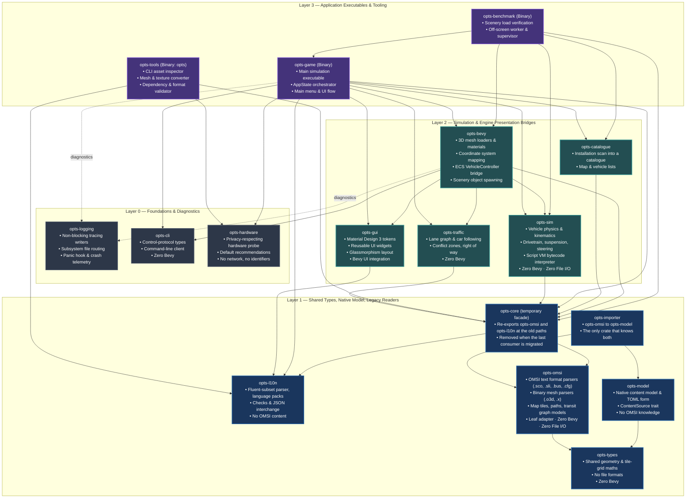

# 📦 Crate Architecture & Dependency Graph

This document defines the architectural layers, crate boundaries, and dependency relationships across the OPTS workspace per [ADR-0005](../adr/0005-crate-architecture.md).

---

## 🏛️ Architecture Layers

The OPTS workspace enforces a strict, unidirectional 4-tier layering model. No upward dependencies or dependency cycles are permitted.

---

## 📋 Crate Directory & Inventory

| Crate | Layer | Purpose | Dependencies (Internal) | Depended By | Engine Coupling |
| :--- | :---: | :--- | :--- | :--- | :---: |
| **`opts-logging`** | L0 | Structured diagnostics, subsystem log files, rotation, panic hook | *None* | `opts`, `opts-bevy`, `opts-game` | Pure Rust |
| **`opts-cli`** | L0 | Control-protocol types and the command-line client that remote-controls a running game | *None* | `opts`, `opts-bevy`, `opts-game` | Pure Rust |
| **`opts-types`** | L1 | Shared geometry and tile-grid maths both the legacy readers and the native model need ([ADR-0014](../adr/0014-data-model-separation.md)) | *None* | `opts-model`, `opts-omsi` | Pure Rust |
| **`opts-l10n`** | L1 | Localisation without the engine: Fluent-subset parser, language packs, checks, JSON interchange | *None* | `opts-core`, `opts-game`, `opts-gui`, `opts-tools` | Pure Rust |
| **`opts-omsi`** | L1 | The legacy OMSI readers (`.bus`, `.sco`, `.sli`, `.map`, `.o3d`, `.x`, ...) and the OMSI-shaped data they fill: a leaf adapter | `opts-types` | `opts-core`, `opts-importer` | Pure Rust |
| **`opts-model`** | L1 | The native content model and its TOML form (stubs: `VehicleDefinition`, `ContentSource`) | `opts-types` | `opts-importer` | Pure Rust |
| **`opts-importer`** | L1 | Turns legacy OMSI content into the native model; the only crate that knows both | `opts-model`, `opts-omsi` | *None yet* | Pure Rust |
| **`opts-core`** | L1 | Temporary facade: re-exports `opts-omsi` and `opts-l10n` at the old paths until the last consumer is migrated | `opts-l10n`, `opts-omsi` | `opts-benchmark`, `opts-bevy`, `opts-catalogue`, `opts-game`, `opts-sim`, `opts-tools`, `opts-traffic` | Pure Rust |
| **`opts-sim`** | L2 | Vehicle dynamics, articulated-segment kinematics, pedestrians, OMSI script VM | `opts-core` | `opts-benchmark`, `opts-bevy`, `opts-game` | Pure Rust |
| **`opts-traffic`** | L2 | AI road traffic: lane graph, car following, conflict zones, right of way | `opts-core` | `opts-bevy`, `opts-game` | Pure Rust |
| **`opts-catalogue`** | L2 | Scans an installation into a map/vehicle catalogue | `opts-core` | `opts-benchmark`, `opts-game` | Pure Rust |
| **`opts-gui`** | L2 | Material Design 3 UI widget library and theme tokens | `opts-l10n` | `opts-bevy`, `opts-game` | Bevy UI |
| **`opts-hardware`** | L0 | Privacy-respecting hardware capability probe and default recommendations ([charter](hardware-probe.md)): no network, no identifiers, Linux/macOS/Windows | *None* (external: `sysinfo`) | `opts-game`, `opts-tools` | Pure Rust |
| **`opts-bevy`** | L2 | Bevy loaders, materials, coordinates, vehicle/script/articulation bridges, control server, hot reload | `opts-cli`, `opts-core`, `opts-gui`, `opts-logging`, `opts-sim`, `opts-traffic` | `opts-benchmark`, `opts-game` | Bevy Engine |
| **`opts-game`** | L3 | Game application: menus, world loading (tiles, traffic, pedestrians), state machine | `opts-bevy`, `opts-catalogue`, `opts-cli`, `opts-core`, `opts-gui`, `opts-hardware`, `opts-l10n`, `opts-logging`, `opts-sim`, `opts-traffic` | `opts`, `opts-benchmark` | Bevy Engine |
| **`opts`** | L3 | Workspace root binary | `opts-game`, `opts-cli`, `opts-logging` | *None (executable root)* | — |
| **`opts-tools`** | L3 | File inspection tool (`inspect`) | `opts-core`, `opts-hardware`, `opts-l10n` | *None (executable root)* | CLI Tooling |
| **`opts-benchmark`** | L3 | Scenery object load verification harness ([spec](scenery-benchmark.md)): an off-screen worker that rebuilds objects through the loader and a supervisor | `opts-bevy`, `opts-catalogue`, `opts-core`, `opts-game`, `opts-sim` | *None (executable root)* | Bevy |

*Table regenerated from `cargo metadata` (normal dependencies) on 2026-10-11 by the [critical review](../meta/critical-review-2026-10-11.md) (F-011). Two edges break the intended layering: `opts-bevy` → `opts-gui` (reporting modal) and `opts-bevy` → `opts-cli` (audit 5037f89a A-F-015, M-0046). The Mermaid diagram above has not been updated yet (M-0041).*
---

## 🔒 Invariant Boundary Rules

1. **`opts-omsi` Zero-Engine & Zero-IO Invariant, and the legacy/native boundary ([ADR-0014](../adr/0014-data-model-separation.md)):**
   - Must never depend on `bevy`, `wgpu`, or windowing crates, and never on `opts-model`.
   - Must never perform synchronous file I/O (`std::fs::File`, `std::io::Read`). All parsers operate strictly on in-memory slices (`&str`, `&[u8]`).
   - It is a **leaf adapter**: `opts-bevy`, `opts-sim`, `opts-traffic`, `opts-gui` and `opts-catalogue` must not depend on it (directly or through the `opts-core` facade) in new code. The files that still do are counted by `scripts/omsi_uses.py` against `docs/dev/omsi-uses-known.txt`; the count may only fall. `opts-game` is the composition root and may wire the OMSI source through `opts-importer`.
   - `opts-model` and `opts-omsi` share only `opts-types` and never import each other; `opts-importer` is the only crate that depends on both.
2. **`opts-sim` Zero-Engine & Zero-IO Invariant:**
   - Must never depend on `bevy` or rendering crates.
   - Simulation logic must remain 100% deterministic and headless-runnable.
3. **`opts-logging` Zero-OPTS Invariant:**
   - Must never depend on any OPTS internal crate (`opts-omsi`, `opts-sim`, etc.).
   - Provides pure tracing layers, rotation policies, and file writers.
4. **Engine Access Gating:**
   - Only `opts-bevy`, `opts-gui`, and `opts-game` are permitted to declare `bevy` as a dependency.
