# 📦 Crate Architecture & Dependency Graph

This document defines the architectural layers, crate boundaries, and dependency relationships across the OPTS workspace per [ADR-0005](../adr/0005-crate-architecture.md).

---

## 🏛️ Architecture Layers

The OPTS workspace enforces a strict, unidirectional 4-tier layering model. No upward dependencies or dependency cycles are permitted.

```mermaid
graph TD
    classDef foundation fill:#2d3748,stroke:#4a5568,stroke-width:2px,color:#fff;
    classDef domain fill:#1a365d,stroke:#2b6cb0,stroke-width:2px,color:#fff;
    classDef bridge fill:#234e52,stroke:#319795,stroke-width:2px,color:#fff;
    classDef app fill:#44337a,stroke:#805ad5,stroke-width:2px,color:#fff;

    %% Layer 0: Foundations
    subgraph L0 ["Layer 0 — Foundations & Diagnostics"]
        opts_debounce["opts-debounce<br/>• Trailing debounce of file-change events<br/>• No dependencies · Zero Bevy"]:::foundation
        opts_map_advice["opts-map-advice<br/>• Map load profile and advice heuristics<br/>• No dependencies · Zero Bevy"]:::foundation
        opts_logging["opts-logging<br/>• Non-blocking tracing writers<br/>• Subsystem file routing<br/>• Panic hook & crash telemetry"]:::foundation
        opts_cli["opts-cli<br/>• Control-protocol types<br/>• Command-line client<br/>• Zero Bevy"]:::foundation
        opts_hardware["opts-hardware<br/>• Privacy-respecting hardware probe<br/>• Default recommendations<br/>• No network, no identifiers"]:::foundation
        opts_collision["opts-collision<br/>• Oriented-box contact (separating axes)<br/>• Velocity response & spatial grid<br/>• Zero Bevy · Zero File I/O"]:::foundation
    end

    %% Layer 1: Domain Core & Parsers
    subgraph L1 ["Layer 1 — Shared Types, Native Model, Legacy Readers"]
        opts_types["opts-types<br/>• Shared geometry & tile-grid maths<br/>• No file formats<br/>• Zero Bevy"]:::domain
        opts_l10n["opts-l10n<br/>• Fluent-subset parser, language packs<br/>• Checks & JSON interchange<br/>• No OMSI content"]:::domain
        opts_omsi["opts-omsi (facade)<br/>• Re-exports the OMSI reader crates at the old paths<br/>• Leaf adapter · Zero Bevy · Zero File I/O"]:::domain
        opts_omsi_binary["opts-omsi-binary<br/>• OMSI binary mesh readers: .o3d and .x<br/>• Parsers over byte slices<br/>• No Bevy · Zero File I/O"]:::domain
        opts_omsi_vehicles["opts-omsi-vehicles<br/>• OMSI vehicle readers: .bus, model.cfg, paths.cfg, .hof<br/>• Setvar catalogue and light reader<br/>• No Bevy · Zero File I/O"]:::domain
        opts_omsi_map["opts-omsi-map<br/>• OMSI map readers: global.cfg, tiles, terrain, water<br/>• Chronology overlay and map writers<br/>• No Bevy · Zero File I/O"]:::domain
        opts_omsi_scenery["opts-omsi-scenery<br/>• OMSI scenery readers: .sco, .sli, crossings<br/>• Train consist reader<br/>• No Bevy · Zero File I/O"]:::domain
        opts_omsi_text["opts-omsi-text<br/>• OMSI text readers: keyword blocks, .cfg, .cti, .oft, .org<br/>• Timetables, weather, sound lists<br/>• No Bevy · Zero File I/O"]:::domain
        opts_wav["opts-wav<br/>• RIFF/WAVE decoder (PCM 8/16/24, float 32)<br/>• Samples to interleaved f32<br/>• No dependencies · Zero Bevy"]:::domain
        opts_vdf["opts-vdf<br/>• Valve KeyValues (VDF) parser<br/>• Steam library and app manifest text<br/>• No dependencies · Zero Bevy"]:::domain
        opts_steam["opts-steam<br/>• Steam library and OMSI install discovery<br/>• Reads libraryfolders.vdf and app manifests<br/>• No Bevy"]:::domain
        opts_position_tag["opts-position-tag<br/>• Player position text for log messages<br/>• Process-wide tile and world coordinates<br/>• No dependencies · Zero Bevy"]:::domain
        opts_model["opts-model<br/>• Native content model & TOML form<br/>• ContentSource trait<br/>• No OMSI knowledge"]:::domain
        opts_importer["opts-importer<br/>• opts-omsi to opts-model<br/>• The only crate that knows both"]:::domain
        opts_core["opts-core (temporary facade)<br/>• Re-exports opts-omsi and opts-l10n at the old paths<br/>• Removed when the last consumer is migrated"]:::domain
    end

    %% Layer 2: Domain Simulation & Engine Bridges
    subgraph L2 ["Layer 2 — Simulation & Engine Presentation Bridges"]
        opts_sim["opts-sim<br/>• Vehicle physics & kinematics<br/>• Drivetrain, suspension, steering<br/>• Script VM bytecode interpreter<br/>• Zero Bevy · Zero File I/O"]:::bridge
        opts_traffic["opts-traffic<br/>• Lane graph & car following<br/>• Conflict zones, right of way<br/>• Zero Bevy"]:::bridge
        opts_car_following["opts-car-following<br/>• Intelligent Driver Model<br/>• Vehicle classes & driver parameters<br/>• Zero Bevy · Zero File I/O"]:::bridge
        opts_signals["opts-signals<br/>• Traffic-light programs<br/>• Aspect shown to each vehicle<br/>• Zero Bevy · Zero File I/O"]:::bridge
        opts_scripted_drive["opts-scripted-drive<br/>• Pedals from the desired acceleration<br/>• Script torque back to acceleration<br/>• Zero Bevy · Zero File I/O"]:::bridge
        opts_scene_trace["opts-scene-trace<br/>• Scene trace records and store<br/>• Bevy types, no OMSI"]:::bridge
        opts_spatial_zones["opts-spatial-zones<br/>• Ceilings and tunnels<br/>• Sampling, tracking, overlays"]:::bridge
        opts_stream_budget["opts-stream-budget<br/>• Tile-streaming frame budget<br/>• Wanted and evictable tiles<br/>• Zero Bevy · Zero File I/O"]:::bridge
        opts_traffic_weather["opts-traffic-weather<br/>• Grip and fog for AI drivers<br/>• Car-following parameter rules<br/>• Zero Bevy · Zero File I/O"]:::bridge
        opts_vehicle_traits["opts-vehicle-traits<br/>• Traffic traits of a vehicle type<br/>• Mapped onto the driver parameters<br/>• Zero Bevy · Zero File I/O"]:::bridge
        opts_kinematic["opts-kinematic<br/>• Cheap kinematic acceleration (M-0103)<br/>• Drive torque curve over speed<br/>• Zero Bevy · Zero File I/O"]:::bridge
        opts_catalogue["opts-catalogue<br/>• Installation scan into a catalogue<br/>• Map & vehicle lists"]:::bridge
        opts_gui["opts-gui<br/>• Material Design 3 tokens<br/>• Reusable UI widgets<br/>• Glassmorphism layout<br/>• Bevy UI integration"]:::bridge
        opts_theme_files["opts-theme-files<br/>• RON theme files in the config folder<br/>• Discovery and contrast-checked loading<br/>• No Bevy"]:::bridge
        opts_bevy["opts-bevy<br/>• 3D mesh loaders & materials<br/>• Coordinate system mapping<br/>• ECS VehicleController bridge<br/>• Scenery object spawning"]:::bridge
    end

    %% Layer 3: Application Executables & Tools
    subgraph L3 ["Layer 3 — Application Executables & Tooling"]
        opts_exhaust["opts-exhaust<br/>• Exhaust plumes of the vehicles nearest the camera<br/>• Puff emission, outlets, distance fade<br/>• Bevy systems over opts-bevy and opts-sim"]:::app
        opts_game["opts-game (Binary)<br/>• Main simulation executable<br/>• AppState orchestrator<br/>• Main menu & UI flow"]:::app
        opts_benchmark["opts-benchmark (Binary)<br/>• Scenery load verification<br/>• Off-screen worker & supervisor"]:::app
        opts_tools["opts-tools (Binary: opts)<br/>• CLI asset inspector<br/>• Mesh & texture converter<br/>• Dependency & format validator"]:::app
    end

    %% Dependencies
    opts_benchmark --> opts_bevy
    opts_benchmark --> opts_catalogue
    opts_benchmark --> opts_core
    opts_benchmark --> opts_game
    opts_benchmark --> opts_sim
    opts_bevy --> opts_cli
    opts_bevy --> opts_core
    opts_bevy --> opts_debounce
    opts_bevy --> opts_gui
    opts_bevy -.->|diagnostics| opts_logging
    opts_bevy --> opts_position_tag
    opts_bevy --> opts_sim
    opts_bevy --> opts_traffic
    opts_catalogue --> opts_core
    opts_core --> opts_l10n
    opts_core --> opts_omsi
    opts_exhaust --> opts_bevy
    opts_exhaust --> opts_sim
    opts_game --> opts_bevy
    opts_game --> opts_catalogue
    opts_game --> opts_cli
    opts_game --> opts_collision
    opts_game --> opts_core
    opts_game --> opts_exhaust
    opts_game --> opts_gui
    opts_game --> opts_hardware
    opts_game --> opts_l10n
    opts_game -.->|diagnostics| opts_logging
    opts_game --> opts_map_advice
    opts_game --> opts_sim
    opts_game --> opts_steam
    opts_game --> opts_theme_files
    opts_game --> opts_traffic
    opts_gui --> opts_l10n
    opts_importer --> opts_model
    opts_importer --> opts_omsi
    opts_model --> opts_types
    opts_omsi --> opts_omsi_binary
    opts_omsi --> opts_omsi_map
    opts_omsi --> opts_omsi_scenery
    opts_omsi --> opts_omsi_text
    opts_omsi --> opts_omsi_vehicles
    opts_omsi --> opts_wav
    opts_omsi_binary --> opts_omsi_text
    opts_omsi_map --> opts_omsi_text
    opts_omsi_map --> opts_types
    opts_omsi_scenery --> opts_omsi_binary
    opts_omsi_scenery --> opts_omsi_text
    opts_omsi_scenery --> opts_omsi_vehicles
    opts_omsi_vehicles --> opts_omsi_text
    opts_sim --> opts_core
    opts_steam --> opts_vdf
    opts_theme_files --> opts_gui
    opts_tools --> opts_core
    opts_tools --> opts_hardware
    opts_tools --> opts_l10n
    opts_traffic --> opts_car_following
    opts_traffic --> opts_vehicle_traits
    opts_vehicle_traits --> opts_car_following
    opts_traffic --> opts_signals
    opts_traffic --> opts_traffic_weather
    opts_traffic_weather --> opts_car_following
    opts_game --> opts_stream_budget
    opts_game --> opts_scripted_drive
    opts_bevy --> opts_scene_trace
    opts_bevy --> opts_spatial_zones
    opts_traffic --> opts_core
```

---

## 📋 Crate Directory & Inventory

| Crate | Layer | Purpose | Dependencies (Internal) | Depended By | Engine Coupling |
| :--- | :---: | :--- | :--- | :--- | :---: |
| **`opts-logging`** | L0 | Structured diagnostics, subsystem log files, rotation, panic hook | *None* | `opts-bevy`, `opts-game` | Pure Rust |
| **`opts-cli`** | L0 | Control-protocol types and the command-line client that remote-controls a running game | *None* | `opts-bevy`, `opts-game` | Pure Rust |
| **`opts-collision`** | L0 | Planar oriented-box collision: separating-axis contact, velocity response and a spatial grid | *None* | `opts-game` | Pure Rust |
| **`opts-types`** | L1 | Shared geometry and tile-grid maths both the legacy readers and the native model need ([ADR-0014](../adr/0014-data-model-separation.md)) | *None* | `opts-model`, `opts-omsi-map` | Pure Rust |
| **`opts-l10n`** | L1 | Localisation without the engine: Fluent-subset parser, language packs, checks, JSON interchange | *None* | `opts-core`, `opts-game`, `opts-gui`, `opts-tools` | Pure Rust |
| **`opts-omsi`** | L1 | Facade over the OMSI reader crates (`opts-omsi-text`, `-binary`, `-vehicles`, `-map`, `-scenery`): re-exports them at the old `opts_omsi::formats::...` paths, so callers are unchanged ([plan](../../dev/crate-split-omsi.md)); a leaf adapter | `opts-omsi-binary`, `opts-omsi-map`, `opts-omsi-scenery`, `opts-omsi-text`, `opts-omsi-vehicles`, `opts-wav` | `opts-core`, `opts-importer` | Pure Rust |
| **`opts-omsi-binary`** | L1 | OMSI binary mesh readers (`.o3d`, `.x`) split out of `opts-omsi` ([plan](../../dev/crate-split-omsi.md)) | `opts-omsi-text` | `opts-omsi`, `opts-omsi-scenery` | Pure Rust |
| **`opts-omsi-vehicles`** | L1 | OMSI vehicle readers (`.bus`, `model.cfg`, `paths.cfg`, `.hof`, script textures), the setvar catalogue and the `.sco` light reader, split out of `opts-omsi` ([plan](../../dev/crate-split-omsi.md)) | `opts-omsi-text` | `opts-omsi`, `opts-omsi-scenery` | Pure Rust |
| **`opts-omsi-map`** | L1 | OMSI map readers and writers (`global.cfg`, `tile_*.map`, `.map.terrain`, `.water`, OSN times) and the `chrono` overlay, split out of `opts-omsi` ([plan](../../dev/crate-split-omsi.md)) | `opts-omsi-text`, `opts-types` | `opts-omsi` | Pure Rust |
| **`opts-omsi-scenery`** | L1 | OMSI scenery readers (`.sco`, `.sli`, crossings) and the train consist reader, split out of `opts-omsi` ([plan](../../dev/crate-split-omsi.md)) | `opts-omsi-binary`, `opts-omsi-text`, `opts-omsi-vehicles` | `opts-omsi` | Pure Rust |
| **`opts-omsi-text`** | L1 | OMSI text readers: the keyword-block scanner and the text-only parsers (`.cfg`, `.cti`, `.oft`, `.org`, timetables, weather, sound lists) split out of `opts-omsi` ([plan](../../dev/crate-split-omsi.md)) | *None* | `opts-omsi`, `opts-omsi-binary`, `opts-omsi-map`, `opts-omsi-scenery`, `opts-omsi-vehicles` | Pure Rust |
| **`opts-wav`** | L1 | RIFF/WAVE sound decoder (PCM 8/16/24 bit, IEEE float 32 bit) to interleaved `f32` samples (split out of `opts-omsi`, M-0117 budget room; [plan](../../dev/crate-split-weather.md)) | *None* | `opts-omsi` | Pure Rust |
| **`opts-vdf`** | L1 | Valve KeyValues (VDF) text parser for Steam library and app manifest files (split out of `opts-game`, ISS-034 budget room; [plan](../../dev/crate-split-game.md)) | *None* | `opts-steam` | Pure Rust |
| **`opts-steam`** | L1 | Steam library and OMSI 2 install discovery: reads `libraryfolders.vdf` and the app manifests through `opts-vdf` (split out of `opts-game`, ISS-034 budget room; [plan](../../dev/crate-split-steam.md)) | `opts-vdf` | `opts-game` | Pure Rust |
| **`opts-position-tag`** | L1 | Player position text for log messages (tile, local and world coordinates; split out of `opts-bevy`, M-0122) | *None* | `opts-bevy` | Pure Rust |
| **`opts-model`** | L1 | The native content model and its TOML form (stubs: `VehicleDefinition`, `ContentSource`) | `opts-types` | `opts-importer` | Pure Rust |
| **`opts-importer`** | L1 | Turns legacy OMSI content into the native model; the only crate that knows both | `opts-model`, `opts-omsi` | *None yet* | Pure Rust |
| **`opts-core`** | L1 | Temporary facade: re-exports `opts-omsi` and `opts-l10n` at the old paths until the last consumer is migrated | `opts-l10n`, `opts-omsi` | `opts-benchmark`, `opts-bevy`, `opts-catalogue`, `opts-game`, `opts-sim`, `opts-tools`, `opts-traffic` | Pure Rust |
| **`opts-sim`** | L2 | Vehicle dynamics, articulated-segment kinematics, pedestrians, OMSI script VM | `opts-core` | `opts-benchmark`, `opts-bevy`, `opts-exhaust`, `opts-game` | Pure Rust |
| **`opts-traffic`** | L2 | AI road traffic: lane graph, conflict zones, right of way, agents and lane changes | `opts-car-following`, `opts-core`, `opts-vehicle-traits`, `opts-signals`, `opts-traffic-weather` | `opts-bevy`, `opts-game` | Pure Rust |
| **`opts-car-following`** | L2 | The Intelligent Driver Model car-following law, vehicle classes and driver parameters, split from `opts-traffic` ([plan](../../dev/crate-split-traffic.md)) | *None* | `opts-traffic`, `opts-vehicle-traits`, `opts-traffic-weather` | Pure Rust |
| **`opts-vehicle-traits`** | L2 | Traffic traits of a vehicle type (class, length, mass, drive and brake force) mapped onto the car-following driver parameters, split out of `opts-traffic` (crate split, M-0103) | `opts-car-following` | `opts-traffic` | Pure Rust |
| **`opts-signals`** | L2 | Traffic-light programs and the aspect each instant shows to a vehicle, split out of `opts-traffic` (crate split, M-0103) | *None* | `opts-traffic` | Pure Rust |
| **`opts-scripted-drive`** | L2 | The near-vehicle drive (M-0103): the desired acceleration as script pedals, and the script's wheel torque and brake force back as an acceleration | *None* | `opts-game` | Pure Rust |
| **`opts-scene-trace`** | L2 | The scene trace: records, filters and the trace store of what is under the camera, split out of `opts-bevy` (crate split) | *None* | `opts-bevy` | Bevy |
| **`opts-spatial-zones`** | L2 | Spatial zones (ceilings, tunnels) with their sampling, tracking and overlays, split out of `opts-bevy` (crate split) | *None* | `opts-bevy` | Bevy |
| **`opts-stream-budget`** | L2 | Tile-streaming frame budget and prioritisation (M-0089): wanted and evictable tiles, spreading and motion policy, split out of `opts-game` (crate split) | *None* | `opts-game` | Pure Rust |
| **`opts-traffic-weather`** | L2 | Weather for AI drivers: grip and fog visibility change the car-following parameters, split out of `opts-traffic` (M-0117) | `opts-car-following` | `opts-traffic` | Pure Rust |
| **`opts-kinematic`** | L2 | Cheap kinematic acceleration of an AI vehicle from its measured drive torque over speed; the run-up law shared with the script census in `opts-sim` examples (M-0103) | *None* | *None* | Pure Rust |
| **`opts-catalogue`** | L2 | Scans an installation into a map/vehicle catalogue | `opts-core` | `opts-benchmark`, `opts-game` | Pure Rust |
| **`opts-theme-files`** | L2 | RON theme files in the configuration folder: discovery and loading through the contrast checker of `opts-gui` (split out of `opts-game`, ISS-034 budget room; [plan](../../dev/crate-split-theme.md)) | `opts-gui` | `opts-game` | Pure Rust (external: `directories`) |
| **`opts-gui`** | L2 | Material Design 3 UI widget library and theme tokens | `opts-l10n` | `opts-bevy`, `opts-game`, `opts-theme-files` | Bevy UI |
| **`opts-debounce`** | L0 | Trailing debounce of file-change events for the hot-reload watcher (split out of `opts-bevy`, M-0117 budget room; [plan](../../dev/crate-split-weather.md)) | *None* | `opts-bevy` | Pure Rust |
| **`opts-map-advice`** | L0 | Map load profile and the heuristic advice engine: pure thresholds, no engine dependency (split out of `opts-game`, [plan](../../dev/crate-split-advice.md)) | *None* | `opts-game` | Pure Rust |
| **`opts-hardware`** | L0 | Privacy-respecting hardware capability probe and default recommendations ([charter](hardware-probe.md)): no network, no identifiers, Linux/macOS/Windows | *None* (external: `sysinfo`) | `opts-game`, `opts-tools` | Pure Rust |
| **`opts-bevy`** | L2 | Bevy loaders, materials, coordinates, vehicle/script/articulation bridges, control server, hot reload | `opts-cli`, `opts-core`, `opts-debounce`, `opts-gui`, `opts-logging`, `opts-position-tag`, `opts-scene-trace`, `opts-spatial-zones`, `opts-sim`, `opts-traffic` | `opts-benchmark`, `opts-exhaust`, `opts-game` | Bevy Engine |
| **`opts-exhaust`** | L3 | Engine exhaust plumes of the player and the nearest vehicles: puff emission, the model outlet, the distance fade (split out of `opts-game`, M-0117 budget room; [plan](../../dev/crate-split-exhaust.md)) | `opts-bevy`, `opts-sim` | `opts-game` | Bevy Engine |
| **`opts-game`** | L3 | Game application: menus, world loading (tiles, traffic, pedestrians), state machine | `opts-bevy`, `opts-catalogue`, `opts-cli`, `opts-collision`, `opts-core`, `opts-exhaust`, `opts-gui`, `opts-hardware`, `opts-l10n`, `opts-logging`, `opts-map-advice`, `opts-scripted-drive`, `opts-sim`, `opts-steam`, `opts-stream-budget`, `opts-theme-files`, `opts-traffic` | `opts`, `opts-benchmark` | Bevy Engine |
| **`opts`** | L3 | Workspace root binary | `opts-game` | *None (executable root)* | — |
| **`opts-tools`** | L3 | File inspection tool (`inspect`) | `opts-core`, `opts-hardware`, `opts-l10n` | *None (executable root)* | CLI Tooling |
| **`opts-benchmark`** | L3 | Scenery object load verification harness ([spec](scenery-benchmark.md)): an off-screen worker that rebuilds objects through the loader and a supervisor | `opts-bevy`, `opts-catalogue`, `opts-core`, `opts-game`, `opts-sim` | *None (executable root)* | Bevy |

*Table regenerated from `cargo metadata` (normal dependencies) on 2026-10-11 by the [critical review](../meta/critical-review-2026-10-11.md) (F-011). Two edges break the intended layering: `opts-bevy` → `opts-gui` (reporting modal) and `opts-bevy` → `opts-cli` (audit 5037f89a A-F-015, M-0046). The Mermaid diagram above has not been updated yet (M-0041).*
---

## 🔒 Invariant Boundary Rules

1. **`opts-omsi` Zero-Engine & Zero-IO Invariant, and the legacy/native boundary ([ADR-0014](../adr/0014-data-model-separation.md)):**
   - Must never depend on `bevy`, `wgpu`, or windowing crates, and never on `opts-model`.
   - Must never perform synchronous file I/O (`std::fs::File`, `std::io::Read`). All parsers operate strictly on in-memory slices (`&str`, `&[u8]`).
   - It is a **leaf adapter**: `opts-bevy`, `opts-sim`, `opts-traffic`, `opts-car-following`, `opts-gui` and `opts-catalogue` must not depend on it (directly or through the `opts-core` facade) in new code. The uses that remain are counted by `scripts/omsi_uses.py` against `docs/dev/omsi-uses-known.txt`; the count may only fall. `opts-game` is the composition root and may wire the OMSI source through `opts-importer`.
   - `opts-model` and `opts-omsi` share only `opts-types` and never import each other; `opts-importer` is the only crate that depends on both.
2. **`opts-sim` Zero-Engine & Zero-IO Invariant:**
   - Must never depend on `bevy` or rendering crates.
   - Simulation logic must remain 100% deterministic and headless-runnable.
3. **`opts-logging` Zero-OPTS Invariant:**
   - Must never depend on any OPTS internal crate (`opts-omsi`, `opts-sim`, etc.).
   - Provides pure tracing layers, rotation policies, and file writers.
4. **Engine Access Gating:**
   - Only `opts-bevy`, `opts-gui`, and `opts-game` are permitted to declare `bevy` as a dependency.
