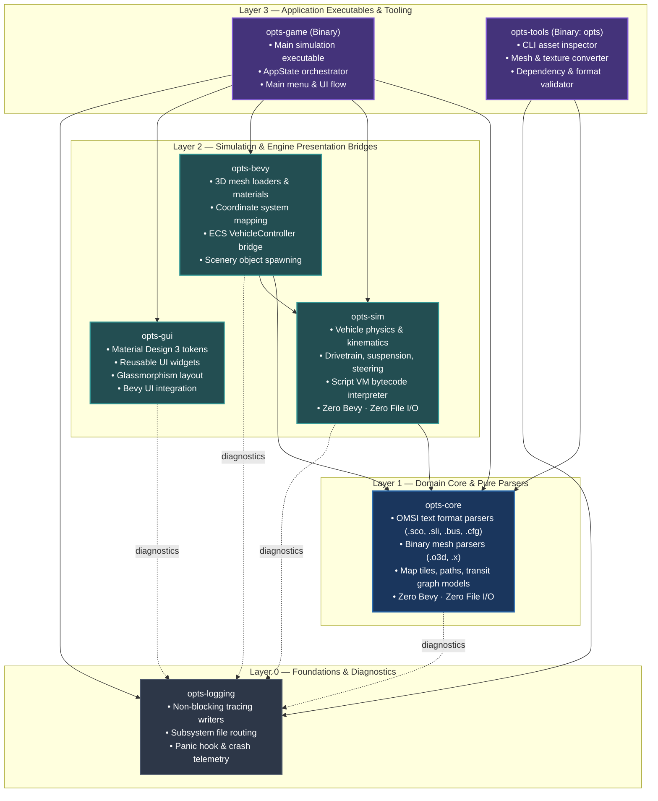

# 📦 Crate Architecture & Dependency Graph

This document defines the architectural layers, crate boundaries, and dependency relationships across the OPTS workspace per [ADR-0005](../adr/0005-crate-architecture.md).

---

## 🏛️ Architecture Layers

The OPTS workspace enforces a strict, unidirectional 4-tier layering model. No upward dependencies or dependency cycles are permitted.

---

## 📋 Crate Directory & Inventory

| Crate | Layer | Purpose | Dependencies (Internal) | Depended By | Engine Coupling |
| :--- | :---: | :--- | :--- | :--- | :---: |
| **`opts-logging`** | L0 | Structured diagnostics, subsystem log files, rotation, panic hook | *None (zero OPTS deps)* | All crates | Pure Rust |
| **`opts-core`** | L1 | OMSI format parsers, math, road graph, vehicle/scenery data models | `opts-logging` *(optional)* | `opts-sim`, `opts-bevy`, `opts-game`, `opts-tools` | Pure Rust |
| **`opts-sim`** | L2 | Deterministic vehicle dynamics, kinematics, drivetrain, script VM | `opts-core`, `opts-logging` | `opts-bevy`, `opts-game` | Pure Rust |
| **`opts-gui`** | L2 | Material Design 3 UI widget library and theme token hierarchy | `opts-core` *(optional)*, `opts-logging` | `opts-game` | Bevy UI |
| **`opts-bevy`** | L2 | Bevy 3D asset loaders, materials, coordinates, ECS vehicle bridge | `opts-core`, `opts-sim`, `opts-logging` | `opts-game` | Bevy Engine |
| **`opts-game`** | L3 | Primary interactive simulator application and state machine root | `opts-core`, `opts-sim`, `opts-bevy`, `opts-gui`, `opts-logging` | *None (executable root)* | Bevy Engine |
| **`opts-tools`** | L3 | Unified CLI toolsuite (`opts`) for inspection and asset conversion | `opts-core`, `opts-logging` | *None (executable root)* | CLI Tooling |

---

## 🔒 Invariant Boundary Rules

1. **`opts-core` Zero-Engine & Zero-IO Invariant:**
   - Must never depend on `bevy`, `wgpu`, or windowing crates.
   - Must never perform synchronous file I/O (`std::fs::File`, `std::io::Read`). All parsers operate strictly on in-memory slices (`&str`, `&[u8]`).
2. **`opts-sim` Zero-Engine & Zero-IO Invariant:**
   - Must never depend on `bevy` or rendering crates.
   - Simulation logic must remain 100% deterministic and headless-runnable.
3. **`opts-logging` Zero-OPTS Invariant:**
   - Must never depend on any OPTS internal crate (`opts-core`, `opts-sim`, etc.).
   - Provides pure tracing layers, rotation policies, and file writers.
4. **Engine Access Gating:**
   - Only `opts-bevy`, `opts-gui`, and `opts-game` are permitted to declare `bevy` as a dependency.
