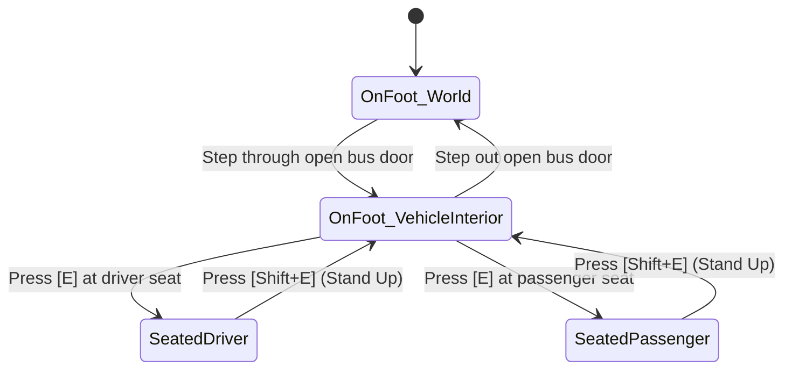
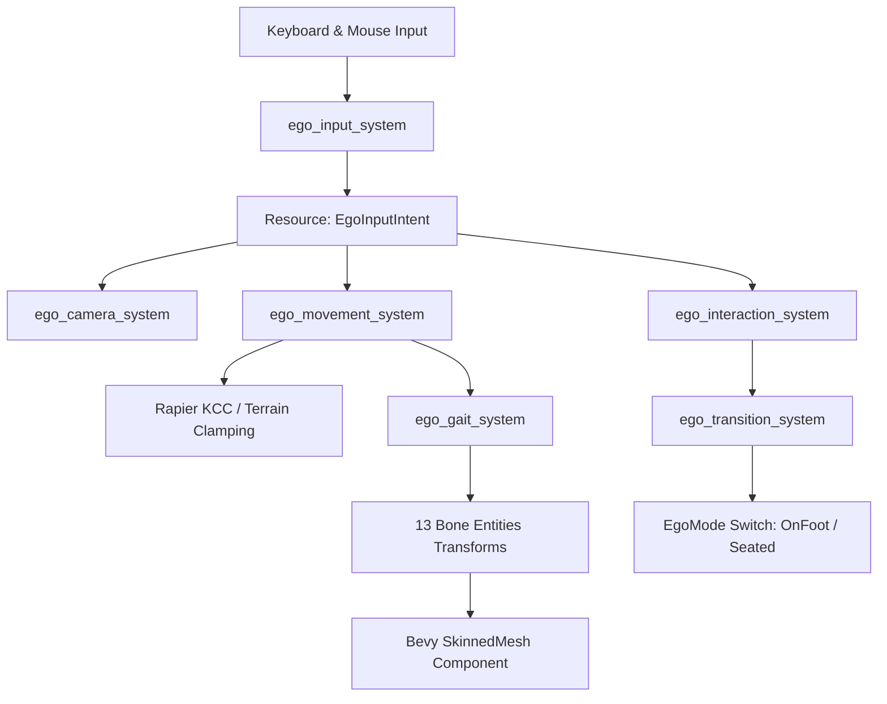

# 🚶 First-Person Ego Perspective Architecture & Design Proposal

| Metadata | Value |
| :--- | :--- |
| **Status** | 🟡 Proposal — awaiting maintainer review |
| **Layer** | L4 · Engine Systems & Gameplay Architecture |
| **Target Crates** | `opts-sim`, `opts-bevy`, `opts-game` |
| **Related Milestone** | Proposed `M-0024` (Phase 4) |
| **Last Updated** | 2026-10-08 |

---

## 📖 1. Overview & Executive Summary

This document presents the architectural design for a first-person **"Ego Perspective"** in Open Public Transport Simulator (OPTS). It establishes how the player can embody a human character, freely navigate bus depots, pedestrian sidewalks, and vehicle interiors on foot, and seamlessly transition into the driver's seat or passenger seats.

The proposal is grounded directly in the format investigation of OMSI 2's human character system ([`docs/src/formats/text/humans.md`](../formats/text/humans.md)). Crucially, our research revealed that **OMSI characters are continuous smooth-skinned 3D meshes deformed by a 13-bone skeletal rig**, while animations are **not stored in pre-baked clip files, but procedurally synthesized by mathematical kinematics in the engine runtime**.

This architecture bridges those findings into Bevy's modern Entity Component System (ECS) and physics pipeline.

---

## 🎯 2. Scope Definition (Stage B1)

### Evaluated Paradigms
1. **Free Roam Sandbox:** Complete spatial freedom to walk around the world, enter/exit vehicles, explore depots, and inspect vehicle exteriors.
2. **Scripted Mission Walk:** Walking restricted strictly to narrative or scenario triggers (e.g., walk to bus during pre-trip inspection).
3. **Combined Layered Architecture (Adopted):** A generalized, unified First-Person Controller (FPC) that acts as a free-roam sandbox by default, with higher-level scenario hooks for structured objectives.

### Core Modalities
The player entity operates within a state machine governing three distinct modes:



1. **`EgoMode::OnFoot`:**
   - Walking in the 3D world (depots, sidewalks, crosswalks) or along bus interior aisles.
   - Kinematic character physics with ground collision, step-height handling, and interaction raycasting.
2. **`EgoMode::SeatedDriver`:**
   - Seated at the vehicle's driver position (`[drivpos]`).
   - Camera locked or mouse-look oriented from the driver viewpoint. Input focus transfers to steering, pedals, transmission, and dashboard switches.
3. **`EgoMode::SeatedPassenger`:**
   - Seated at any vacant passenger seat (`[passpos]`).
   - Experiencing the ride as a passenger while AI drives the scheduled route.

---

## 👁️ 3. Camera Attachment & View Model (Stage B2)

### Attachment Hierarchy
In Bevy ECS, the camera is parented to a dedicated head pivot child entity rather than the root actor:

```
EgoPlayer (Root Entity: Movement, Rapier Capsule Collider, OmsiTransform)
 ├── EgoBody (Child Entity: Skinned 3D Mesh, 13-Bone Joint Hierarchy)
 └── EgoCameraPivot (Child Entity: Local Eye Offset, Mouse Pitch, Camera3d)
```

### Anatomical Eye Offset Calculation
From our investigation of `.hum` manifests, human stature is declared via `height` in `[humangeom]` and the base of the skull / neck pivot is defined via $(0, y_{\text{neck}}, z_{\text{neck}})$ in `[links]`. The eye elevation is positioned approximately $11\text{ cm}$ below the crown:

$$\text{EyeElevation} = \text{height} - 0.11\text{ m}$$
$$\Delta z_{\text{eye}} = \text{EyeElevation} - z_{\text{neck}} \approx +0.15\text{ m}$$
$$\Delta y_{\text{eye}} = +0.08\text{ m} \quad (\text{forward toward facial plane})$$

In Bevy's right-handed $Y$-up coordinate space ($+Y$ up, $-Z$ forward):
$$\text{LocalEyeOffset} = \text{Vec3::new}(0.0, \Delta z_{\text{eye}}, -\Delta y_{\text{eye}})$$

For a standard $1.75\text{ m}$ character, this evaluates to `Vec3::new(0.0, 0.15, -0.08)` relative to the `Head` bone.

### Rotation & Mouse-Look Model
- **Yaw (Body Rotation):** Mouse $X$ delta rotates the root `EgoPlayer` around Bevy $+Y$.
- **Pitch (Head Tilt):** Mouse $Y$ delta rotates the `EgoCameraPivot` around local $+X$, clamped to $[-85^\circ, +85^\circ]$ to prevent gimbal inversion.
- **First-Person Clipping Prevention:** The head sub-mesh is rendered using `ShadowCasterOnly` (casting dynamic shadows on the ground without rendering into the camera's near plane). Looking downward reveals the player's animated chest, arms, legs, and feet.

### Head Bobbing & Motion Sickness Safeguards
- Dynamic vertical and lateral head bobbing is driven by the walking cycle phase $\phi$.
- An exponential smoothing filter prevents sharp jarring movements.
- An accessibility setting (`HeadBobScale: 0.0..1.0`, default `0.3`) allows players prone to motion sickness to completely stabilize camera elevation.

---

## 🏃 4. Locomotion & Physics Model (Stage B3)

### Input Mapping
| Control | Action | Details |
| :--- | :--- | :--- |
| `W` / `S` | Longitudinal Movement | Forward / backward along body look vector |
| `A` / `D` | Lateral Strafe | Left / right strafe |
| `Shift` (Hold) | Sprint | Increases speed by factor $2.5\times$ |
| `Ctrl` / `C` | Crouch | Lowers eye level to $1.10\text{ m}$, halves movement speed |
| `Space` | Step / Jump | Clears small vertical obstacles $\le 0.25\text{ m}$ |
| `E` | Contextual Interact | Enters vehicle, opens doors, sits down |

### Locomotion Speeds
Speeds are parameterized by the character's `.hum` stride length `schrittweite` ($L \approx 1.4\text{ m}$) at normal cadence:
- **Walk:** $1.28\text{ m/s}$ ($4.6\text{ km/h}$)
- **Sprint:** $3.20\text{ m/s}$ ($11.5\text{ km/h}$)
- **Crouch:** $0.64\text{ m/s}$ ($2.3\text{ km/h}$)

### Kinematics & Collision Architecture
- **Capsule Collider:** Height $h = \text{height}$ ($1.75\text{ m}$), radius $r = 0.28\text{ m}$ in `bevy_rapier3d`.
- **Kinematic Character Controller (KCC):**
  - **Auto-stepping:** Automatically surmounts curbs, sidewalks, and bus boarding steps up to $h_{\text{step}} = 0.25\text{ m}$.
  - **Slope Limit:** Maximum walkable slope $\alpha_{\text{max}} = 45^\circ$.
  - **Gravity:** Standard $-9.81\text{ m/s}^2$ downward acceleration applied when unsupported.

---

## 🚌 5. Vehicle Interaction & Relative Frames (Stage B4)

### Proximity & Raycast Detection
The player casts a $2.0\text{ m}$ forward interaction ray from the camera crosshair. If the ray intersects an interactable entity or if the player is within $1.5\text{ m}$ of a vehicle door node (`[entry]` / `[exit]` from `paths.cfg`), a contextual HUD prompt appears:
- Near exterior door: `[E] Open Door` or `[E] Board Bus`
- Near driver cab: `[E] Take Driver Seat`
- Near empty passenger seat: `[E] Sit Down`

### Moving Vehicle Reference Frame Reparenting
When the player crosses an entrance threshold onto a bus floor:
1. The `EgoPlayer` entity is reparented under the vehicle chassis entity.
2. The player's physics translation operates in **vehicle local space**.
3. When the bus turns, accelerates, or brakes, the player automatically moves with the bus hull without clipping or falling through moving walls. Inertial forces can optionally apply subtle balance sway to the player's gait.

### Seated Transitions
- **Entering Driver Seat:** Pressing `[E]` at the driver seat smoothly lerps the camera from the aisle into the vehicle's standard driver camera (`[add_camera_driver]`). State transitions to `EgoMode::SeatedDriver`. Vehicle driving controls activate immediately.
- **Standing Up:** Pressing `[Shift + E]` (or clicking "Stand Up" on the UI overlay) smoothly transitions the camera back to the standing avatar in the cab aisle. Vehicle driving controls disengage (parking brake auto-set).

---

## 🛠️ 6. Bevy Integration Sketch (Stage B5)

### System Scheduling Overview

| Schedule | System Name | Responsibility |
| :--- | :--- | :--- |
| **`PreUpdate`** | `ego_input_system` | Polls keyboard, mouse, and gamepad inputs into `EgoInputIntent`. |
| **`Update`** | `ego_camera_system` | Applies mouse delta to body yaw and camera pitch; updates head-bob. |
| **`Update`** | `ego_movement_system` | Applies velocity, gravity, and step-climbing to the Rapier KCC. |
| **`Update`** | `ego_gait_system` | Computes procedural IK joint angles for the 13 bones. |
| **`Update`** | `ego_interaction_system` | Casts $2.0\text{ m}$ raycast and updates `EgoInteractionState`. |
| **`Update`** | `ego_transition_system` | Manages reparenting and seated mode transitions. |
| **`PostUpdate`** | `sync_coordinate_transforms` | Synchronizes Bevy `Transform` and `OmsiTransform`. |

### Data Flow



---

## 🔗 7. Interaction with Existing Systems (Stage B6)

### 1. Camera System Coexistence
Vehicle camera presets (`[add_camera_driver]`, `[add_camera_pax]`) are static/orbit projection bridges in `opts-bevy`. The ego camera coexists cleanly:
- When seated as driver, pressing `F1` or mouse-look toggle alternates between the rigid OMSI preset (popular with multi-monitor steering wheel setups) and free-look `EgoPerspective`.

### 2. Articulated Vehicles & Bellows Traversal
Articulated buses link multiple segments via coupling joints and `passengercabin.cfg` (`[linkToPrevVeh]`, `[linkToNextVeh]`).
- As the player walks across the turntable/bellows boundary, their entity parent smoothly reparents from the front tractor to the rear trailer segment, ensuring flawless traversal through sharp articulated turns.

### 3. Simulation Loop Synchronization
- **Fixed Timestep (60 Hz):** Physics raycasting, collision resolution, and door trigger zones execute on the fixed tick in `opts-sim`.
- **Unlocked Display Framerate:** Camera pitch/yaw and mouse-look execute during `PreUpdate` / `Render` with transform interpolation for zero visual stutter.

### 4. Asset Catalogue Integration
The player character is queried from the SQLite catalogue (`Humans/` folder-entity category):
`SELECT path FROM catalogue_entities WHERE category = 'Humans' AND name = :driver_ident;`
Defaulting to `Humans/Other/man02_hh_driver.hum`.

---

## 🎨 8. UX, Accessibility & Constraints (Stage B7)

1. **Frictionless Transitions:** Stepping out of doors or standing up from the driver's seat requires a single intuitive keypress (`[Shift + E]`).
2. **Strictly Optional:** Players wishing to play OPTS strictly as a vehicle simulator are never forced to walk. All standard OMSI vehicle camera shortcuts (`F1`–`F4`) remain fully functional.
3. **Accessibility Options:**
   - Adjustable Head-Bob scale ($0\%$ to $100\%$).
   - Adjustable Field of View ($60^\circ$ to $105^\circ$).
   - Static center reticle toggle to combat motion sickness.
4. **Multiplayer Foundation:** Embodying the player as a networked character entity with 13 procedural bones lays the direct architectural foundation for seeing other drivers and passengers in future multiplayer sessions.

---

## 🗺️ 9. Milestone Proposal (Stage B8)

*(Note: Per clean-room guardrails, this milestone is documented as a proposal for review and is not committed directly to the roadmap).*

### Milestone Proposal: `M-0024: Ego Perspective & Character Locomotion`

| Field | Value |
| :--- | :--- |
| **Milestone ID** | `M-0024` (Proposed) |
| **Phase** | Phase 4: `opts-sim` & `opts-game` (The Simulation) |
| **Priority** | 🟡 Normal |
| **Dependencies** | Phase 3 Bevy Bridge (`M-0018`–`M-0020`), Vehicle Physics (`M-0021`), Cabin Navigation (`M-0022`) |

#### Deliverables & Tasks
- [ ] **`opts-core`:** Parser and AST for `.hum` human manifests (`opts_core::formats::humans`).
- [ ] **`opts-bevy`:** Skinned mesh loader bridge for chunk `0x54` bone weights.
- [ ] **`opts-sim`:** Kinematic Character Controller (KCC) with auto-stepping and curb collision.
- [ ] **`opts-sim`:** Procedural IK gait generator evaluating `[links]` and `[walk_param]`.
- [ ] **`opts-game`:** First-person camera mount with mouse-look and head-bob smoothing.
- [ ] **`opts-game`:** Contextual interaction state machine (`OnFoot` $\leftrightarrow$ `SeatedDriver` / `SeatedPassenger`).

---

## ⚠️ 10. Risks & Alternatives (Stage B9)

| Risk | Impact | Likelihood | Mitigation / Alternative |
| :--- | :---: | :---: | :--- |
| **OMSI procedural IK formulas are complex to reverse-engineer.** | Medium | Medium | **Alternative (Skeletal Clips):** Rather than recreating OMSI's exact mathematical trigonometric formulas, OPTS can map the canonical 13 bones to standard open-source (CC0) skeletal animation clips (walk, idle, sit) using Bevy's native animation blending system. |
| **Vertex skinning weights in chunk `0x54` contain authoring noise.** | Low | Low | **Mitigation:** The `opts-core` parser clamps vertex indices $\ge \text{vertex\_count}$ and normalizes skin weights to $\sum w_i = 1.0$. |
| **OMSI character assets not available (stand-alone mode).** | Medium | Low | **Fallback:** OPTS can bundle a self-authored CC0 driver avatar in glTF format that implements the same 13-bone rig, enabling full first-person walking without requiring proprietary OMSI files. |
| **Feature distracts from core vehicle physics.** | Medium | Low | **Scope Discipline:** Ego perspective is scheduled in Phase 4 after core vehicle chassis physics (`M-0021`) and timetable routing are functional. |

---

## 🔗 Related Documents

- [Human Manifest Format (`.hum`)](../formats/text/humans.md)
- [Binary Mesh Format (`.o3d`)](../formats/binary/o3d.md)
- [Chunk Reference (`.o3d`)](../formats/binary/o3d-chunks.md)
- [Passenger Cabin Configuration (`passengercabin.cfg`)](../formats/text/vehicles/passengercabin_cfg.md)
- [Coordinate Systems & Math](coordinates.md)
- [Roadmap Overview](../roadmap/README.md)
