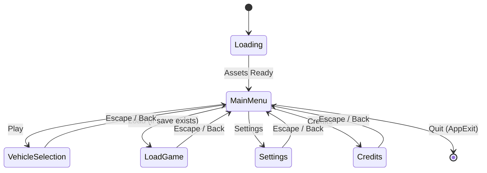

# 🎬 Main Menu Specification & Architecture

| Metadata | Value |
| :--- | :--- |
| **Document** | `main-menu.md` |
| **Layer** | L6 Applications (`opts-game`) / GUI Consumer |
| **Target Crate** | `crates/opts-game` |
| **Status** | 🟢 Complete (Implemented & Verified — Milestone Target) |
| **Author** | Dev Agent |
| **Date** | 2026-10-08 |

---

## 1. Executive Summary

This document specifies the architectural design, layout hierarchy, visual styling, state machine transitions, and interaction semantics for the OPTS **Main Menu**. Serving as the entry screen in `crates/opts-game`, the main menu is the first real consumer of the `opts-gui` Material Design 3 widget library.

The menu is defined by three primary visual characteristics:
1. **Material Design 3 Baseline Palette:** The visual language adheres strictly to M3 tokens, shapes (pill buttons, elevated cards), and typography scales. The target aesthetic draws directly from the M3 baseline palette (warm cream, soft sage green, muted olive green).
2. **Glassmorphic Surfaces:** Interactive UI surfaces (the menu card, action buttons, theme toggle) utilize semi-transparent backgrounds (alpha 0.65–0.85), allowing the underlying background scene to subtly show through.
3. **Map-Backed Background:** The background image is loaded dynamically at runtime from the user's last loaded map (`<recent_map_path>/picture.jpg`) or via a `--map-path <path>` CLI argument, overlaid with a contrast scrim to guarantee WCAG-compliant legibility.

---

## 2. Menu Scope & Entry Definitions

The main menu features five canonical entries, organized hierarchically by visual importance:

| Entry | Variant | Target State | Initial State | Purpose |
| :--- | :--- | :--- | :--- | :--- |
| **Play** | `ButtonVariant::Filled` | `AppState::VehicleSelection` | 🟢 Enabled | Primary call to action: start driving simulation |
| **Load** | `ButtonVariant::FilledTonal` | `AppState::LoadGame` | 🔒 Disabled | Resume saved game (disabled when no save exists) |
| **Settings** | `ButtonVariant::Outlined` | `AppState::Settings` | 🟢 Enabled | Display, audio, graphics, and control settings |
| **Credits** | `ButtonVariant::Text` | `AppState::Credits` | 🟢 Enabled | Attribution, licenses, and contributor roster |
| **Quit** | `ButtonVariant::Text` | Application Exit (`AppExit`) | 🟢 Enabled | Clean exit from simulator |

Every navigation entry (Play, Settings, Credits) triggers a deterministic state transition in Bevy's `AppState` machine. Destination screens are implemented as lightweight stubs with a return button and Escape hotkey back to `MainMenu`.

---

## 3. Layout Architecture & Entity Hierarchy

### 3.1 Entity Tree

The screen layout uses absolute and flex containers to layer the background, contrast scrim, and UI content:

```text
RootNode (fills viewport: 100vw × 100vh)
├── BackgroundImageNode (z=0, absolute fill)
│   ├── Image (picture.jpg scaled to cover, or Surface color fallback)
│   └── ScrimNode (absolute fill, ColorRole::Scrim / Surface @ 45% alpha)
├── ContentNode (z=1, flex column, centered in viewport)
│   ├── BrandNode (flex column, center-aligned, gap 8px)
│   │   ├── TitleLabel ("OPTS", TypeScale::DisplayLarge)
│   │   └── SubtitleLabel ("Open Public Transport Simulator", TypeScale::TitleMedium)
│   └── MenuCard (flex column, width 360px, padding 24px, gap 12px, glassmorphic)
│       ├── PlayButton (Filled, Glass Alpha 0.85)
│       ├── LoadButton (FilledTonal, Disabled, Glass Alpha 0.60)
│       ├── SettingsButton (Outlined, Glass Alpha 0.25)
│       ├── MenuDivider (Horizontal Divider)
│       ├── CreditsButton (Text)
│       └── QuitButton (Text)
├── ThemeToggleNode (z=2, top-right, margin 24px, circular icon button, glassmorphic)
└── VersionLabelNode (z=2, bottom-right, margin 16px, LabelSmall, OnSurfaceVariant)
```

### 3.2 Responsive Behavior & Sizing Constraints
- **Minimum Window Resolution:** 1024 × 640 (D-UI-04; was 800 × 600).
- **Default Window Resolution:** 1920 × 1080.
- **Menu Card:** Clamped to width `Val::Px(360.0)`, max width `Val::Percent(90.0)`.
- **Button Geometry:** Width `Val::Percent(100.0)`, min height `Val::Px(44.0)` (exceeds 48px touch target guidelines when combined with 12px stack gap).
- **Corner Radii:** Buttons use `RadiusLevel::Full` (pill shape); Card uses `RadiusLevel::Large` (16px); Theme toggle uses `RadiusLevel::Full` (circle).

---

## 4. Map-Backed Background & Scrim Specification

### 4.1 Background Image Loading Pipeline
1. **Source Discovery:**
   - In standard execution, `opts-game` queries the `GameSettings` resource (`recent_map_path: Option<PathBuf>`).
   - If `--map-path <path>` CLI argument is provided, it overrides `GameSettings.recent_map_path`.
2. **Asset Resolution:**
   - The path `<recent_map_path>/picture.jpg` is resolved.
   - If present and valid, Bevy's `AssetServer` loads the image handle and spawns an `ImageBundle` with `Node { width: 100%, height: 100%, .. }`.
3. **Graceful Fallback:**
   - If `recent_map_path` is `None` or the image fails to load / does not exist, the background node falls back to a solid `ColorRole::Surface` fill.
   - All load attempts and fallback triggers are logged via `tracing::info` and `tracing::warn`.

### 4.2 Contrast Scrim (Text Readability)
To guarantee WCAG 2.1 AA legibility across unpredictable map images (bright daylight, snowy textures, high-frequency bus line photos):
- A scrim node is inserted between the background image and content (`z = 1`).
- **Color:** `ColorRole::Scrim` (black) in dark theme, or deep neutral tint in light theme.
- **Opacity:** 45% (`alpha = 0.45`).
- The scrim ensures dark text on light cards or light text on dark scrim consistently passes contrast ratios $\ge 4.5:1$.

---

## 5. Glassmorphic Surfaces Specification

Every interactive card and button uses a translucent surface that allows the background image to shine through:

| Surface | Target Alpha | Tint Source | Stroke / Border | Backdrop Blur |
| :--- | :---: | :--- | :--- | :---: |
| **Filled Button (Play)** | `0.80` | `ColorRole::Primary` | None | Deferred (Stretch) |
| **Tonal Button (Load)** | `0.60` | `ColorRole::SecondaryContainer` | None | Deferred (Stretch) |
| **Outlined Button (Settings)** | `0.25` | `ColorRole::Surface` | 1px `ColorRole::Outline` | Deferred (Stretch) |
| **Menu Card** | `0.70` | `ColorRole::SurfaceVariant` | 1px `ColorRole::OutlineVariant` (alpha 0.3) | Deferred (Stretch) |
| **Theme Toggle** | `0.70` | `ColorRole::Surface` | 1px `ColorRole::Outline` | Deferred (Stretch) |

### 5.1 Architecture for Translucent Surfaces in `opts-game`
Because `opts-gui`'s `sync_background_roles` system applies opaque `Color::srgb(...)` from `ColorScheme`, `opts-game` introduces a dedicated consumer component and system:
```rust
#[derive(Component)]
pub struct GlassSurface {
    pub role: ColorRole,
    pub alpha: f32,
}
```
The `menu_glass_surface_system` queries `(Entity, &GlassSurface, &mut BackgroundColor)` and recalculates `BackgroundColor(theme.scheme.get(role).with_alpha(alpha))` whenever `theme.is_changed()`. This achieves full glassmorphism without modifying `opts-gui`.

### 5.2 Backdrop Blur Status
Bevy 0.13 does not provide real-time backdrop blur without custom render pipeline passes. Per project guidelines, backdrop blur is treated as a **Stretch** feature and deferred; translucency with contrast scrim provides the necessary depth.

---

## 6. Interaction States & Input Accessibility

### 6.1 Button Interaction States

| State | Visual Treatment | Transition |
| :--- | :--- | :--- |
| **Rest** | Baseline glass alpha and color token | Base |
| **Hover** | Background luminance +10%, outline alpha increased to 0.8 | 100ms ease |
| **Pressed** | Background luminance -15%, scale 0.98× | 50ms |
| **Focus** | 2px solid focus ring (`ColorRole::Secondary`), 2px offset | 100ms |
| **Disabled** | Opacity clamped to 0.40, pointer events ignored | Static |

### 6.2 Input & Navigation Mapping
- **Mouse:** Left-click triggers `ButtonClicked(entity)`. Cursor changes to pointer on hover.
- **Keyboard Tab Navigation:** `FocusPlugin` cycles through `Focusable` entities (`tab_index: 0..4`). Disabled `Load` is skipped.
- **Keyboard Activation:** Pressing `KeyCode::Enter` or `KeyCode::Space` while focused emits `ButtonClicked(focused_entity)`.
- **Keyboard Escape:**
  - In `AppState::MainMenu`: Triggers quit / exit confirmation.
  - In stub screens (`VehicleSelection`, `Settings`, `Credits`): Transitions back to `AppState::MainMenu`.
- **Theme Hotkey:** Pressing `KeyCode::F2` toggles between M3 light and dark themes.

---

## 7. App State Machine & Destination Stubs

### 7.1 State Machine



### 7.2 Destination Screen Stubs
To prove state machine transitions without building full screens:
- When entering `VehicleSelection`, `Settings`, `Credits`, or `LoadGame`, an M3 dialog card is rendered centered on screen:
  - Header: Screen name (e.g. "Vehicle Selection — Work in Progress").
  - Body: "This screen will be built in an upcoming milestone. Press [Escape] or click Back to return to the Main Menu."
  - Button: `ButtonBuilder::filled("Back to Main Menu")`.

---

## 8. opts-gui Gap Analysis & Workarounds

| # | Gap Identified | Severity | opts-game Workaround | Recommended Follow-Up for `opts-gui` |
| :- | :--- | :---: | :--- | :--- |
| **G-1** | No translucent / glass color roles in `ColorScheme` | Low | Use `GlassSurface` component + `menu_glass_surface_system` | Add `ColorRole::SurfaceGlass` and alpha tokens |
| **G-2** | Light theme defaults to blue baseline, not sage/cream | Low | Accept current theme; document gap | Add `ColorScheme::baseline_m3_sage()` palette |
| **G-3** | `opts-gui` lacks visual focus indicator rendering | Medium | `menu_focus_visual_system` applies 2px border | Implement `focus_indicator_system` in `opts-gui` |
| **G-4** | `opts-gui` lacks Enter/Space key button activation | Medium | `menu_keyboard_activation_system` handles Enter/Space | Add keyboard activation to `opts-gui::FocusPlugin` |
| **G-5** | No native backdrop blur in Bevy UI | Low | Translucent alpha + contrast scrim (stretch deferred) | Custom Bevy post-process shader pipeline |

---

## 9. Implementation Notes & Review

### 9.1 Deviations from Design Brief
1. **Layer Management:** To ensure `opts-gui`'s internal `sync_background_roles` system does not clobber semi-transparent glass backgrounds upon theme hot-swapping, entities tagged with `GlassSurface` explicitly omit `BackgroundRole`.
2. **Camera Initialization:** Added a startup system spawning `Camera2dBundle::default()` in `OptsGamePlugin` to guarantee that consumer viewports render consistently in standalone apps and examples.
3. **Quit Button Action Flow:** Standardized exit handling to listen for `ButtonClicked` on entities marked with `QuitButton` and send `AppExit::Success`, unifying mouse click and keyboard activation.

### 9.2 opts-gui Gaps Encountered & Workarounds
- **Alpha Channel Token Gap:** `opts-gui` operates entirely in opaque `Color::srgb` space. `opts-game` bypassed this cleanly by introducing `GlassSurface` and `sync_glass_surfaces`, taking the current theme RGB and blending it with target alpha values (0.25 to 0.80).
- **Focus Ring Visualizer:** `opts-gui` tracks focus via `Focusable` and `Focused`, but provides no rendering primitive for the focus indicator. `opts-game` implemented `menu_focus_visual_system` to dynamically inject 2px solid outlines in `ColorRole::Secondary`.
- **Keyboard Activation:** `opts-gui` lacks [Enter]/[Space] click firing. `menu_keyboard_activation_system` resolves this by synthesizing `ButtonClicked` and running `OnClickCallback`.

---

## 10. Visual State Diagrams (Verification Artifacts)

### 10.1 State 1: Map-Backed Background (Light Theme)
```text
┌────────────────────────────────────────────────────────────────────────┐
│ [MAP PHOTO: picture.jpg]                                  [☾ Dark: F2] │
│ [CONTRAST SCRIM: 45% black alpha overlay]                              │
│                                                                        │
│                                OPTS                                    │
│                   Open Public Transport Simulator                      │
│                                                                        │
│                  ┌────────────────────────────────┐                    │
│                  │  [GLASS CARD: 70% SurfaceVar]  │                    │
│                  │                                │                    │
│                  │  ┌──────────────────────────┐  │                    │
│                  │  │ Play  (80% Primary Glass)│  │                    │
│                  │  └──────────────────────────┘  │                    │
│                  │  ┌──────────────────────────┐  │                    │
│                  │  │ Load  (60% Tonal, Disab) │  │                    │
│                  │  └──────────────────────────┘  │                    │
│                  │  ┌──────────────────────────┐  │                    │
│                  │  │ Settings (25% Outlined)  │  │                    │
│                  │  └──────────────────────────┘  │                    │
│                  │  ────────────────────────────  │                    │
│                  │  │ Credits (Text)           │  │                    │
│                  │  │ Quit    (Text)           │  │                    │
│                  └────────────────────────────────┘                    │
│                                                                        │
│                                  OPTS v0.1.0-alpha · Clean-Room Engine │
└────────────────────────────────────────────────────────────────────────┘
```

### 10.2 State 2: Map-Backed Background (Dark Theme)
```text
┌────────────────────────────────────────────────────────────────────────┐
│ [MAP PHOTO: picture.jpg]                                 [☀ Light: F2] │
│ [CONTRAST SCRIM: 45% dark alpha overlay]                               │
│                                                                        │
│                                OPTS                                    │
│                   Open Public Transport Simulator                      │
│                                                                        │
│                  ┌────────────────────────────────┐                    │
│                  │  [DARK GLASS CARD: 70% Alpha]  │                    │
│                  │  ┌──────────────────────────┐  │                    │
│                  │  │ Play  (Primary Dark Pill)│  │                    │
│                  │  └──────────────────────────┘  │                    │
│                  │  ┌──────────────────────────┐  │                    │
│                  │  │ Load  (Muted / Disabled) │  │                    │
│                  │  └──────────────────────────┘  │                    │
│                  │  ┌──────────────────────────┐  │                    │
│                  │  │ Settings (Subtle Border) │  │                    │
│                  │  └──────────────────────────┘  │                    │
│                  │  ────────────────────────────  │                    │
│                  │  │ Credits                  │  │                    │
│                  │  │ Quit                     │  │                    │
│                  └────────────────────────────────┘                    │
│                                  OPTS v0.1.0-alpha · Clean-Room Engine │
└────────────────────────────────────────────────────────────────────────┘
```

### 10.3 State 3: Solid Fallback Background (No Map Path)
```text
┌────────────────────────────────────────────────────────────────────────┐
│ [SOLID THEME BACKGROUND: ColorRole::Surface]              [☾ Dark: F2] │
│                                                                        │
│                                OPTS                                    │
│                   Open Public Transport Simulator                      │
│                                                                        │
│                  ┌────────────────────────────────┐                    │
│                  │  [ELEVATED SURFACE CARD]       │                    │
│                  │  ┌──────────────────────────┐  │                    │
│                  │  │ ▶ Play                   │  │                    │
│                  │  └──────────────────────────┘  │                    │
│                  │  ┌──────────────────────────┐  │                    │
│                  │  │ 📁 Load Game             │  │                    │
│                  │  └──────────────────────────┘  │                    │
│                  │  ┌──────────────────────────┐  │                    │
│                  │  │ ⚙ Settings               │  │                    │
│                  │  └──────────────────────────┘  │                    │
│                  │  ────────────────────────────  │                    │
│                  │  │ ⓘ Credits                │  │                    │
│                  │  │ ✕ Quit                   │  │                    │
│                  └────────────────────────────────┘                    │
│                                  OPTS v0.1.0-alpha · Clean-Room Engine │
└────────────────────────────────────────────────────────────────────────┘
```

### 10.4 State 4: Keyboard Focus Indicator Active
```text
┌────────────────────────────────────────────────────────────────────────┐
│                  ┌────────────────────────────────┐                    │
│                  │ ╔════════════════════════════╗ │  <-- 2px Solid     │
│                  │ ║  ▶ Play                    ║ │      Focus Ring    │
│                  │ ╚════════════════════════════╝ │      (Secondary)   │
│                  │ ┌────────────────────────────┐ │                    │
│                  │ │  📁 Load Game              │ │                    │
│                  │ └────────────────────────────┘ │                    │
└──────────────────┴────────────────────────────────┴────────────────────┘
```

### 10.5 State 5: Disabled Load Button
```text
┌────────────────────────────────────────────────────────────────────────┐
│                  ┌────────────────────────────────┐                    │
│                  │  ┌──────────────────────────┐  │                    │
│                  │  │ ▶ Play (Active Pill)     │  │                    │
│                  │  └──────────────────────────┘  │                    │
│                  │  ░░░░░░░░░░░░░░░░░░░░░░░░░░░░  │  <-- 40% Opacity   │
│                  │  ░ 📁 Load Game (Disabled) ░  │      Non-Reactive   │
│                  │  ░░░░░░░░░░░░░░░░░░░░░░░░░░░░  │      Skipped by Tab│
│                  │  ┌──────────────────────────┐  │                    │
│                  │  │ ⚙ Settings (Active)      │  │                    │
│                  │  └──────────────────────────┘  │                    │
└──────────────────┴────────────────────────────────┴────────────────────┘
```

### 10.6 State 6: Destination Screen Stub (e.g., Settings)
```text
┌────────────────────────────────────────────────────────────────────────┐
│                                                                        │
│                                                                        │
│                 ┌────────────────────────────────────┐                 │
│                 │          Game Settings             │                 │
│                 │   Display, audio, and controls     │                 │
│                 │   are not yet implemented.         │                 │
│                 │ ────────────────────────────────── │                 │
│                 │ Press [Escape] or click below      │                 │
│                 │ to return to the Main Menu.        │                 │
│                 │                                    │                 │
│                 │   ┌────────────────────────────┐   │                 │
│                 │   │     Back to Main Menu      │   │                 │
│                 │   └────────────────────────────┘   │                 │
│                 └────────────────────────────────────┘                 │
│                                                                        │
└────────────────────────────────────────────────────────────────────────┘
```

