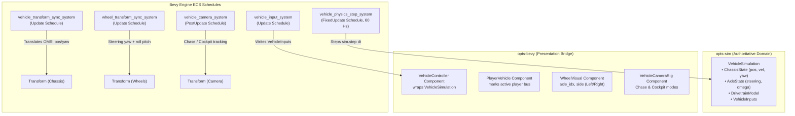

# 🚌 Vehicle ECS Simulation Bridge

This document specifies the architectural bridge connecting the pure Rust vehicle dynamics core in `opts-sim` to Bevy's Entity Component System (ECS) in `opts-bevy`.

---

## 1. Architectural Philosophy & Clean-Room Separation

As established in [ADR-0001](../adr/0001-why-bevy-and-rust.md) and [ADR-0002](../adr/0002-clean-room-policy.md):
- **`opts-sim`** contains the authoritative simulation models (drivetrain, suspension, Ackermann steering, braking, Coulomb friction, articulation). It is pure Rust, `no_std`-friendly where possible, and has zero dependency on Bevy, GPU rendering, or windowing APIs.
- **`opts-bevy`** is the presentation and integration crate. It consumes `opts-sim` as a domain library, mapping simulation state onto Bevy `Entity`, `Component`, and `Transform` hierarchies.



---

## 2. Component Architecture

### `VehicleController`
The core component attached to the vehicle root entity.
```rust
#[derive(Component)]
pub struct VehicleController {
    /// Authoritative simulation instance from `opts-sim`.
    pub sim: VehicleSimulation,
    /// Pending inputs collected during the rendering frame.
    pub inputs: VehicleInputs,
}
```

### `PlayerVehicle`
Marker component placed on the vehicle currently piloted by the user:
```rust
#[derive(Component, Default)]
pub struct PlayerVehicle;
```

### `WheelVisual`
Attached to child entities representing individual 3D wheel meshes:
```rust
#[derive(Component, Clone, Copy, Debug)]
pub struct WheelVisual {
    /// Zero-based axle index (0 = front steering axle, 1 = drive axle, etc.).
    pub axle_index: usize,
    /// Wheel side on the axle.
    pub side: WheelSide,
    /// Initial local rest translation in vehicle space.
    pub rest_translation: Vec3,
}

#[derive(Clone, Copy, Debug, PartialEq, Eq)]
pub enum WheelSide {
    Left,
    Right,
}
```

### `VehicleCameraRig`
Controls camera positioning relative to the vehicle:
```rust
#[derive(Component)]
pub struct VehicleCameraRig {
    /// Current active camera mode.
    pub mode: VehicleCameraMode,
    /// Chase camera distance offset (meters).
    pub chase_distance: f32,
    /// Chase camera elevation height above chassis (meters).
    pub chase_height: f32,
    /// Cockpit driver viewpoint offset in vehicle coordinates.
    pub cockpit_offset: Vec3,
    /// Damping stiffness factor for smooth camera following.
    pub damping: f32,
}

#[derive(Clone, Copy, Debug, PartialEq, Eq)]
pub enum VehicleCameraMode {
    ExteriorChase,
    InteriorCockpit,
}
```

---

## 3. Scheduling & Determinism

### Smooth presentation (2026-10-12)

The simulation steps at a fixed rate while frames come at any rate, so a transform written once per fixed step shows as judder ("choppy" motion at 144 Hz or with vsync). The rendered pose is therefore **interpolated**: `VehicleController::render_prev` keeps the chassis pose before the last step and `vehicle_transform_sync_system` blends it with the current one by `Time<Fixed>::overstep_fraction()`; articulated segments keep their last two fixed-step poses and `articulation_render_system` (PostUpdate) blends them; the rail player's drawn train runs the elapsed part of the step ahead (`speed · overstep`). The ground height is sampled at the frame rate and blended between neighbouring road samples (inverse-distance weights) so it does not step from sample to sample.

### Timestep Decoupling
Display frame rates fluctuate (30–144+ FPS). To ensure simulation determinism and eliminate numerical drift:
1. **Inputs are polled in `Update`**: Player keypresses and gamepad axes are translated into `VehicleInputs` on `VehicleController`.
2. **Physics steps in `FixedUpdate`**: `VehicleSimulation::step(fixed_dt)` executes at a strictly fixed $60\text{ Hz}$ ($\Delta t = 1/60\text{ s} \approx 0.016667\text{ s}$).
3. **Visual transforms synchronize in `Update`**: Entity `Transform` and child wheel mesh rotations are updated from the latest simulation state.

---

## 4. Coordinate Transformation & Spatial Alignment

OMSI vehicle dynamics operate in a 2D ground coordinate plane:
- Vehicle heading $\psi = 0$ corresponds to $+Y$ (forward), positive yaw $\psi > 0$ rotates counterclockwise (left).
- Bevy utilizes a 3D coordinate frame where $+Y$ is vertical up, $-Z$ is forward, and $+X$ is right.

Using the canonical transformations from `opts_bevy::coords`:
$$\text{Bevy Translation} = \begin{bmatrix} -x_{\text{sim}} \\ z_{\text{ground}} \\ -y_{\text{sim}} \end{bmatrix}$$
$$\text{Bevy Rotation} = \text{Quat::from\_rotation\_y}(-\psi_{\text{sim}})$$

### Wheel Mesh Hierarchy Synchronization
Each child wheel entity tagged with `WheelVisual` receives a local transform composed of:
1. **Steering Deflection:** Rotates around the vertical axle axis ($+Y$) by the Ackermann steering angle $\delta$ for that wheel:
   $$\text{Rot}_{\text{steer}} = \text{Quat::from\_rotation\_y}(-\delta)$$
2. **Rolling Spin:** Rotates around the wheel's spin axis ($+X$) by the integrated wheel rotation angle $\theta$:
   $$\text{Rot}_{\text{roll}} = \text{Quat::from\_rotation\_x}(\theta)$$
3. **Combined Local Rotation:**
   $$\text{Rot}_{\text{local}} = \text{Rot}_{\text{steer}} \times \text{Rot}_{\text{roll}}$$

---

## 5. Input Mapping & Controls

Default desktop keyboard mappings for `PlayerVehicle`:

| Input Key | Vehicle Action | Simulation Mapping |
| :--- | :--- | :--- |
| `KeyW` / `ArrowUp` | Throttle | `inputs.throttle += rate * dt` (clamped $[0, 1]$) |
| `KeyS` / `ArrowDown` | Foot Brake | `inputs.brake += rate * dt` (clamped $[0, 1]$) |
| `KeyA` / `ArrowLeft` | Steer Left | `inputs.steering += steer_rate * dt` (clamped $[-1, 1]$) |
| `KeyD` / `ArrowRight` | Steer Right | `inputs.steering -= steer_rate * dt` (clamped $[-1, 1]$) |
| `Space` | Handbrake | `inputs.handbrake = pressed` (clamped $[0, 1]$) |
| `KeyD` (Tap) | Drive Gear | `inputs.gear = GearPosition::Drive` |
| `KeyN` (Tap) | Neutral Gear | `inputs.gear = GearPosition::Neutral` |
| `KeyR` (Tap) | Reverse Gear | `inputs.gear = GearPosition::Reverse` |
| `KeyF1` | Chase Camera | `camera_rig.mode = VehicleCameraMode::ExteriorChase` |
| `KeyF2` | Cockpit Camera | `camera_rig.mode = VehicleCameraMode::InteriorCockpit` |

Automatic centering applies to steering when neither steering key is pressed:
$$\text{steering} \to 0.0 \quad \text{at rate } k_{\text{return}} \cdot \Delta t$$
