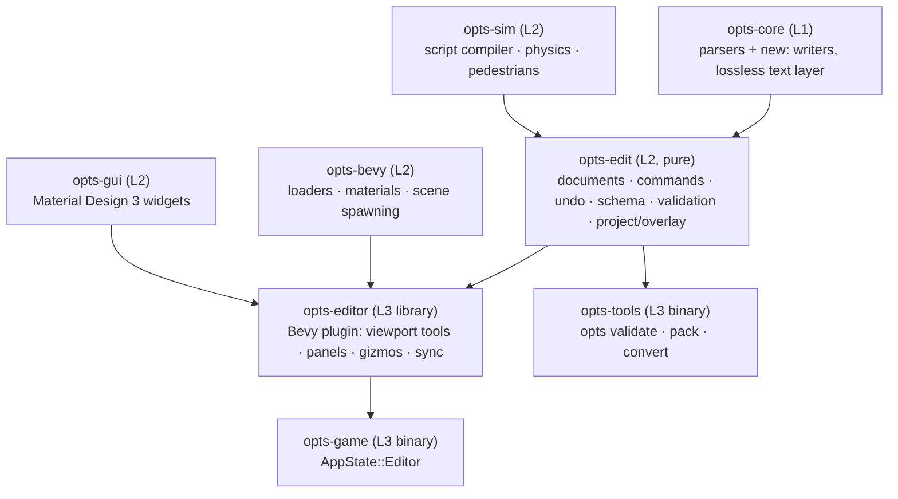
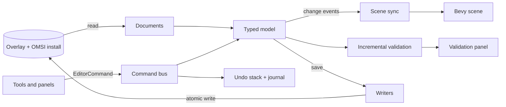

# Editor Architecture

| Metadata | Value |
| :--- | :--- |
| **Status** | 📝 Specification |
| **Layering** | Follows [ADR-0005](../adr/0005-crate-architecture.md): no upward dependencies, no cycles |

## 1. Crates



| Crate | New / changed | Responsibility | Must not |
| :--- | :--- | :--- | :--- |
| `opts-core` | changed | Adds `write`/`to_bytes` for every format that is editable, and the **lossless text layer** (§3). Stays free of Bevy and file I/O. | touch the filesystem |
| `opts-edit` | **new**, pure | Project model and overlay file system, documents, the command/undo system, the schema registry, the validation engine, the package builder. Deterministic and headless-testable. | depend on Bevy |
| `opts-editor` | **new** | Everything interactive: viewport tools (select, move, draw spline, paint terrain …), gizmos, panels, the sync between documents and the Bevy scene. | contain format knowledge (asks `opts-edit`) |
| `opts-game` | changed | `AppState::Editor`, the *Editor* menu entry, `--editor`, *Play from here*. | |
| `opts-tools` | changed | Headless commands on the same engine: `opts validate`, `opts pack`, `opts fmt` (canonical rewrite), `opts diff` (semantic diff of two projects). | |

`opts-sim` is used for script compilation (diagnostics while editing `.osc`) and physics previews; `opts-bevy` provides the exact loaders and renderers the game uses (P3).

## 2. Data flow



Rules:

* The **only** way to change content is an `EditorCommand` on the bus. Tools, property fields, scripts and the control protocol all submit commands.
* The typed model is the single source of truth while the editor runs. The Bevy scene is a *projection*: scene sync re-spawns only the entities of dirty elements (see §6).
* Files are written only by *Save*, *autosave to the journal* and *Export*; there is no write-through on each edit.

## 3. Documents and the lossless layer

A **document** is one file of the project (`tile_7_0.map`, `MAN_GN92_main.bus`, `Busstops.cfg`). Three layers:

1. **Syntax layer** (text formats). `opts_core::text::Syntax` is the file as a list of *items*: keyword blocks `{ keyword, parameters, line range, trailing comment lines }` and *verbatim runs* (banner comments, prose, blank lines, text outside blocks). Together with the detected encoding (CP1252, UTF-8, UTF-16 LE/BE with BOM; the `global.cfg` of *Oberstedt 2* is UTF-16, [`global-cfg.md`](../formats/map/global-cfg.md)), end-of-line style and trailing-newline state. Printing an unmodified syntax tree reproduces the input **byte for byte**.
2. **Typed layer.** The existing parsers (`SceneryObject`, `MapTile`, `BusManifest`, …) are extended to remember, per element, *which syntax items it came from* and to keep unmodelled fields (`raw_params`, unknown keywords) in the element. An edit changes the typed element; saving re-serialises **only the touched items** with the canonical formatter and splices them into the syntax tree.
3. **Binary formats** (`.o3d`, `.map.terrain`, `.map.water`, `.map.LM.bmp`, `.map.prt`) have no verbatim runs; they are written from the typed model by dedicated writers with known layouts ([`o3d.md`](../formats/binary/o3d.md), [`tiles.md`](../formats/map/tiles.md)). Unknown chunks are kept (`unknown_chunks`).

**Canonical formatting.** New or modified blocks are written the way OMSI's own editor writes them: keyword line, one parameter per line, numbers with enough digits to round-trip (`f32` shortest representation; integers verbatim), CRLF if the file uses CRLF. Parameters whose meaning is unknown are written back unchanged.

**Opening cost.** A tile has 10–25 lines per object and tens of thousands of lines; documents are parsed lazily, per tile, on a background thread, and kept as `Arc` snapshots so the viewport and validation read without locks.

## 4. Commands, undo, journal

```rust
trait EditorCommand: Send + Sync {
    fn label(&self) -> String;                       // "Move 3 objects"
    fn apply(&mut self, project: &mut Project) -> Result<Effects, EditError>;
    fn revert(&mut self, project: &mut Project) -> Result<Effects, EditError>;
    fn merge(&mut self, next: &dyn EditorCommand) -> bool; // drag steps collapse into one entry
    fn to_journal(&self) -> JournalEntry;            // serialisable for crash recovery
}
```

* **Transactions.** Compound edits (delete a spline = remove the spline block, clear `conn_id` links of its neighbours, delete attachments that name it, fix attachment indices of later splines) are one command with one undo step. A command is atomic: if any part fails, nothing changed.
* **Stable handles.** Elements are addressed by `(document, ElementId)`, where `ElementId` is the OMSI `id code` for objects and splines (unique per map, allocated from `[NextIDCode]` of `global.cfg`) and a generated stable id for elements without one (rules, paths, timetable rows). Indices — such as the spline index of `[splineAttachement]` or the lane index of a `[rule]` — are *derived* at write time, so inserting or deleting elements cannot silently re-target them.
* **Undo stack** per project, unlimited depth, bounded by memory; *Save* does not clear it.
* **Journal.** Every applied command is appended (fsync-batched) to `.opts-editor/journal.ndjson`; after a crash the project reopens at the last saved state and offers *Replay journal*.

## 5. Schema registry

For every format, `opts-edit::schema` declares keywords with parameter count, types, units, ranges, defaults, a one-line description and the specification page. Sources and uses:

| Source | Used for |
| :--- | :--- |
| the field tables of the format specifications (maintained next to the parser) | property panels (labels, units, sliders), the text editor's completion and hover help |
| the corpus statistics in the specifications | plausible ranges (a warning, not an error, outside them) |
| `❓` marks in the specifications | fields shown as *raw*, never normalised |

A test iterates every keyword listed in the specification tables and fails when the registry lacks it, so the specification and the editor cannot drift apart (P4).

## 6. Preview and synchronisation

* **Element-level rebuild.** Each scene entity carries `EditorElement(document, ElementId)`. A change event names the elements; scene sync despawns and re-spawns exactly those (an object: its meshes; a spline: its ribbon and the terrain carve of its neighbourhood; a tile's terrain: the tile mesh). The loaders are those of the game (`spawn_object`, `extrude_spline_segment`, …), refactored so they can build a single element; the same refactoring serves M-0046 (world loader extraction).
* **Gizmos and overlays** (selection outlines, spline control points, lane paths, traffic rules, terrain grid) are separate entities on an editor-only render layer, never part of the exported scene.
* **Hot reload bridge.** External changes to a project file (another editor, version control) arrive through the existing hot-reload pipeline ([ADR-0007](../adr/0007-hot-reload.md)); the document is reloaded if clean, otherwise a conflict banner offers *keep mine / take theirs / open diff*.
* **Play from here.** The editor writes the dirty documents to a *staging* overlay and starts a game session with `--project <dir> --map … --entry-at x,y,z`; the game's hot reload picks up later saves. A second window is used when the platform allows; otherwise the editor suspends its viewport.

## 7. Threading and performance budget

| Work | Where | Budget |
| :--- | :--- | :--- |
| Parse a tile, build the picking BVH | background pool | < 150 ms for a 3,000-object tile |
| Apply a command, emit change events | main thread | < 1 ms typical, < 8 ms for 1,000 elements |
| Scene sync of changed elements | main thread, amortised | ≤ 4 ms per frame, remainder next frame |
| Incremental validation | background | results within 250 ms of the last edit |
| Full validation of a project | background | progress bar, cancellable |
| Mesh decoding of scrambled content for display | existing decode pool | unchanged |

Picking uses a CPU BVH over element bounds (objects: transformed mesh bounds; splines: swept ribbon bounds; lanes: polyline capsules). The GPU is not read back.

## 8. Extension points

* **Tools** implement `EditorTool` (activate, pointer events, preview, commit as commands) and register in the tool palette.
* **Inspectors** are generated from the schema; special widgets (profile cross-section canvas, timetable grid, colour scheme chooser) register for a keyword or a content type.
* **Generators** (`opts-edit::generate`) create content from parameters: a junction from arm angles, a parking row, a bus stop with its objects and `Busstops.cfg` entry, an AI list from a depot description. The map generator research of M-0038 plugs in here.
* **Importers/exporters:** glTF/OBJ meshes → plain `.o3d`; heightmap images → terrain; CSV ⇄ timetables; OpenStreetMap extracts → spline layouts (later, optional).
* **Control protocol.** `editor.*` methods (open, select, run command, save, validate, screenshot) make every editor action scriptable and testable ([ADR-0006](../adr/0006-control-protocol.md)).

## 9. Testing strategy

| Level | Tests |
| :--- | :--- |
| Unit | each command: apply → revert restores the model; formatter golden tests; schema coverage test |
| Round trip | **every file of the installed corpus**: `print(parse(bytes)) == bytes` for text formats; for binary writers `parse(write(parse(bytes)))` equals the first parse |
| Property | random command sequences with undo/redo keep the model valid and the validation clean |
| Integration | headless editor session on a fixture map: place objects, draw splines, save, reload in the game loader, compare the scene (counts, bounding boxes, screenshots) |
| Acceptance | a checklist run in real OMSI 2 for each new writer (the file loads, looks right) — manual, recorded in `docs/src/meta/` per release; no decompilation involved |
