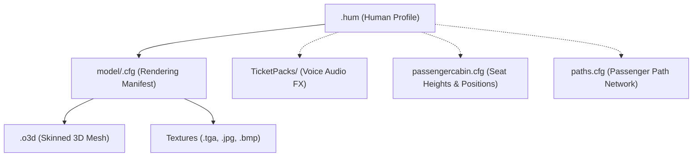

# `.hum` — Human Character Configuration Files

| Metadata | Value |
| :--- | :--- |
| **Format Family** | Text (keyword-based) |
| **File Extensions** | `.hum` |
| **Parser Crate** | `opts-core` |
| **Parser Module** | `opts_core::formats::humans` |
| **Encoding** | Windows-1252 (CP1252) |
| **Status** | 🟢 Specified & implemented — all 58 corpus files parse |
| **Last Updated** | 2026-10-09 |

---

## 📖 Overview

In OMSI 2, all pedestrian AI characters, boarding passengers, and vehicle drivers are declared via **human configuration manifests** (`.hum` files). A `.hum` file does **not** contain mesh geometry or animation clips directly. Instead, it serves as an **anthropometric and kinematic profile**:

1. **Rendering Delegation:** Points to a model rendering manifest (`model\<name>.cfg`) via `[model]`, which binds 3D mesh geometry (`.o3d`) and textures (`.tga`, `.jpg`, `.bmp`).
2. **Procedural Skeleton & Biometrics:** Declares physical stature (`[humangeom]`), seating contact elevation (`[seatheight]`), and exact 3D joint pivot locations (`[links]`) for an inverse kinematics (IK) skeletal rig.
3. **Locomotion Kinematics:** Configures gait dynamics (`[walk_param]`) including stride length, arm swing amplitude, resting upper arm flare, and hip/waist sway.
4. **Physical Simulation:** Defines body mass in metric tonnes (`[mass]`) for vehicle suspension and payload calculations.
5. **Operational Identity:** Declares voice audio profile (`[voice]`) and demographic age (`[age]`) for ticket purchasing interactions.

### Relationship to Other Files



| File | Relationship |
| :--- | :--- |
| `model/<name>.cfg` | Referenced directly via `[model]`. Declares level-of-detail tiers (`[LOD]`), visual mesh files (`[mesh]`), and bone index bindings (`[setbone]`). |
| `<name>.o3d` | 3D mesh referenced by the `.cfg`. Contains continuous deformable geometry with a 13-bone smooth-skinning weight table in chunk `0x54`. |
| `humans.txt` | Shipped pool index file in `Humans/` listing default passenger paths. |
| `passengercabin.cfg` | Vehicle cabin layout declaring seat heights (`[passpos]`) that evaluate against `[seatheight]`. |
| `TicketPacks/` | Audio banks referenced by `[voice]` for fare requests and ticket complaint dialogues. |

---

## 🔤 General Structure

A `.hum` file is a plain-text ASCII / CP1252 document following OMSI's keyword block syntax:
- Keywords are enclosed in square brackets (e.g. `[model]`, `[humangeom]`).
- Each parameter occupies a separate line immediately following the keyword.
- Comments can begin with `//` or appear as free-text prose outside active keyword blocks.
- **Template Comment Convention:** Authoring files shipped by Marcel Kuhnt and Rüdiger Hülsmann frequently include a preliminary comment block defining parameter names enclosed in curly braces (e.g. `{x_hip}`, `{y_hip}`), followed by the active numeric keyword block. Parsers should ignore curly-braced comment blocks and parse the subsequent numeric block.

---

## 📚 Keyword Reference

Across the complete corpus of 58 `.hum` files in OMSI 2, **exactly 8 distinct keywords** exist:

| Keyword | Parameters | Value Types | Corpus Frequency | Purpose |
| :--- | :---: | :--- | :---: | :--- |
| `[model]` | 1 | Relative path string | 58 / 58 (100%) | Relative path to model rendering manifest (`model\<name>.cfg`) |
| `[seatheight]` | 1 | Float (meters) | 58 / 58 (100%) | Reference seated hip contact height above floor (corpus range `0.60`–`0.90` m) |
| `[humangeom]` | 2 | Floats | 58 / 58 (100%) | Overall anthropometry: `feetdist` (stance width, m) and `height` (stature, m) |
| `[links]` | 22 | Floats | 58 / 58 (100%) | Right-side joint pivot positions in local space (mirrored across $X=0$ for left side) |
| `[walk_param]` | 5 | Floats | 58 / 58 (100%) | Locomotion dynamics: stride length, arm rest angle, arm swing, hip sway, waist sway |
| `[voice]` | 1 | String ident | 58 / 58 (100%) | Voice profile ID (see [Voices](#voices)) mapped to `TicketPacks` |
| `[mass]` | 1 | Float (tonnes) | 58 / 58 (100%) | Body mass in metric tonnes (e.g. `0.07` = 70 kg) for vehicle axle payload physics |
| `[age]` | 1 | Integer (years) | 10 / 58 (17%) | Optional age in years (corpus: `12`, `16`, `17`, `24`, `29`, `36`, `75`, `93`) for fare logic |

---

### Detailed Keyword Layout

#### `[model]` — Rendering Manifest Reference
```omsi
[model]
model\man01.cfg
```
Declares the path to the model rendering configuration file relative to the `.hum` file's parent directory.

#### `[seatheight]` — Seated Elevation
```omsi
[seatheight]
0.75
```
Defines the vertical elevation (in meters) of the character's hips when seated in a passenger seat. This value is cross-referenced by the engine when placing a passenger onto a vehicle seat declared via `[passpos]` in `passengercabin.cfg`.

#### `[humangeom]` — Stature & Stance Width
```omsi
[humangeom]
0.20
1.75
```
- Line 1: `feetdist` — Lateral separation between feet in meters (e.g. `0.20`).
- Line 2: `height` — Total standing stature in meters from ground contact to top of head (e.g. `1.75`).

#### `[links]` — Joint Coordinates (22 Floats)
The `[links]` keyword defines the 3D joint centers for the **right side** of the human body in meters relative to the character origin $(0, 0, 0)$ (centered on ground plane between the feet). The engine automatically mirrors these coordinates across the sagittal plane ($X \to -X$) for the left side:

| Index | Field Name | Axis | Description | Typical Value (m) |
| :---: | :--- | :---: | :--- | :---: |
| 1 | `x_hip` | $+X$ | Right hip lateral offset | `0.10` |
| 2 | `y_hip` | $+Y$ | Right hip longitudinal offset | `-0.01` |
| 3 | `z_hip` | $+Z$ | Right hip vertical elevation | `0.84` |
| 4 | `x_knee` | $+X$ | Right knee lateral offset | `0.14` |
| 5 | `y_knee` | $+Y$ | Right knee longitudinal offset | `-0.02` |
| 6 | `z_knee` | $+Z$ | Right knee vertical elevation | `0.43` |
| 7 | `y_waist` | $+Y$ | Waist longitudinal offset (midline $X = 0$) | `-0.01` |
| 8 | `z_waist` | $+Z$ | Waist vertical elevation (midline $X = 0$) | `1.05` |
| 9 | `x_shoulder` | $+X$ | Right shoulder lateral offset | `0.17` |
| 10 | `y_shoulder` | $+Y$ | Right shoulder longitudinal offset | `-0.05` |
| 11 | `z_shoulder` | $+Z$ | Right shoulder vertical elevation | `1.39` |
| 12 | `x_elbow` | $+X$ | Right elbow lateral offset | `0.43` |
| 13 | `y_elbow` | $+Y$ | Right elbow longitudinal offset | `-0.08` |
| 14 | `z_elbow` | $+Z$ | Right elbow vertical elevation | `1.34` |
| 15 | `y_neck` | $+Y$ | Neck base longitudinal offset (midline $X = 0$) | `-0.05` |
| 16 | `z_neck` | $+Z$ | Neck base vertical elevation (midline $X = 0$) | `1.49` |
| 17 | `x_hand` | $+X$ | Right wrist / carpus lateral offset | `0.69` |
| 18 | `y_hand` | $+Y$ | Right wrist / carpus longitudinal offset | `-0.08` |
| 19 | `z_hand` | $+Z$ | Right wrist / carpus vertical elevation | `1.34` |
| 20 | `x_finger` | $+X$ | Right fingertip lateral offset | `0.89` |
| 21 | `y_finger` | $+Y$ | Right fingertip longitudinal offset | `-0.08` |
| 22 | `z_finger` | $+Z$ | Right fingertip vertical elevation | `1.34` |

*(Note: Midline anatomical structures `waist` and `neck` omit the lateral $X$ coordinate because $X \equiv 0$).*

#### `[walk_param]` — Locomotion Kinematics (5 Floats)
```omsi
[walk_param]
1.4
70
0.7
1.0
0.0
```
- Line 1: `schrittweite` — Stride length in meters for a full double-step cycle (standard: `1.4` m).
- Line 2: `upper_arm_beta` — Resting outward flare angle of the upper arm in degrees (typically `66.0`°–`70.0`°).
- Line 3: `armschwing` — Arm swing oscillation multiplier (typically `0.7`–`1.0`).
- Line 4: `walk_huefte` — Hip lateral oscillation multiplier (standard: `1.0`).
- Line 5: `anim_walk_taille` — Waist lateral sway multiplier (standard: `0.0`).

#### `[voice]` — Audio Profile
```omsi
[voice]
M2
```
Declares the vocal sound profile ident. Mapped to passenger ticket dialogue sound triggers defined in `TicketPacks/<pack>/sound.cfg`. See [Voices](#voices) for the idents observed in the corpus.

#### `[mass]` — Payload Mass
```omsi
[mass]
0.07
```
Declares passenger body mass in metric tonnes (e.g. `0.07` = 70 kg, `0.08` = 80 kg). Added dynamically to vehicle axle spring calculations when boarded.

#### `[age]` — Demographic Age (Optional)
```omsi
[age]
12
```
Optional integer declaring age in years (observed: `12`, `17`, `24`, `29`, `36`, `75`, `93`). Determines ticket discount categories (e.g. child discount vs full fare).

---

## 🦴 Mesh and Skeleton Architecture

### Continuous Skinned Geometry
Unlike vehicles which are composed of dozens of independent rigid mesh attachments, human characters in OMSI are **continuous smooth-skinned meshes**. A single `.o3d` mesh contains the entire human body, head, clothing, and limbs.

### Chunk `0x54` — Bone Weights
Every primary human `.o3d` mesh contains chunk `0x54` extending to the end of the file. It defines **exactly 13 canonical bones**:

| Bone Name | German Name | Anatomical Region | Typical Weighted Vertices |
| :--- | :--- | :--- | :---: |
| `Hip` | *Hüfte* | Pelvis / Root | ~710 |
| `Main` | *Rumpf / Wirbelsäule* | Torso / Spine | ~2,378 |
| `Head` | *Kopf* | Skull & Neck | ~3,418 |
| `OS_L` | *Oberschenkel Links* | Left Thigh | ~283 |
| `OS_R` | *Oberschenkel Rechts* | Right Thigh | ~348 |
| `US_L` | *Unterschenkel Links* | Left Shin / Calf | ~536 |
| `US_R` | *Unterschenkel Rechts* | Right Shin / Calf | ~540 |
| `OA_L` | *Oberarm Links* | Left Upper Arm | ~280 |
| `OA_R` | *Oberarm Rechts* | Right Upper Arm | ~252 |
| `UA_L` | *Unterarm Links* | Left Forearm | ~208 |
| `UA_R` | *Unterarm Rechts* | Right Forearm | ~1,999 |
| `Hand_L` | *Linke Hand* | Left Hand | ~1,831 |
| `Hand_R` | *Rechte Hand* | Right Hand | ~1,823 |

### Bone Binding in Model Configuration (`[setbone]`)
In the referenced `model/<name>.cfg`, each bone from chunk `0x54` is mapped to an internal negative integer ID:

```omsi
[setbone]
OS_L
-2

[setbone]
OS_R
-3

[setbone]
US_L
-4

[setbone]
US_R
-5

[setbone]
OA_L
-6

[setbone]
OA_R
-7

[setbone]
UA_L
-8

[setbone]
UA_R
-9

[setbone]
Hip
-10

[setbone]
Main
-11

[setbone]
Head
-12

[setbone]
Hand_L
-13

[setbone]
Hand_R
-14
```

Negative IDs (`-2` through `-14`) designate **built-in procedural engine bone slots** in OMSI's core runtime.

---

## 🎬 Animation Storage & Synthesis

### Absence of Pre-baked Animation Files
An exhaustive survey of the 214.5 GiB OMSI 2 installation reveals:
- **Zero** keyframe animation format files (`.anm`, `.anim`, `.bvh`, `.fxa`).
- **Zero** animation tracks or keyframe chunks inside human `.o3d` files.
- **Zero** variable-driven animations (`[newanim]`) in human `model.cfg` files.
- **Zero** pedestrian script files (`.osc`).

### The Procedural Kinematics Engine
Human locomotion and posing are **100% procedurally synthesized by the OMSI engine**:
1. The engine constructs a skeletal hierarchy using the joint pivot coordinates from `[links]`.
2. As the human moves along a world path, oscillation frequencies for legs and arms are driven dynamically by ground velocity ($v = \Delta \text{dist} / \Delta t$).
3. The rotational angles for knees, hips, and shoulders are computed on-the-fly via mathematical sine/cosine curves, scaled by `[walk_param]`.
4. The resulting 13 transform matrices are uploaded to the skinning pipeline, deforming the continuous `.o3d` mesh via chunk `0x54` vertex weights.

---

## ⚙️ Animation Triggering & State Machine

OMSI's pedestrian state machine is governed by four engine-internal predefined variables (documented in `program/varlist_human.txt`):

| Variable | Type | Description |
| :--- | :---: | :--- |
| `LastMovedDist` | Float | Ground distance traversed during the previous simulation tick (meters) |
| `PAX_State` | Integer | Passenger behavioral state machine index |
| `HeightOfSeat` | Float | Seat surface elevation assigned to the passenger (meters) |
| `Colorscheme` | Integer | Active texture repaint variant index from `[CTC]` |

### Locomotion & Posing States

| State | Condition | Kinematic Behavior |
| :--- | :--- | :--- |
| **Walking** | Ground velocity $> 0$ | Dynamic alternating leg stride and arm swing driven by `LastMovedDist / schrittweite`. Pelvis vertically bobs, hips sway laterally via `walk_huefte`. |
| **Standing Idle** | Velocity $= 0$ at standing node (`h = 0`) | Stationary upright posture. Arms relaxed at sides with flare angle `upper_arm_beta`. Feet planted on ground ($Z=0$). |
| **Seated** | Assigned to seat with `h > 0` | Hips placed at seat elevation `HeightOfSeat`. Thighs rotated 90° horizontal forward, shins bent 90° downward, feet resting on cabin floor. |
| **Boarding / Alighting** | Traversal of vehicle entry/exit pathpoints | Transitions between world spline elevation and vehicle floor coordinates. |

---

## 🚗 Comparison to Vehicles

| Feature | Vehicles (`.bus`, `model.cfg`) | Humans (`.hum`, `<name>.cfg`) |
| :--- | :--- | :--- |
| **Root Manifest** | `.bus` | `.hum` |
| **Visual Configuration** | `model.cfg` | `<name>.cfg` (in `model/`) |
| **Geometry Structure** | Multiple rigid sub-meshes (`.o3d` / `.x`) | Single continuous smooth-skinned mesh (`.o3d`) |
| **Rigging Technique** | Hierarchical coordinate frames (`[animparent]`) | 13-bone skeletal skinning (chunk `0x54`) |
| **Locomotion Method** | Physics engine (wheel torque, tire friction) | Procedural kinematic IK generator |
| **Camera Anchors** | Explicit presets (`[add_camera_driver]`, `[add_camera_pax]`) | Implicit: attach to `Head` bone (`-12`) |
| **Interaction Anchors** | Interactive cockpits via `[mouseevent]` | Dedicated hand joints (`Hand_L: -13`, `Hand_R: -14`) |
| **Payload Representation** | Carries passenger capacity in `passengercabin.cfg` | Exposes body mass in `[mass]` for vehicle loading |

### Camera Attachment for Ego Perspective
Human assets do not define explicit `[add_camera_driver]` blocks. However, they expose:
1. **`Head` Bone (`-12`):** Direct 3D transform of the skull, rotating with looking direction.
2. **Neck Pivot Coordinates:** Local point `(0, y_neck, z_neck)` and total stature `height` from `[links]`.
An ego-perspective camera can attach directly to the `Head` bone transform with an eye-level forward offset vector.

---

## ❓ Open Questions

| ID | Question | Status | Impact |
| :--- | :--- | :---: | :--- |
| **Q-HUM01** | What are the exact trigonometric equations used by OMSI's procedural walk cycle generator? | 🟡 Open | Medium — Required for 1:1 mathematical recreation of OMSI's gait; OPTS can alternatively drive the 13 bones with standard skeletal animation clips. |
| **Q-HUM02** | How does OMSI handle skin weight normalization when a vertex in chunk `0x54` has more than 4 bone influences? | 🟡 Open | Low — Standard graphics pipelines cap at 4 or 8 influences and normalize $\sum w_i = 1.0$. |

---

## 📊 Corpus Verification (2026-10-09)

Parser: `opts_core::formats::humans::HumanProfile`. Corpus: all `.hum` files under `Humans/` of the local installation (58 files, Humans folders `ADDON_*`, `aXYZ`, `Busfahrer_Bremen`, `Luz_drv`, `Other`, `Palmedor`, …).

| Check | Result |
| :--- | :--- |
| Files parsed | **58 / 58** (0 failures) |
| Encoding | CP1252 in all files (no UTF-16/UTF-8 BOM) |
| Mandatory keywords (`[model]`, `[seatheight]`, `[humangeom]`, `[links]`, `[walk_param]`, `[voice]`, `[mass]`) | 58 / 58 |
| `[age]` | 10 / 58 |
| Stature (`height`) | 1.50 – 1.85 m |
| `[seatheight]` | 0.60 – 0.90 m |
| `[mass]` | 0.0001 – 0.09 t (the 0.0001 t entries are non-physical figures such as the ghost character) |
| `[age]` values | 12, 16, 17, 24, 29, 36, 75, 93 |
| Model manifests (`model\*.cfg`) | All parse with `ModelConfig` (after the two fixes below) |

### Voices

Observed idents (not the `W*`/`D*` family an earlier draft assumed): `M1`–`M6`, `MY1` (young male), `F1`–`F4`, `F6`, `FY1` (young female), `FO1` (old female), plus the special profiles `Geist` and `Halloween_Manfred`. Drivers use ordinary `M*`/`F*` voices; there is no separate driver voice.

### Parsing rules established by the corpus

- **Template blocks are inert.** Authoring files contain an indented example (`\t[humangeom]` followed by `{feetdist (FD)}` placeholders) before the real block. A keyword is only recognised at **column 0**; the indented copies and the `{…}` placeholder lines are therefore parameters of the preceding keyword and are ignored because only the first *N* parameter lines of each keyword are read. The parser additionally skips a block whose first parameter starts with `{`.
- **Fixed parameter counts:** `[humangeom]` 2, `[links]` 22, `[walk_param]` 5, others 1. Extra lines are ignored.
- **Numbers** use `.` but tolerate `,`.

### Fixes this corpus pass forced in the model-manifest parser

1. `[setbone]` indices are **signed**: human skeleton slots are `-2` … `-14` (`MeshBone::index` is now `i32`).
2. `[CTC]` has **2 or 3** parameters; the default-index line is absent in some human manifests (`Busfahrer_Bremen/model/Mann_1.cfg`) and defaults to `0`.

### `Humans/humans.txt` (pool index)

Plain text, one `.hum` path per line, backslash-separated and relative to the OMSI root (`humans\axyz\man02.hum`); case is inconsistent (`Humans\` vs `humans\`, `aXYZ` vs `axyz`), so lookups must be case-insensitive. It lists the default passenger pool; it is not required to discover characters (the catalogue indexes every `.hum` as a `human` entity).

### Ego-perspective eye point

`HumanProfile::eye_position()` returns `(0, y_neck, height − 0.11 m)` in the character frame (x lateral, y longitudinal, z vertical, origin on the ground between the feet). The frame is OMSI's world frame (Z up); convert with `omsi_to_bevy_pos` when attaching a camera. The head bone (`-12`) supplies orientation once skinning exists.

### Implementation status (2026-10-09)

- `.o3d` chunk `0x54` is decoded (`O3d::bone_influences`); skinning tables keep the four strongest influences per vertex and index the 13 bones in the canonical order `Hip, Main, Head, OS_L, OS_R, US_L, US_R, OA_L, OA_R, UA_L, UA_R, Hand_L, Hand_R` regardless of the order in the file.
- `opts_bevy::human::spawn_human` builds the joint hierarchy from `[links]` (right-side pivots mirrored for the left), bind poses as pure translations, the eye anchor, and Bevy `SkinnedMesh` parts.
- The rest pose of the meshes is a **T-pose** (hands at ±0.69–0.91 m). Poses are joint rotations: *standing* swings the arms down by `upper_arm_beta`; *seated* rotates the thighs 90° forward and the shins 90° back down.
- The player's character is the first `Humans/**/*driver*.hum` of the catalogue, seated at the vehicle's `[drivpos]` (`x` lateral, `y` forward, `z` seat contact point). Walking, boarding and the procedural gait (Q-HUM01) are not implemented.

### Still open

Q-HUM01 (exact gait equations) and Q-HUM02 (skin-weight normalisation) remain open; neither blocks parsing, catalogue indexing or a head-mounted camera.

---

## 🏛️ Provenance & Clean-Room Attestation

- **ADR-0002 Compliance:** This specification was authored purely through non-invasive inspection of plain-text `.hum`, `.cfg`, and `.txt` files, and binary chunk header inspection of `.o3d` files in the licensed OMSI 2 distribution.
- **Zero Binary Disassembly:** No reverse engineering, disassembly, or decompilation of `OMSI.exe` or any executable DLL was performed.
- **Reference Corpus:**
  - `Humans/aXYZ/man01.hum` (95 lines)
  - `Humans/Other/woman02.hum` (95 lines)
  - `Humans/Other/man02_hh_driver.hum` (95 lines)
  - `Humans/ADDON_Rheinhausen/driver1.hum` (92 lines)
  - `Humans/ADDON_Bad_Huegelsdorf/Frau_3.hum` (94 lines)

---

## 🔗 Related Documents

- [Binary Mesh Format (`.o3d`)](../binary/o3d.md)
- [Chunk Reference (`.o3d`)](../binary/o3d-chunks.md)
- [Vehicle Model Configuration (`model.cfg`)](vehicles/model_cfg.md)
- [Passenger Cabin Configuration (`passengercabin.cfg`)](vehicles/passengercabin_cfg.md)
- [Predefined Variables & Callbacks](vehicles/predefined-variables.md)
- [Coordinate Systems & Math](../../architecture/coordinates.md)
- [Ego Perspective Architecture](../../architecture/ego-perspective.md)
