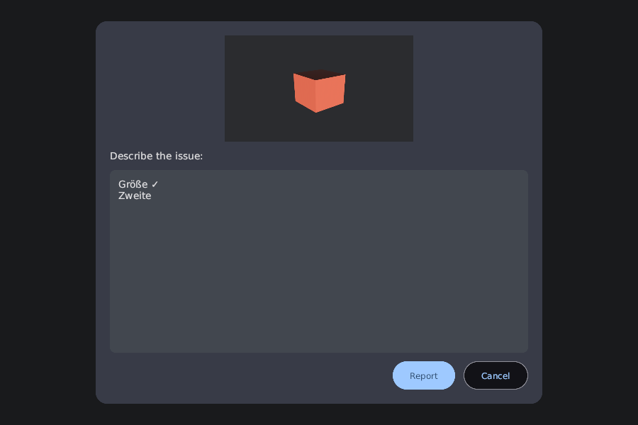
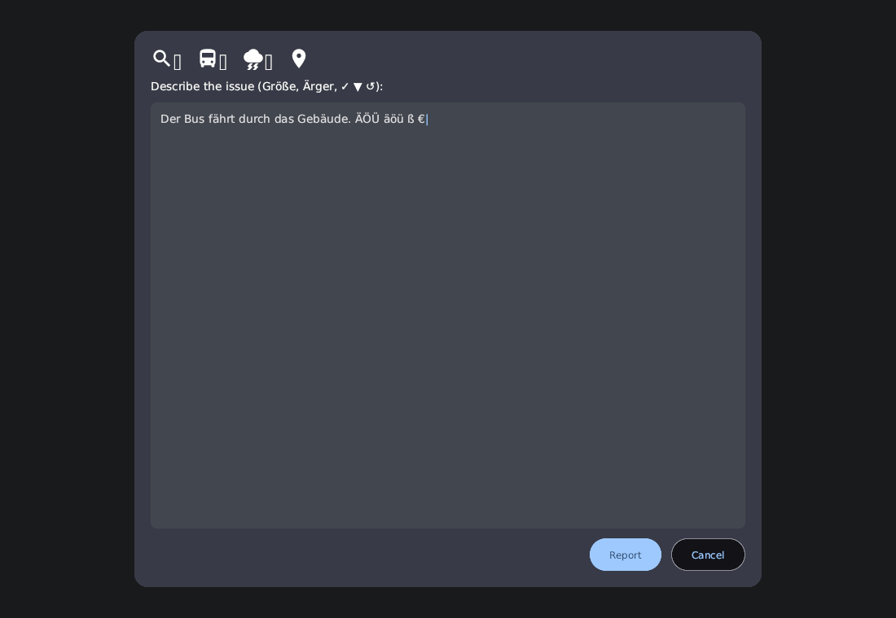

# F1 Reporting — Final Report (2026-10-10)

## Decisions
- **F1 conflict:** option A — F1 is reporting. Camera modes moved to the number keys `1`–`5` (Ego, Cockpit, External, Passenger, Free roam), "previous mode" to `0`. The gear selector lost its digit aliases.
- Backdrop click does nothing; clipboard (`Ctrl+A/C/X/V`) via `arboard`; `ReportContext` filled by `opts-game`; success toast after saving.
- Fonts: DejaVu Sans (umlauts, symbols) as default font, Material Icons for pictograms (Bevy 0.14 has no font fallback and cannot draw colour emoji — see `opts_gui::fonts`).

## What was built
| Area | Content |
| :--- | :--- |
| `opts-gui` | `Modal` (scrim, focus trap, Escape event), multiline `TextArea` + `TextBuffer`, clipboard, bundled fonts + `icons` module, `modal_text_area` example |
| `opts-bevy::reporting` | state machine, F1 trigger, screenshot capture + PNG encoding (async), modal UI, pause of `Time<Virtual>`, `ModalActive`/`not_modal_active`, async save with collision suffixes, `.report` formatting |
| `opts-game` | plugin wiring (non-headless), `ReportContext` updater, git hash via `build.rs`, run conditions on every input system, audit test |
| docs | `architecture/reporting-feature.md`, `formats/text/report-format.md`, `crates/opts-bevy.md`, `crates/opts-gui.md`, `architecture/camera-system.md` |

## Verification
- `cargo fmt`, `cargo clippy --workspace --all-targets -D warnings`, `cargo test --workspace`: pass.
- `crates/opts-bevy/tests/reporting.rs` (9 tests): report layout, collision handling (incl. stray PNG), F1 → pause + gating → modal → cancel → resume, already-paused simulation stays paused, Report button saves both files and shows the toast, capture timeout, UTF-8 round trip (umlauts, ✓, ▼, 😀), gating condition.
- `crates/opts-game/tests/input_gating_audit.rs`: every input-reading file is on a reviewed list; gated plugin registrations still use the run condition.
- Real window and GPU: `cargo run -p opts-bevy --example report_flow` presses F1, types text, checks that virtual time stood still while the modal was open (drift 0.0000 s), clicks Report, verifies the files; the PNG shows the scene without the modal.

| Modal | Text area with icons and umlauts |
| :--- | :--- |
|  |  |

Sample `.report` (written by that run):

```text
OPTS Report
===========

Timestamp:   2026-10-10T08:05:43+02:00
Version:     test
Git:         (none)
Platform:    linux
Map:         Berlin-Spandau
Camera:      (none)
Vehicle:     (none)
Focused UI:  TextArea

--- Description ---

Größe ✓
Zweite
```

## Deviations / limits
- `text_area` is a directory module (file size limit). The scrim colour is a fixed 60 % black (the token sync overwrites alpha).
- The Manual-flow checklist items that need a human at the keyboard (typing, Backspace/arrows/Home/End, clicking) were exercised through injected key and button events (`report_flow`, unit tests) — not by hand in the full game; no input-injection tool exists on this Wayland machine.
- Scroll position of the text area uses an estimated wrapped-line count.

## Follow-ups
- Run the real game once and press F1 in the menu and in a session (checklist D1).
- A toast for failed saves exists (z-index above the modal) but is not covered by a test.
