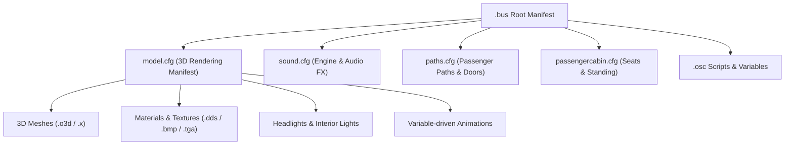

# 🎓 Loading Your First Bus Model in Bevy

| Metadata | Value |
| :--- | :--- |
| **Topic** | Vehicle Loading, Model Hierarchies & Camera Presets in Bevy |
| **Prerequisites** | Rust 1.76+, Bevy 0.14 ECS concepts, [Coordinate Systems](../architecture/coordinates.md), [Loading Your First `.sco`](first-sco.md) |
| **Crates Used** | `opts-core`, `opts-bevy` |
| **Example Code** | [`crates/opts-bevy/examples/load_bus.rs`](file:///home/louisgoodnews/Dokumente/opts/crates/opts-bevy/examples/load_bus.rs) |

---

## 🎯 What You Will Learn

In this tutorial, you will:
1. Understand the multi-tiered structure of OMSI 2 vehicle assets (`.bus` manifest and `model.cfg` rendering definition).
2. Parse vehicle metadata and geometry manifests using [`opts_core::formats::vehicles::bus`](file:///home/louisgoodnews/Dokumente/opts/crates/opts-core/src/formats/vehicles/bus.rs) and [`opts_core::formats::vehicles::model`](file:///home/louisgoodnews/Dokumente/opts/crates/opts-core/src/formats/vehicles/model/mod.rs).
3. Bridge OMSI vehicle coordinate spaces ($X$ right, $Y$ forward, $Z$ up) and camera conventions into Bevy's right-handed engine frame.
4. Spawn an interactive bus entity hierarchy in Bevy ECS with mesh attachments, PBR materials, spotlights (headlights), and interior lights using [`spawn_vehicle_model`](file:///home/louisgoodnews/Dokumente/opts/crates/opts-bevy/src/vehicle.rs).
5. Switch smoothly between vehicle camera presets (`[add_camera_driver]`, `[view_schedule]`, `[view_ticketselling]`, `[add_camera_pax]`, exterior orbit) using [`camera_preset_to_bevy_transform`](file:///home/louisgoodnews/Dokumente/opts/crates/opts-bevy/src/coords.rs).

---

## 🚌 1. The Anatomy of an OMSI Bus Manifest

A vehicle in OMSI is defined by a tree of interconnected configuration files originating from a root `.bus` manifest:



### The Root `.bus` File
The `.bus` file provides:
- **Vehicle Identity:** Manufacturer, model designation, and default livery (`[friendlyname]`).
- **Physical Specs:** Curb mass in tonnes (`[mass]`) and axle placements (`[newaxle]`).
- **Camera Presets:**
  - `[add_camera_driver]`: Driver seat and dashboard viewpoints.
  - `[view_schedule]`: Timetable / clipboard inspection camera.
  - `[view_ticketselling]`: Cash desk / ticket printer interaction camera.
  - `[add_camera_pax]`: Passenger compartment seat viewpoints.
  - `[set_camera_outside_center]`: Exterior chase / orbit pivot point.

### The Rendering Manifest (`model.cfg`)
The `model.cfg` file partitions geometry into:
- **LOD Tiers (`[LOD]`):** Distance thresholds for level-of-detail switching.
- **Mesh Elements (`[mesh]`):** References to `.o3d` or `.x` files with viewpoint visibility masks (`[viewpoint]`: 0 = all, 1 = exterior only, 2 = interior cab only).
- **Material Modifiers (`[matl]`, `[matl_change]`):** Surface textures, alpha modes (cutoff vs blend), lightmaps, and night textures.
- **Light Sources:**
  - `[spotlight]`: Directed exterior headlight beams with inner and outer cone angles.
  - `[interiorlight]`: Spherical interior cabin illumination sources.

---

## 📐 2. Coordinate System & Camera Transformations

### Vehicle Body Coordinates
OMSI vehicles use a **right-handed $Z$-up** coordinate frame:
- $+X$: Lateral offset to the right.
- $+Y$: Longitudinal offset forward.
- $+Z$: Vertical elevation up.

Bevy uses a **right-handed $Y$-up** coordinate frame:
- $+X$: Lateral offset to the right ($X_{\text{bevy}} = X_{\text{omsi}}$).
- $+Y$: Vertical elevation up ($Y_{\text{bevy}} = Z_{\text{omsi}}$).
- $-Z$: Longitudinal offset forward ($Z_{\text{bevy}} = -Y_{\text{omsi}}$).

### Camera Definition Quirks
In OMSI vehicle camera directives (`[add_camera_driver]`, `[add_camera_pax]`), the lateral coordinate has an **inverted sign convention**:
- Line 1 ($X$): Positive points **left** (unlike the vehicle frame where $+X$ is right):
  $$\text{pos}_{\text{omsi}} = (-X_{\text{cam}}, Y_{\text{cam}}, Z_{\text{cam}})$$
- Line 4 (`dist`): Longitudinal offset along the camera's viewing line-of-sight (slightly negative for driver head pivot offset).
- Line 5 (`fov`): Horizontal field of view in degrees.
- Line 6 (`yaw`): Horizontal viewing rotation (0° forward, negative left, positive right).
- Line 7 (`pitch`): Vertical elevation angle (negative down, positive up).

`opts-bevy` provides the [`camera_preset_to_bevy_transform`](file:///home/louisgoodnews/Dokumente/opts/crates/opts-bevy/src/coords.rs) function to compute the exact camera transform:

```rust
use opts_bevy::camera_preset_to_bevy_transform;
use bevy::math::Vec3;

// Driver seat at X=0.68m (left), Y=4.15m (forward), Z=1.42m (up)
let cam_pos = Vec3::new(0.68, 4.15, 1.42);
let dist = -0.08;
let yaw_deg = 0.0;
let pitch_deg = -4.0;

let bevy_tx = camera_preset_to_bevy_transform(cam_pos, dist, yaw_deg, pitch_deg);
```

---

## 🛠️ 3. Step-by-Step Implementation

### Step 1: Add Dependencies

Ensure your project includes `bevy`, `opts-core`, and `opts-bevy`:

```toml
[dependencies]
bevy = "0.14"
opts-core = { path = "crates/opts-core" }
opts-bevy = { path = "crates/opts-bevy" }
```

### Step 2: Initialize Bevy with `OptsAssetPlugin`

The [`OptsAssetPlugin`](file:///home/louisgoodnews/Dokumente/opts/crates/opts-bevy/src/plugin.rs) bundles loaders for `.o3d`, `.x`, `.dds`, `.bmp`, `.tga`, `.sco`, and `.sli`, along with coordinate synchronization:

```rust
use bevy::prelude::*;
use opts_bevy::OptsAssetPlugin;

fn main() {
    App::new()
        .add_plugins(DefaultPlugins)
        .add_plugins(OptsAssetPlugin)
        .add_systems(Startup, setup_scene)
        .run();
}
```

### Step 3: Parse and Spawn the Vehicle Hierarchy

In your startup system, parse the manifest text and spawn the hierarchy using [`spawn_vehicle_model`](file:///home/louisgoodnews/Dokumente/opts/crates/opts-bevy/src/vehicle.rs):

```rust
use bevy::prelude::*;
use opts_bevy::{spawn_vehicle_model, BusVehicle, camera_preset_to_bevy_transform};
use opts_core::formats::vehicles::{bus::BusManifest, model::ModelConfig};

fn setup_scene(
    mut commands: Commands,
    mut meshes: ResMut<Assets<Mesh>>,
    mut materials: ResMut<Assets<StandardMaterial>>,
) {
    // 1. Environment lighting
    commands.spawn(DirectionalLightBundle {
        directional_light: DirectionalLight {
            illuminance: 15_000.0,
            shadows_enabled: true,
            ..default()
        },
        transform: Transform::from_rotation(Quat::from_euler(EulerRot::XYZ, -0.65, 0.45, 0.0)),
        ..default()
    });

    // 2. Parse vehicle definitions
    let bus_text = include_str!("../../assets/sample_bus.bus");
    let manifest = BusManifest::parse(bus_text).expect("Valid .bus manifest");

    let model_text = include_str!("../../assets/sample_model.cfg");
    let model = ModelConfig::parse(model_text).expect("Valid model.cfg");

    // 3. Create Bevy mesh & material handles for the bus components
    let body_mesh = meshes.add(Cuboid::new(2.5, 2.4, 11.5));
    let body_mat = materials.add(StandardMaterial {
        base_color: Color::srgb(0.96, 0.77, 0.12), // BVG Yellow
        ..default()
    });

    let mesh_handles = vec![body_mesh];
    let mat_handles = vec![body_mat];

    // 4. Spawn the bus entity hierarchy
    let bus_spawn_transform = Transform::from_xyz(0.0, 1.5, 0.0);
    let bus_entity = spawn_vehicle_model(
        &mut commands,
        &manifest,
        &model,
        bus_spawn_transform,
        &mesh_handles,
        &mat_handles,
    );

    // 5. Position 3D camera at the default driver seat viewpoint
    let driver_cam = &manifest.driver_cameras[manifest.std_camera_index.unwrap_or(0)];
    let local_cam_tx = camera_preset_to_bevy_transform(
        Vec3::new(driver_cam.x, driver_cam.y, driver_cam.z),
        driver_cam.dist,
        driver_cam.yaw_deg,
        driver_cam.pitch_deg,
    );

    commands.spawn(Camera3dBundle {
        transform: Transform {
            translation: bus_spawn_transform.translation + local_cam_tx.translation,
            rotation: local_cam_tx.rotation,
            scale: Vec3::ONE,
        },
        projection: Projection::Perspective(PerspectiveProjection {
            fov: driver_cam.fov_deg.to_radians(),
            ..default()
        }),
        ..default()
    });
}
```

### Step 4: Add Interactive Camera Switching

With [`BusVehicle`](file:///home/louisgoodnews/Dokumente/opts/crates/opts-bevy/src/vehicle.rs) attached to the bus root entity, you can easily switch cameras at runtime:

```rust
fn handle_camera_switching(
    keyboard: Res<ButtonInput<KeyCode>>,
    mut vehicle_query: Query<&mut BusVehicle>,
    mut camera_query: Query<(&mut Transform, &mut Projection), With<Camera3d>>,
) {
    let Ok(mut vehicle) = vehicle_query.get_single_mut() else { return };
    let Ok((mut cam_tx, mut projection)) = camera_query.get_single_mut() else { return };

    if keyboard.just_pressed(KeyCode::Digit1) {
        vehicle.active_camera_index = 0; // Driver seat
    } else if keyboard.just_pressed(KeyCode::Digit2) {
        vehicle.active_camera_index = 1; // Timetable schedule view
    }

    if let Some(local_tx) = vehicle.current_camera_bevy_transform() {
        cam_tx.translation = local_tx.translation;
        cam_tx.rotation = local_tx.rotation;
        
        if let Some(cam) = vehicle.current_camera() {
            if let Projection::Perspective(ref mut persp) = *projection {
                persp.fov = cam.fov_deg.to_radians();
            }
        }
    }
}
```

---

## 🏃 4. Running the Complete Example

An interactive, fully featured runnable example is provided in `opts-bevy`. Run it with:

```bash
cargo run -p opts-bevy --example load_bus
```

### Controls in the Example:
- **`1`**: Driver seat view (standard OMSI driver camera)
- **`2`**: Timetable / schedule view (`[view_schedule]`)
- **`3`**: Ticket selling / cash desk view (`[view_ticketselling]`)
- **`4`**: Passenger cabin view (`[add_camera_pax]`)
- **`5`**: Smooth exterior orbit view orbiting the vehicle center (`[set_camera_outside_center]`)
- **`Space`**: Cycle smoothly through all presets

---

## 🔗 Next Steps

- [Vehicle Definitions (`.bus`) Specification](../formats/text/vehicles/bus.md)
- [Model Configuration (`model.cfg`) Specification](../formats/text/vehicles/model_cfg.md)
- [Passenger Paths (`paths.cfg`) Specification](../formats/text/vehicles/paths_cfg.md)
- [Phase 4: Vehicle Physics & Simulation](../roadmap/phase-4/README.md)
